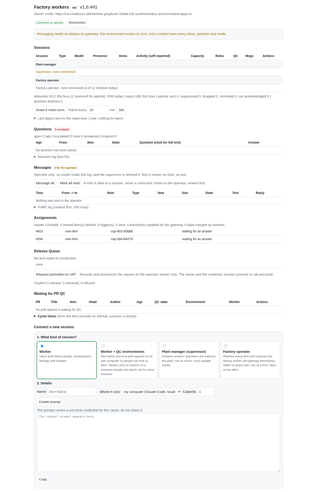
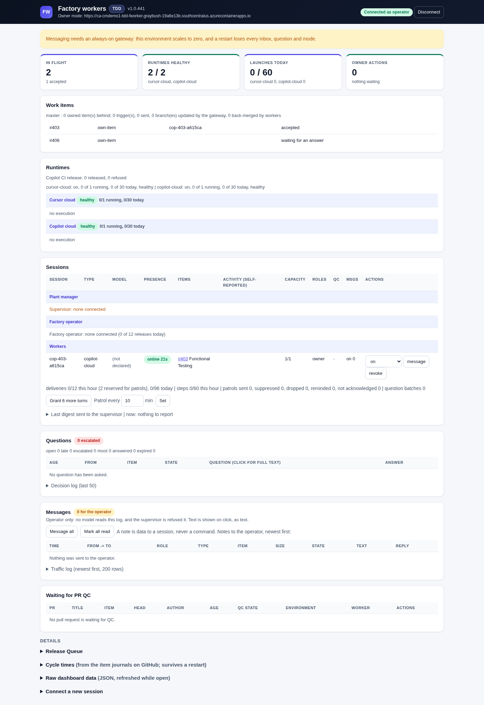
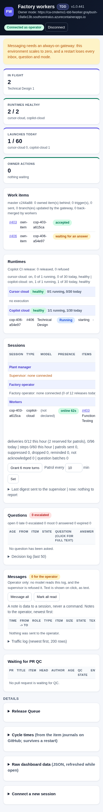
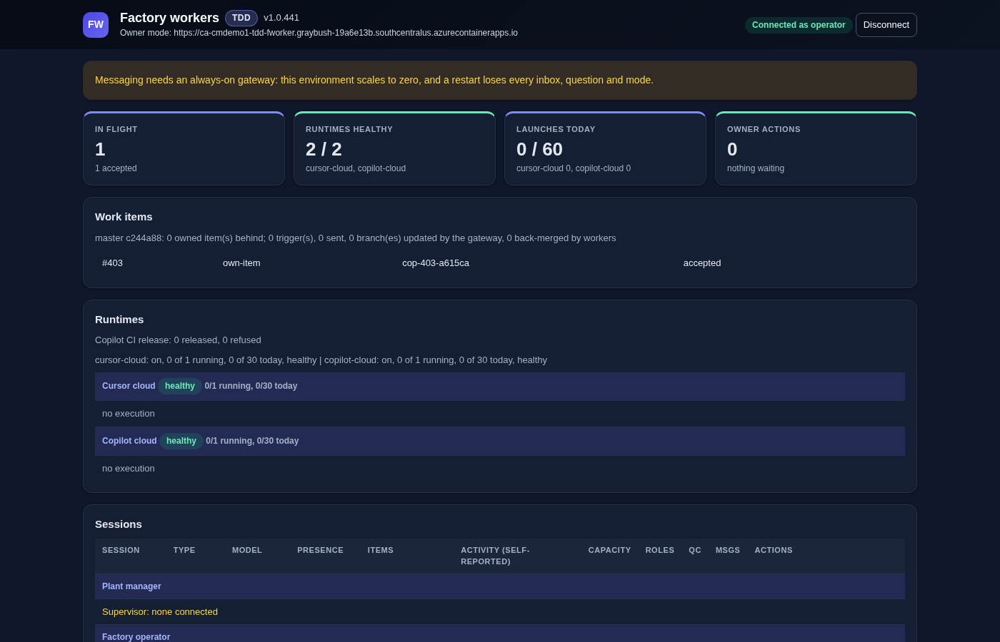

# The gateway dashboard

`GET /dashboard` serves one self-contained HTML page (`DashboardPage` in `gateway/Program.cs`): inline CSS and script, no CDN,
no external font. The page is anonymous; every data call sends the operator token from the token box (kept in this tab's
`sessionStorage` only) in the `Authorization` header. It polls `/api/v1/dashboard` every 4 seconds, as before.

## Look and feel

Taken from the work orders app (`cmdemo1-workorders`, `src/UI/Client/wwwroot/css/app.css`): indigo primary `#4f46e5`, the
slate neutrals (`#0f172a` text, `#475569` muted, `#e5e9f0` borders, `#f5f7fb` page), the navy gradient of its sidebar for the
header, white cards with a 12px radius and a light shadow, 8px controls, the Inter / system font stack, uppercase table
headers, and the same status colours for badges (green ok, amber waiting, red failed, blue running). Light by default; dark
through `prefers-color-scheme`. At phone width the cards stack and wide tables scroll inside their card, never the page.

## Layout

1. Header: environment, version, operator token / Connect / Disconnect.
2. Summary cards (from the dashboard JSON alone, no extra request): items in flight (by runtime phase), runtimes healthy,
   launches today against the daily limits, owner actions.
3. Work items (assignments, with the master base-update line).
4. Runtimes: every runtime kind (`cae-job`, `copilot-cloud`, `cursor-cloud`) with its executions, the last runs and a
   session link when the execution carries one; the Copilot CI release line.
5. Sessions, Questions, Messages, Waiting for PR QC (unchanged content and buttons).
6. Details, collapsed: Release Queue (with Request promotion to UAT), Cycle times, Raw dashboard data (JSON), Connect a new
   session.

There is no Start/Stop factory control: the gateway has no endpoint for it, and the page adds none.

## Screenshots

| Before | After |
|---|---|
|  |  |

Phone width:  Dark: 

## Tests

`tests/scenarios/qc-dashboard.ps1` checks the key sections are rendered and that the page loads no external script or
stylesheet; the messaging and owner scenarios run the page's script in node against a live gateway.

A link `/dashboard#token=<value>` connects with that token on load, then removes the fragment from the address bar and history (`history.replaceState`); the token is never sent in a query string.
