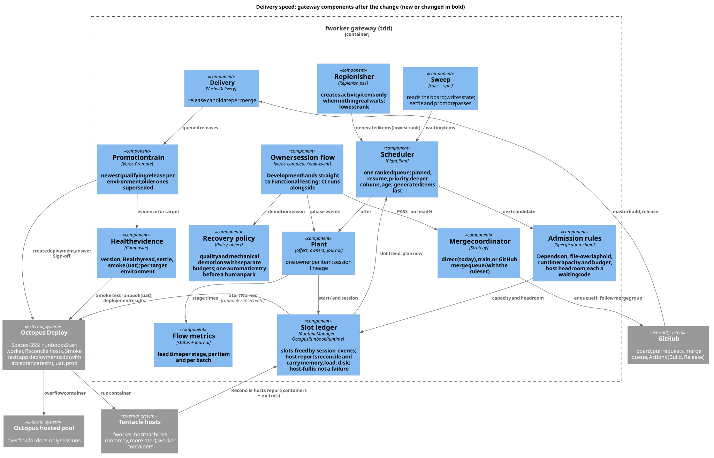
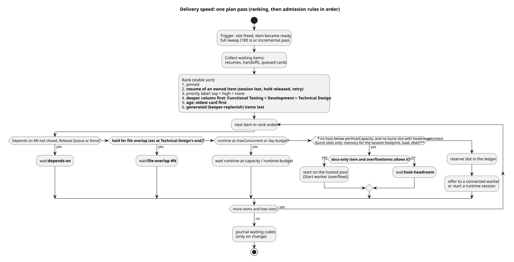
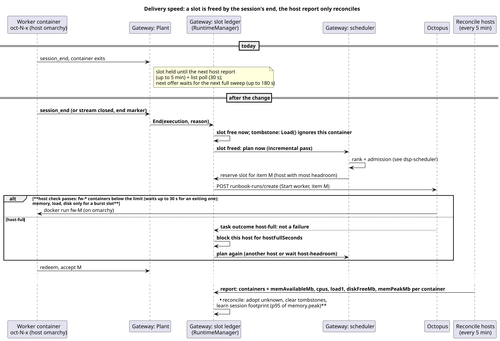

# Delivery speed: work-conserving scheduling, merge queue and a release train

Status: design only, 2026-10-25. Nothing here is built. Asked for by the owner after the UI batch #706 to #721: "Come up with 10
ideas that could optimize the speed of software delivery while maintaining our current standard of quality", then "I accept all
recommendations. Create a cohesive design that accounts for all of these using good design patterns." Builds on
`plant-manager.md` (offers, owners, policies), `octopus-runbook-runtime.md` (runbooks, hosts, reports), `auto-promote.md`
(gates, Sign-off), `backlog-keeper.md` (replenish) and `copilot-cloud-agent.md` (one task owns the item).

Diagrams (PlantUML sources and rendered SVG in `docs/design/diagrams/`):

| View | Source | Rendered |
|---|---|---|
| Gateway components after the change | `dsp-component.puml` | [dsp-component.svg](diagrams/dsp-component.svg) |
| One item's states | `dsp-lifecycle.puml` | [dsp-lifecycle.svg](diagrams/dsp-lifecycle.svg) |
| One plan pass: ranking and admission | `dsp-scheduler.puml` | [dsp-scheduler.svg](diagrams/dsp-scheduler.svg) |
| A slot freed by the session's end | `dsp-slot.puml` | [dsp-slot.svg](diagrams/dsp-slot.svg) |
| From the push to prod | `dsp-delivery.puml` | [dsp-delivery.svg](diagrams/dsp-delivery.svg) |

## 0. Summary

The batch spent about 60% of each item's lead time waiting for one of two worker slots, and about 70 minutes per item between
the merge and prod. The design rests on one rule: **no slot sits idle while work waits, and no check is removed.**

| # | Idea (accepted 2026-10-25) | Where | Pattern |
|---|---|---|---|
| 1 | More worker slots | 4: slot ledger, headroom admission, docs-only overflow, more hosts | Admission control; reconciliation loop |
| 2 | Finish items before starting new ones | 3: one ranked queue | Priority queue with a ranking policy |
| 3 | Keep one worker from Development through Functional Testing | 5: Functional Testing starts at the push | Pipeline parallelism on one head |
| 4 | No activity items while real work waits | 6: replenish with backpressure | Producer with backpressure |
| 5 | Avoid conflicts when scheduling | 7: file-overlap hold at Technical Design's end | Specification (one rule of the chain) |
| 6 | Retry parked items automatically | 8: recovery policy | Policy table; separate budgets per cause |
| 7 | GitHub merge queue instead of branch updates | 9: merge coordinator | Strategy (direct, train, queue) |
| 8 | Release the build that was already tested | 10: release the merge group's build | Build once per commit |
| 9 | Smoke test instead of the 10-minute health waits | 11: health evidence per target | Composite of evidence |
| 10 | Promote the newest qualifying release only | 12: promotion train | Supersession |

Plus flow metrics (13), so each change is measured on the next batch instead of assumed.

Estimated effect on a batch like #706 to #721 (16 items), from this batch's own stage times:

| | Today | Sections 3 to 8 | Plus a second host (or a third slot) | Plus 9 to 12 |
|---|---|---|---|---|
| Slot time per item | ~44 min (5 TD, 16 Dev, ~8 CI held, 10 FT, ~5 turnover) | ~31 min | ~31 min | ~31 min |
| Span of worker starts | 6.6 h | ~4.1 h (2 slots) | ~2.8 h (3 slots) | ~2.8 h |
| Merge to prod per release | ~70 min | ~70 min | ~70 min | ~50 min |
| Batch, first card to last prod | 9.2 h (15 of 16) | ~5.9 h | ~4.6 h | ~4.3 h |

Estimates: the span of starts is items x slot time / slots; the last item then needs about 1.5 to 1.8 h to reach prod.
Section 13 measures the real numbers.

## 1. Baseline and what the code showed

Batch #706 to #721, created 02:54 UTC 2026-10-25; first prod 04:48, fifteenth 12:06. #709 conflicted twice with other UI items,
was parked `runtime-failed` by the gateway, and at 09:43 the kit's watcher (`cmdemo1-aisf`, "AI Factory") parked it for a
human after 180 minutes without a verdict. Medians: waiting for a slot ~220 min, Technical Design 5, Development 16, Functional
Testing 10, merge 8, master CI and candidate 12, tdd 11, tdd to uat 22, uat to prod 23; created to prod 362, first start to
prod 134.

Reading the code (origin/master 9951915) corrected three points of the first analysis:

1. **The octopus owner session already spans Development and Functional Testing.** At Development's end with checks pending,
   `complete` answers exit 21 `accepted-checks-pending`, parks `development:awaiting-checks` and keeps the owned claim
   (`Verbs.Item.ps1:494-500`), so the session **holds its slot while CI runs** (about 8 minutes). Three texts then tell the
   agent to stop: the answer ("Your work here is done - stop now.", line 500), the comment ("The worker's job here is done.",
   line 499) and `factory-development/SKILL.md:31,42` (exit 21 is "the normal way to finish"); `factory-owner-session` step 3
   has no case for exit 21. Cursor agents stopped: 7 of 16 items lost their session there and queued again for 9 to 44 minutes.
2. **A finished container keeps its slot until the next host report** (Reconcile hosts every 5 min) plus a list poll (30 s),
   and a freed slot requests no plan: an unpinned waiting item is offered at the next full sweep (up to 180 s).
3. **The replenisher counts open items, not waiting ones** (`Replenish.ps1:76-94`, `targetOpen` 10): at 08:59, with seven real
   UI items still waiting, it created #735 to #737, then "Docs: note 1" to "note 16" from 10:34, all on the same two slots.

## 2. Quality invariants (unchanged by every section)

1. CI ("Build result", secret-scan) green on the exact commit that lands on master. With the merge queue, "only merge
   non-failing pull requests" is on, so no master commit skips a green group.
2. A Functional Testing PASS on the pull request's head, with its demo video for `video` items, before any merge.
3. The per-item gates of `auto-promote.md` (Gates 1): the Auto Merge label, no Hold label, the gateway's merge after a PASS.
4. Every commit in a promoted range traced to a qualifying factory item; Sign-off answered only for the gateway's deployments.
5. Every promotion checks `/_build` and Healthy reads of the previous environment. tdd's deployment keeps its acceptance tests;
   prod's promotion keeps its 10-minute settle and adds a smoke run (11).
6. Quality demotions keep `maxDemotions` 2 and are never retried automatically; a human park stays the last resort.

## 3. Scheduler: one ranked queue (idea 2)

`Plant.Plan` sorts pinned, then priority label, then past-intake (`Plant.cs:1946-1951`). It becomes an explicit **ranking
policy** (one comparer, unit-tested) followed by an **admission chain**.

### 3.1 Ranking (stable sort)

1. pinned;
2. **resume of an owned item**: session lost, released from a hold, automatic retry (8);
3. priority label `priority:top`, `priority:high`, none (so `manager prioritize --level top` keeps its meaning);
4. **deeper column first**: Functional Testing, Development, Technical Design;
5. **age**: oldest card first;
6. **generated items last** (the `<!-- keeper-replenish -->` marker).

### 3.2 Admission chain (Specification pattern)

Each rule is a small object `IAdmissionRule { Name; Check(item, plant) -> Admit | Wait(code, detail) }`, evaluated in order;
the first `Wait` becomes the item's waiting code, journaled only when it changes.

| Order | Rule | Waiting code | New |
|---|---|---|---|
| 1 | `Depends on #N` not met: not closed, not in Release Queue or Done (`Test-DependencyMet`, `Verbs.Sweep.ps1:425-436`) | `depends-on` | no |
| 2 | held for file overlap (7) | `file-overlap #N` | yes |
| 3 | runtime at `maxConcurrent` or its day budget | `runtime-at-capacity`, `runtime-budget` | no |
| 4 | no host below its limit with headroom (4.2) | `host-headroom`, or overflow (4.3) | yes |

### 3.3 Triggers

A plan pass runs on: **slot freed** (4.1), **item became ready** (handoff, hold released, retry due), the incremental pass and
the full sweep (180 s). Today only the last two exist for unpinned items.

## 4. Capacity: a slot ledger with event-driven release (idea 1)

### 4.1 Event-driven release, periodic reconciliation

The **slot ledger** (`RuntimeManager` + `OctopusRunbookRuntime`) frees a slot **at once** on the session's own end signal:
`session_end`, the stream closed past its grace, or the runner's end marker. It keeps a tombstone for the container, and
`Load()` (`OctopusRunbookRuntime.cs:279-283`) ignores report entries of tombstoned containers. Freeing raises **slot freed**,
which runs a plan pass. The host report stays the source of truth for what runs (adoption after a restart, unknown and exited
containers) and clears tombstones; it reconciles instead of gating. Overcommit in the moments between a session's end and its
container's exit is prevented on the host: `start-worker.sh` counts the running `fw-*` containers, an exiting one included,
against the host's limit (`perHostCapacity`, or `perHostBurst` with headroom), waits up to 30 s for an exiting container to
leave, and only then answers `host-full` (4.2).

### 4.2 Host headroom: two-level admission

- **Limits.** `perHostCapacity` (existing, tdd 2) stays the guaranteed number per host. A new `perHostBurst` (default equal
  to `perHostCapacity`, so no change) allows extra slots above it **only** when measured headroom allows; no memory test applies
  at or below `perHostCapacity`. `maxConcurrent` must be raised with every new host or burst slot (tdd sets it to 2,
  `deploy.overrides.json:89`).
- **Report.** `reconcile-hosts.sh` adds `memTotalMb`, `memAvailableMb`, `cpus`, `load1`, `diskFreeMb`, and per container
  `memPeakMb` from the cgroup's `memory.peak` (a `docker stats` sample misses peaks).
- **Footprint.** Learned per **session** (one container runs Technical Design, the private build, then app and browser): the
  p95 of `memPeakMb` over at least 10 sessions. Until then there is no burst.
- **Plan (gateway).** A burst slot is admitted when `memAvailableMb - reserveMb >= footprint`, `load1 + containerCpus <= cpus`
  and `diskFreeMb >= minDiskMb`. Among hosts below their limit, the plan picks the one with most headroom (today: fewest
  workers, line 291).
- **Start (host, authoritative).** `start-worker.sh` counts running `fw-*` containers against the limit (waiting up to 30 s
  for one that is exiting) and, for a burst slot, checks the same headroom before `docker run`; otherwise it exits with a
  distinct code (`host-full`). `List` maps that task outcome to a non-failure: no `maxFailuresPerPhase` count, no `unhealthyAfterFailures`
  count (`RuntimeManager.cs:256-260`); only that host is blocked for `hostFullSeconds` and the plan runs again.

omarchy has 4 CPUs, 11.8 GB and runs each container with `--cpus 2` and an 8 GB cap, so it will likely stay at 2. More slots
come from more hosts: a second machine with a polling Tentacle tagged `fworker-host` needs no code, only `maxConcurrent`.

### 4.3 Overflow for docs-only item sessions (owner decision)

Today an own-item session never overflows, whatever `overflowRoles` says (`MayOverflow`, `CodingRoles`, lines 29 and 275), and
the owner's rule of 2026-10-22 allows overflow for short roles only. This section **changes that rule** and needs the owner's
yes: an item whose design carries `aisf:docs-only` (or the replenish marker before design) may run its owner session on the
hosted pool through "Start worker (overflow)" when no host has headroom. Such a session runs no app, database or browser.
- `overflowRoles` keeps its defaults (plant-manager, supervisor, qc, operator); a new `overflowItems: ["docs-only"]` allows
  item sessions.
- If the pull request then touches files outside the docs paths (`factory-functional-testing/SKILL.md:14` asks for app
  verification), the session ends and the item resumes on a host.
- Each overflow session holds an Octopus task while it runs; Octopus Cloud allows 20 concurrent tasks for deployments,
  runbooks and these sessions together, so tdd `overflowMax` is 2.

## 5. Owner session flow: Functional Testing starts at the push (idea 3)

1. **Texts.** The `complete` answer for exit 21 (`Verbs.Item.ps1:500`), its comment (line 499),
   `factory-development/SKILL.md:31,42` and `factory-owner-session` step 3 say: continue with Functional Testing on this head;
   CI runs alongside. The answer is `continue: true, next_column: Functional Testing, checks: pending` (the owner-session
   contract of step 3), and the card moves to Functional Testing.
2. **Watcher without the park.** `awaiting_checks` stays in the state as the checks watcher, without the
   `development:awaiting-checks` park, and is followed in the Functional Testing column too (`Verbs.Sweep.ps1:687-697`;
   `Complete-AwaitingChecks`, lines 9-15, learns that the card may already be in Functional Testing).
3. **Red CI** on the head being tested, before or after the PASS and before the merge, sends `checks.failed` to the owner: a
   fix-forward round (`fixForwardMaxRounds` 4), never a quality demotion, whichever finishes first. The owner goes back to
   Development; Functional Testing runs again on the next head. Two merge-path demotions change with
   `ftWithPendingChecks` on: `Resolve-RedBeforeMerge` (`Verbs.Merge.ps1:48-68`) sends red on the verdict head to the
   fix-forward path instead of `Invoke-Demote 'merge'`, and the PASS on that head is cleared, so the stale-head check
   (lines 175-182) does not demote after the fix-forward push either.
4. **The merge still needs both.** The gateway's merge checks the PASS head and waits for green checks
   (`Verbs.Merge.ps1:172-227`); a session's own merge call relies on the ruleset's required checks (Build result, secret-scan).
5. A PASS that finishes before CI ends the session; the gateway waits for the checks without a slot.
6. A session that ends while owning resumes at rank 2 (3.1) in the column it left, in resume mode, with the same branch and the
   session lineage in the state comment; every comment carries the current session's link.

## 6. Generated work with backpressure (idea 4)

The gateway passes the last plan's count of waiting non-generated items into the sweep's input, next to the other plant facts
it already passes. `Invoke-Replenish` creates an item only when that count is 0 and open real items are below `targetOpen`.
Generated items rank last (3.1). They take a host slot only when one is free; with the overflow decision (4.3), they use the
hosted pool when no host has headroom. `maxPerDay` stays.

## 7. File-overlap hold (idea 5)

- **Footprint.** The Technical Design's first line `Files: <path>, <path>` (the convention of `factory-technical-design`) is
  parsed at `append-body` into `state.design.files` (paths and globs). After the first push, the pull request's changed files
  replace it.
- **Where it is enforced.** At Technical Design's `complete`, like the `Depends on` hold (`factory-technical-design/SKILL.md:11`):
  an owner session goes from Technical Design to Development without a plan pass, so the hold must be in the verb. If any other
  item between Development and merged has an intersecting footprint, the answer is `held: file-overlap #N`, the session ends
  (slot freed) and the item waits.
- **Release.** When #N merges, parks, is closed or leaves that range, or after `maxHoldMinutes` (120), the hold ends and the
  item resumes at rank 2 from the new master. With several items held on the same files, rank orders their release.
- **No deadlock:** a holding item is past Technical Design and is never held itself.
- `schedule.overlapIgnore` lists paths that never hold (empty by default).

#709 under this rule: it would have waited for the UI items changing the same CSS instead of conflicting with them twice.

## 8. Recovery policy (idea 6)

A table from cause to budget and automatic action, evaluated by the gateway (deterministic, not the LLM manager):

| Cause | Class | Budget | Automatic action |
|---|---|---|---|
| FAIL verdict | quality | `maxDemotions` 2 (unchanged) | back to Development; then park `verdict-failed` / `demotion-limit` |
| CI red on the tested head (5.3) | fix-forward | `fixForwardMaxRounds` 4 (unchanged) | owner fixes in Development |
| merge conflict; merge group conflict; out of date | mechanical | `maxMechanical` 4 (new) | owner merges master; Functional Testing again on the new head |
| merge group red, the pull request alone green | mechanical once | 1 | re-enqueue once; red again is a fix-forward round |
| session lost (`ended-with-item`) | runtime | `maxFailuresPerPhase` 2 (unchanged) | resume at rank 2 |
| no verdict after `maxRelaunches` (`validation-no-verdict`, `Verbs.Item.ps1:247`) | runtime | 1 | run Functional Testing once more |
| a park of the mechanical or runtime rows | | `autoRetries` 1 (new) | **retry once when the cause cleared** (blocking item merged, capacity free, master green), then park for a human |

Quality parks (`verdict-failed`, `demotion-limit`, `same-criterion-repeated`) are never retried automatically. Each automatic
step is journaled ("automatic retry 1 of 1"); a second park stays.

The kit's watcher (`cmdemo1-aisf`) parked #709 at 180 minutes without a verdict; the gateway cannot retry a park it did not
make. A kit change (Platform Hub) lets that watcher defer to the gateway while the gateway owns the item.

## 9. Merge coordinator (idea 7)

`merge.strategy` selects a **Strategy** behind one contract: `Submit(item, head) -> queued | refused(reason)` and
`Poll(item) -> merged(commit) | dequeued(reason) | waiting`.

- **`direct` (default, today):** the gateway's squash merge with `update-branch` and `mergeQueueDepth`.
- **`train`:** direct merges, serialized: one item at a time is updated, built and merged, the others wait `merge-train`, so a
  branch is updated at most once per merge ahead of it. Needs no ruleset change.
- **`queue`:** GitHub's merge queue on master: squash, build concurrency 5, minimum group 1, wait 1 minute, **only merge
  non-failing pull requests** on. The gateway enqueues with `expectedHeadOid = H` (GraphQL `enqueuePullRequest`) after a PASS
  on H with green checks and follows the group; dequeues map to section 8. "Behind" no longer exists.
- **Switch together.** Once the ruleset requires the queue, a direct `PUT /pulls/{n}/merge` is refused, so the ruleset change
  and `merge.strategy: queue` flip in one step, and back together.
- **Release runs.** `mergeQueueDepth` exists because `release.yml`'s concurrency group drops an older pending run. Without it, an
  item whose own Release run was dropped is delivered by the newest release that contains its commit (`Get-Delivery`,
  `Verbs.Delivery.ps1:30-37`) and the train (12); section 10 fixes the docs-only signal that would otherwise misread it.
- **cmdemo1-workorders needs:** the `merge_group` trigger in `build.yml` and `secret-scan.yml`; the docs-only detection using
  `merge_group.base_sha`; `branches-ignore: ['gh-readonly-queue/**']` on `push`, so a group does not also start a push Build.

## 10. Release the merge group's build (idea 8)

With the queue, master normally moves to the merge group's tested commit C, and the master Build of C repeats it. Today that
cannot be skipped: packages and `build-version` are built only on master (`build.yml:227-250`), and `release.yml` takes the
version from the master run's number (line 197) and requires `ChurchBulletin.AcceptanceTests.<version>` (line 288). So:

1. `build.yml`: a `merge_group` run also builds and uploads `churchbulletin-nuget-packages` and `build-version`, stamped with
   its own run number.
2. `build.yml`: on a push to master, a first job looks up a successful `merge_group` Build whose head is exactly C. If one
   exists, the heavy jobs skip, `carry-artifacts` copies **all** its artifacts (the packages and `build-version`, and the
   `test-results-*`, `code-coverage-linux`, `crap-metrics-linux`, `qodana-report` and `private-build` artifacts that
   `release.yml`'s build facts read for `/_build`), `publish-github-packages` runs from them, and "Build result" passes. When
   several groups land in one push, the last group's head is the new master commit and already contains the groups ahead of
   it, so its run is found. The full build runs only when no such run exists: a direct push, the `direct` or `train`
   strategy, or commits GitHub re-created.
3. **`release.yml` (the kit's) reads the version from the `build-version` artifact** instead of `workflow_run.run_number`. This
   is a kit change (Platform Hub), needed before step 2 can ship.
4. **Docs-only signal.** `Get-MergeDocsOnly` (`Verbs.Delivery.ps1:104-115`) treats a merge as docs-only when every
   `masterCodeChecks` check is skipped, and `Get-ChecksFor` keeps the latest run per check name (`Prs.ps1:75-79`), so a carried
   build would read as docs-only and its item could reach Done without a release. The docs-only signal becomes the `changes`
   job's output (a `docs-only` marker check), in the same phase.

## 11. Health evidence per target (idea 9)

The health gate becomes a **Composite** of evidence per target environment, using the existing `octopus.health` keys per target:

| Evidence | Meaning | Promote to uat | Promote to prod |
|---|---|---|---|
| `version` | the previous environment's `/_build` shows the release | yes | yes |
| `read` | Healthy `/_healthcheck/detailed` now, none non-Healthy since its deployment | yes | yes |
| `settle` | Healthy reads `spacingMinutes` apart, the later `settleMinutes` after the deployment | **2 min** (today 10 + 5): owner decision | 10 + 5 (unchanged) |
| `smoke` | the Smoke test runbook passed against uat for this release | no (tdd's deployment already runs "Acceptance tests") | **yes** |

- **Smoke test runbook** (fworker Octopus project, `deploy/octopus/main.tf`): runs the release's
  `ChurchBulletin.AcceptanceTests.<version>` package from the Octopus feed with a filter for a new `[Category("Smoke")]`,
  against uat, read-only (sign in through the demo user picker, dashboard, work order search, one work order), on the host pool
  with a small footprint. The gateway reads its result like a deployment task. The smoke run is owned by health evidence only.
- **Due timers:** evidence is evaluated when it becomes due (deployment finished, smoke finished, settle elapsed), not only on
  full sweeps.
- Smoke runs during uat's settle, so prod waits `max(settle, smoke)`.

## 12. Promotion train (idea 10)

The gates already drop most older releases: `/_build` must show the release (`Verbs.Promote.ps1:89-90`, `auto-promote.md` Gates
3, "the newer one is promoted instead") and a release not newer than the target is skipped (`Get-ReleaseContent`). The train
makes that explicit and cheaper:
- per target environment, it evaluates **only the newest release that succeeded in the previous environment**, instead of every
  release on queued items, so health reads and Octopus reads are spent once per target;
- a blocked item (Hold, missing video) blocks the releases that contain it, and the train falls back to the newest release
  before it, as the content gate decides today;
- items of superseded releases ride in the promoted one and settle as "delivered in release X, superseding Y".

The gain is small (fewer reads and evaluations, clearer settle); most of the saving after the merge comes from 10 and 11.

## 13. Flow metrics

The plant records per item: queued, each phase start and end, push, PASS, merge, release candidate, each deployment. The admin
status gains `flow`: per item and per batch (by creation window or label) the time per stage and the waiting codes seen. Each
build phase is switched on in tdd alone and measured on an 8-item test batch before the next.

## 14. Configuration

Defaults keep today's behaviour; tdd's overrides switch each phase on.

| Key | Default (today) | tdd | Section |
|---|---|---|---|
| `schedule.ranking` | `pinned,priority,column` | `pinned,resume,priority,column,age,generated` | 3 |
| `schedule.planOnSlotFreed` | false | true | 3.3, 4.1 |
| `runtimes.octopus.perHostBurst` | = `perHostCapacity` | = `perHostCapacity` until footprints are measured | 4.2 |
| `runtimes.octopus.reserveMb`, `minDiskMb`, `hostFullSeconds` | 2048, 4096, 30 | default | 4.2 |
| `runtimes.octopus.overflowItems` | `[]` | `["docs-only"]` if the owner agrees | 4.3 |
| `runtimes.octopus.overflowMax` | 4 | 2 | 4.3 |
| `owner.ftWithPendingChecks` | false | true | 5 |
| `keeper.replenish.onlyWhenIdle` | false | true | 6 |
| `schedule.fileOverlap.enabled`, `maxHoldMinutes`, `overlapIgnore` | false, 120, `[]` | true | 7 |
| `recovery.maxMechanical`, `recovery.autoRetries` | 0, 0 | 4, 1 | 8 |
| `merge.strategy` | `direct` | `queue` together with the ruleset | 9 |
| `octopus.health.uat.settleMinutes`, `spacingMinutes` | 10, 5 | 2, 1 if the owner agrees | 11 |
| `octopus.health.prod.evidence` | `version,read,settle` | `version,read,settle,smoke` | 11 |
| `delivery.autoPromote.train` | false | true | 12 |

## 15. Ownership and approvals

| Change | Repository or system | Who | Approval |
|---|---|---|---|
| Sections 3 to 9, 11 and 12 gateway parts, 13 | cmdemo1-fworker | this session, PRs with auto-merge | this design |
| `reconcile-hosts.sh`, `start-worker.sh` headroom, Smoke test runbook | cmdemo1-fworker `deploy/octopus` | this session writes; the cmdemo1 session applies to Octopus | this design |
| `build.yml`, `secret-scan.yml`: `merge_group`, `branches-ignore`, group packages, carry job | cmdemo1-workorders | this session | **owner: pipeline change (CLAUDE.md)** |
| Smoke category in AcceptanceTests | cmdemo1-workorders | this session | this design |
| Merge queue on the master ruleset | GitHub repository settings | the owner or the cmdemo1 session (admin) | **owner** |
| `release.yml` version from `build-version`; the watcher defers to the gateway | the kit | Platform Hub | **owner: kit changes** |
| Overflow for docs-only item sessions (changes the 2026-10-22 rule) | cmdemo1-fworker config | this session | **owner** |
| uat promotion settle 10 + 5 to 2 + 1 minutes | cmdemo1-fworker config | this session | **owner** |
| A second `fworker-host` machine | hardware | the owner | optional |

## 16. Build plan

| Phase | Content | Repos | Expected gain |
|---|---|---|---|
| P1 | flow metrics (13); slot release and plan on slot freed (4.1); ranking (3.1); replenish backpressure (6); the exit-21 texts (5.1) | fworker | turnover gaps and filler competition gone; fewer lost sessions |
| P2 | Functional Testing with pending checks (5); recovery policy (8) | fworker | ~8 min less slot time per item; no human park for mechanical causes |
| P3 | host metrics and two-level admission (4.2); docs-only overflow (4.3) if agreed; a second host if added | fworker, Octopus | more slots where hardware allows; docs-only items off the hosts |
| P4 | file-overlap hold (7) | fworker | no conflict round trips between concurrent items |
| P5 | merge coordinator `train` and `queue` (9); `merge_group`, `branches-ignore`; ruleset | fworker, workorders, GitHub | no branch-update cycles |
| P5b | release the merge group's build (10), after the kit's `release.yml` change | workorders, kit, fworker | ~8 to 10 min less per release |
| P6 | health evidence, Smoke test runbook, due timers (11); promotion train (12) | fworker, workorders, Octopus | ~10 to 12 min less per release |

Each phase: scenario tests in `tests/scenarios` (the fake GitHub gains merge groups, dequeues and `expectedHeadOid`; the fake
Octopus gains the Smoke test runbook, host metrics and the `host-full` outcome), the pre-commit review, a PR with auto-merge,
then a tdd test batch measured by `flow`.

## 17. Risks and open questions

- **Footprints decide burst slots.** omarchy likely stays at 2; the slot gain of section 4 then comes from faster turnover,
  docs-only overflow and a second host.
- **Speculative Functional Testing** spends a test pass on heads whose CI turns red; the red rate in this batch was low.
- **Merge queue in the fake GitHub:** the test double must model groups, dequeue reasons and `expectedHeadOid`.
- **Re-created commits:** if master's commit differs from every group head (a direct push, or GitHub re-created the
  commits), the full build runs (10.2); correct, only slower.
- **Smoke tests in uat stay read-only;** the category is reviewed like any other test.
- **Cursor agents' reading of answers:** the cursor scenario suite gains a check that the session continues after exit 21.
