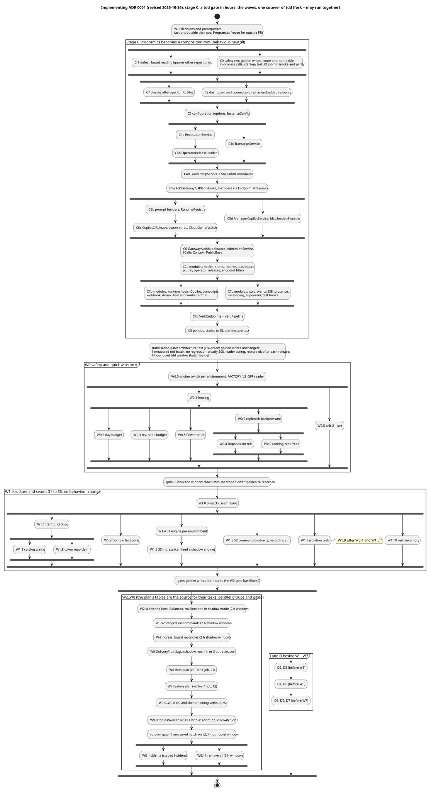

# Implementing ADR 0001: the sequence of work and its parallel lanes

Status: implementation plan, 2026-10-26, revised the same day, on 2026-10-28 (the hybrid composition) and on 2026-10-30 (the audit;
section "Revision 2026-10-30 (audit)" below). Stage C, W0 to W7 and W9.0, W9.2, W9.5 and W9.7 are built; W9.1, W9.3, W9.4, W9.6, W9.8
and W8.0 to W8.3 are in flight; the rest is planned. Asked for by the owner: "prepare for
implementation. I need the sequence of work, phased out including which tasks can be implemented by parallel subagents", then
"Program.cs refactoring has to be first and stabilized before enhancement plan commences." It turns:
- `gateway-composition.md` (stage C, first);
- the phases of `fworker-wolverine-refactor.md` (R0 to R9, waves W0 to W9);
- the speed rules of `delivery-speed.md`;
- the hooks of `system-gateway.md`;

into tasks: each one pull request, with what it comes after, the files it owns, and its size.

**Revision of 2026-10-26** (the owner's decisions of that day; ADR 0001, "Revision 2026-10-26"):
1. uat and prod do not matter for this plan: if it works in tdd, it is accepted.
2. Green pull requests merge and deploy without approval stops.

So the gates are tdd observation windows in hours, not soaks in days or promotions to uat and prod. The v2 engine is built beside
v1 as new projects, held to the same Tier 1 suites and golden-write oracle, and tdd switches engines **as a whole**, once; there is no
per-item engine. Rollback is a revert or the `FACTORY_V2_OFF` kill switch. Appendix A lists the board's tasks whose scope changed.
(The revision of 2026-10-28 brought back one per-plan exception, `intake.v2Plans`, and the revision of 2026-10-30 turns the remaining
gates into events; Appendix B lists the issues of that revision.)

| View | Source | Rendered |
|---|---|---|
| Stage C and the waves | `fwi-waves.puml` | [fwi-waves.svg](diagrams/fwi-waves.svg) |



## Revision 2026-10-30 (audit)

An audit of the program on 2026-10-30 (Opus, against master and the in-flight pull requests #540 to #549) found the verb-level port
(W9.1 to W9.8) nearly complete and built with care, and tdd safe today (shadow run, v1 acts, the v1 lease fences everything). It found
the plan for the rest **not correct as written**:
- under the hybrid composition, v1's lease, sweep, plant, snapshot and rule scripts are v2's base layer, yet W9.11 removed them and no
  task replaced them;
- W9.9 switched nothing (`intake.v2Plans` empty, and `intake.enabled` also turns on v1's intake);
- no Tier 1 scenario has started a `WorkItemSaga`, so the W6 and W7 gates and the cutover precondition could not be proven;
- the rollback path was unsound (the state comment projection is not wired);
- leadership needed a decision before W9.11.

This revision applies the owner's decisions of the same day and rewrites the rest of the plan. What it changes:

**The owner's decisions (2026-10-30):**
1. **Leadership:** keep a single-actor lease with Wolverine in Solo mode. The lease moves from the GitHub ref to a SQL application lock
   that also decides when the Solo node starts; the node runs only on the holder and stops before its hand-over. W9.11 does not
   remove the lease. Balanced mode with Wolverine's leader election (#464) is not the target any more.
2. **The app's uat and prod promotions** stay with v1's `AutoPromoter` after the cutover, until the delivery train has a recorded clean
   live window (the W5 gate, restated below as events). v2 acts in tdd only: the train decides uat and prod in shadow until then, and
   W9.12 hands those environments to it.
3. **`delivery.finalEnvironment` is tdd**: an item's delivery to the app's tdd starts its settle window.
4. **The `peer-approved` merge policy is dropped**, not ported: its reviewer-App approval stays in the script, and its suites
   (`peer-approved`, and `qc-gate`, which runs under that policy) go with v1 in W9.11a.
5. **#496:** the train promotes the newest qualifying release only, where v1 may promote two. Accepted as a declared difference.
6. **The nine defaults** of the audit, accepted as proposed:
   1. `intake.v2Plans` stays, as a deliberate per-plan exception to "no per-capability flags" (section 1, rule 9; section 4);
   2. at the cutover only parity evidence tdd can produce is required ("Owed evidence" below);
   3. dead-letter and envelope-backlog counts in `/api/v1/status` (W9.10o) instead of #462 (OpenTelemetry and Azure Monitor) and #463
      (the dead-letter page), which are not cutover work;
   4. a faster board-reconciler poll (1 to 2 minutes, W9.10g and the W9.9c checklist) instead of a `projects_v2_item` webhook;
   5. S1 is the pre-agreed fallback tier of the tdd database if the cutover batch saturates S0 (DTU p95 at or above 80%);
   6. the gateway's Octopus account gets `DeploymentCreate` on tdd for cmdemo1-ui (W8.2b), for the tdd rollback;
   7. incidents in the app's uat and prod escalate only: open the incident, hold the trains, notify; no automatic rollback there;
   8. no W8.4 analyst role (no new role, `Auth.cs` and `Mcp/RoleTools.cs` untouched); triage reads the health endpoints;
   9. synchronous decision verbs (a saga `InvokeAsync` that can refuse a session) are dropped in favour of the as-built feed
      (`V2VerbFeed`: v1's verb answers, then the saga is told); `wolverine-factory.md` 8 records it.
7. **Multi-repository** comes after the cutover, as its own row (W9.13). The cutover is home-repository only.

**The hybrid composition is the shape of the cutover**, not a stage before it. Where v2 acts, the sagas, the scheduler and the trains
own the items they started and every routed verb; what v1 still did for those items (the sweep's steps, the plant's offers and
starts, the gateway's own rule-script calls, the snapshot) moves to v2 in the W9.10 rows before the switch, so the cutover gate
measures what remains after W9.11, and W9.11 removes code that nothing calls. Section 4 is restated for it.

**New rows between W9.8 and W9.9** (W9.10 is free since #362 closed; lettered sub-rows, each one issue under the W9 epic #268; the
W9 table in section 4 gives content, owned files, order and size; Appendix B the issue numbers):

| Row | In short |
|---|---|
| W9.10a | Solo node only on the acting holder; the old node stops before the hand-over (on today's lease, now) |
| W9.10b | leadership: the lease as a SQL application lock that decides when the Solo node starts; kept by W9.11 |
| W9.10c | idempotency: an atomic pending claim in the command ledger; Copilot resume as unknown (#479) |
| W9.10d | v2 Tier 1: the saga profile, whole-suite claims, the declared-difference blocks, a sharded and blocking v2 job |
| W9.10e | v1 leaves saga items alone: the owned set into `sync-board`, no inline merge, v1 intake off for `v2Plans`, a `Loaded` flag |
| W9.10f | the sweep's item steps on v2 (settle and the master-CI watch, merge pickup, demote, clear hold, idle release, park expiry) |
| W9.10g | the sweep's plant-wide steps on v2 as recurring jobs (reap, renew, board guard, QC sync, replenish, backlog-low); faster reconciler |
| W9.10h | producers for the saga's inputs (park and resume, close, reopen, label, budgets, merge facts, start refused, Depends on) |
| W9.10i | the state comment projection wired (the rollback path) |
| W9.10j | session offers and starts from the saga and the scheduler; ledger executions subtracted from the plant's counts |
| W9.10k | plant state that survives a restart; the plant, digest, patrol and manager fed from saga state |
| W9.10l | the gateway's own rule-script calls and v1 fallbacks: the inventory and an architecture test |
| W9.10m | adoption as reconciliation: the mapping from v1 state to saga state, at every start |
| W9.10n | re-adoption fencing after `FACTORY_V2_OFF`: a new generation per item, ledger slots cleared |
| W9.10o | v2 health and fault handling: the status block, retry classification, save and outbox, `/ready` only where v2 acts |
| W9.10p | the app's uat and prod stay with v1's `AutoPromoter`; the train acts for tdd only |

**W9.9 is resized to L and split** (one issue, #361, three pull requests): W9.9a the router takes the gateway's own calls; W9.9b
adoption wired as a reconciliation; W9.9c the switch, its settings checklist, the drills and the cutover gate. **W9.11 is split** (one
issue, #363): W9.11a the oracle and the tests; W9.11b the removal, which keeps the lease and the `AutoPromoter` for uat and prod; W9.11c
the release check, `CLAUDE.md`, the handoff and the status fields. **New after the cutover:** W9.12 (the train takes the app's uat and
prod after the W5 gate) and W9.13 (multi-repository). **W8:** W8.0's default is the tdd-only rollback, W8.1 is split into a and b,
W8.2b is the infrastructure (cmdemo1 session), and the in-flight pull requests merge in a stated order (W8 below).

**Gates are events,** not windows (the owner's rule: no time minimum where time proves nothing). The W5 gate, the cutover gate, the
W9.11 gate and the W8 gate are restated below as lists of events, each observed and recorded on its epic.

**Owed evidence** (default 2 above). The gates of W2 to W7 were recorded in a reduced form or not at all: W2 had no database stop and no
leader election (Solo); W3's command parity became "v1 unaffected" (#471 was never built); W4 left the reconciler out of the shadow run;
W5, W6 and W7 have no gate comment. What tdd and CI can produce is owed at the cutover, and the rest is dropped with this record:

| Gate | Evidence | Disposition |
|---|---|---|
| W3 | v2's recorded commands matched with v1's writes | replaced by the v2 Tier 1 golden-write comparison of whole suites (W9.10d) and the measured batch; #471's report is not built |
| W4 | every board change of a window has its event in v2's history | owed: observed in the cutover batch (the reconciler runs from W9.10g) |
| W5 | live train decisions matching v1's | owed before W9.12, not before the cutover (decision 2): the W5 gate below |
| W6, W7 | the docs and feature suites green on v2 | owed before W9.9c: recorded on #265 and #266 once W9.10d's saga profile runs them |
| W2 | a database stop with v1 acting | dropped: v2 acts from the cutover, and W9.10o states what a database outage does where it acts |

**CI from now on** (section 1, rule 5, applied): the main session runs `gh workflow run Tests --ref master` now and after every merge
batch and records the result on the wave's epic; `V2_BLOCKING` becomes `true` after the first green master run that W9.10d produces;
#542 to #546 merge one at a time, each rebased on the one before, after the main session lands `V2VerbRouter.Below` and its test helper.

## 1. How parallel subagents work on this repository

1. **One task, one subagent, one worktree, one pull request.** An S or M task is one task cycle of about 50 minutes (section 5); an
   L task is two cycles, and is split into two pull requests where its content allows. A task that grows is split, not widened.
2. **Two to three subagents at once, lane D included, at most four,** plus one reviewer per pull request. Every merge is a release to
   tdd, so merges are serial: the merge, the release and its tdd check take about 10 minutes each.
3. **What a subagent can run:** `dotnet build` and pure dotnet tests only. The worktree guard refuses pwsh to subagents, and Tier 1
   allows one run per machine. So `tests/smoke.ps1`, the parity tests (which call the rule scripts), Tier 1 and the SQL-backed workflow
   tests run in CI. Every rule-script change is therefore first checked in CI. Stage C added a CI job that runs the smoke and parity
   tests in minutes.
4. **The main session is the standing integrator of the hot files.** A task that needs an addition to a hot file it does not own puts
   the change in its pull request only when its row lists that file; otherwise it asks the main session, which serialises it.
   - **Hot files:**
     - `gateway/Program.cs` (until stage C ends);
     - the composition files `gateway/Composition/*`;
     - `config/instance.json`, `config/deploy.overrides.json`;
     - `tests/scenarios/run.ps1` (`$SuiteDefs`), `tests/scenarios/lib.ps1`, the shared scenario files (`owner.ps1`, `octopus.ps1`,
       `leader.ps1`), and from W2 the golden-write declared-differences file of the v2 Tier 1 job;
     - `tests/FakeGitHub/Program.cs` (also the fake Octopus);
     - `.github/workflows/tests.yml`;
     - the solution file and `gateway/Gateway.csproj`;
     - `plugin/scripts/lib/Board.ps1`, `Verbs.Sweep.ps1`;
     - from W6, the verb registry (`gateway/Verbs/*`; from W9 one route file per group);
     - from W2, the EF Core `DbContext` and its migrations, and the Wolverine registration (`gateway/Composition/Wolverine*.cs`).
   - Each wave's `.0` task creates the stubs the wave's tasks will fill (a registration file per seam, a table per new saga, a recurring
     job slot), so the parallel tasks add code in their own files.
   - A task that adds a Tier 1 suite owns its dot-source line and `$SuiteDefs` entry in `run.ps1` and its `suites:` line in
     `tests.yml`, in the same pull request (the "Every suite is in a job" step fails otherwise).
5. **Parallel pull requests are tested together on master.** The ruleset does not require branches to be up to date, and `tests.yml`
   does not run on master pushes. So the main session runs `gh workflow run Tests` on master after each batch of merges and before
   every gate.
6. **Merge windows and tdd observation windows.**
   - Every merge to master restarts the acting tdd gateway. A **tdd observation window** is a stated number of hours from a release
     with no merge to master, except a fix for the window (which restarts it). In every window the main session checks, after the
     release that opens it and at its end: `/_build` shows the release, `/ready` answers 200, `/api/v1/status` shows the leader acting
     and a successful restore (v1: `plantSnapshot.restore.how`; v2: the lease holder's Solo node running, no second node in
     `wolverine_nodes`, and the sagas resumed), and no unplanned restart. Each gate adds its own comparison.
   - From the revision of 2026-10-30 the remaining gates are lists of events, not windows of hours: a gate ends when every event in
     its list has been observed and recorded, and merges wait only while a drill or a measured batch is running.
   - Subagents keep working during a window; their pull requests wait for its end to merge.
   - Pull requests from outside the plan (operator-session fixes) avoid the hot files of the running wave; during stage C, `Program.cs`
     is frozen for them.
7. **Every pull request:** the pre-commit review by a reviewer subagent, Tier 1 green, then merge and release to tdd with no approval
   stop (owner, 2026-10-26). Flaky jobs are re-run at most twice, then read. The tasks the earlier plan marked "owner review" (section 2)
   get a reviewer brief with a security focus, and the main session records each in the handoff for the owner to read afterwards.
8. **Kit-owned files stay untouched:** `build.yml` belongs to the demo-environment kit (only its tests job is local). New checks go into
   `tests.yml`. The Dockerfile copies every `*.csproj` before `dotnet restore`.
9. **One engine switch per environment** (refactor plan rule 3), default v1. tdd goes to v2 shadow mode at W2 and to v2 at the cutover
   (W9.9), each a `deploy.overrides.json` change that merges on green like any other pull request. There are no per-capability flags,
   with one deliberate exception (owner, 2026-10-28, confirmed 2026-10-30): `intake.v2Plans` names the plans the engine carries where
   it acts, so a plan joins v2 by a settings change (docs and feature at the cutover, hotfix and redeliver with W8.1b).
10. **Subagents follow the owner's standing rule** (Opus, low effort). Each brief gives the task's row, the files it owns and must not
   touch, its tests and its "done when".

## 2. Before the first task (W-1: decisions and prerequisites)

From the refactor plan's section 7. Since 2026-10-26 nothing inside this repository waits for an approval; what remains are actions
outside it:

| Item | Who | Needed by |
|---|---|---|
| Freeze `Program.cs` for pull requests from outside the plan during stage C | owner (in force) | the rest of stage C |
| The base: this plan proceeds on fworker; ADR 0001 stays Proposed until the owner accepts it | owner | W1.0 |
| cmdemo1-aisf stops acting on board 679 (kit watcher change) | owner, Platform Hub, cmdemo1 session | W0 |
| Azure SQL for the tdd gateway (provisioned, managed identity) | owner, cmdemo1 session | W2.0 |
| At least one replica for the tdd gateway (timers and recurring jobs need a running process; Solo on the lease holder since 2026-10-30, not Balanced) | cmdemo1 session | W2.2 (done) |
| `FACTORY_V2_OFF` in cmdemo1-system's infrastructure code (tdd fworker settings), unset; **overdue** (2026-10-30: absent from `system.json` and `infra/own/main.bicep`) | cmdemo1 session | W9.9c (After column); drilled there; removed with its reader in W9.11b |
| `projects_v2_item` delivery (organization or App webhook) | owner (admin) | not needed: default 4 of 2026-10-30, a 1 to 2 minute reconciler poll (W9.10g) |
| `DeploymentCreate` on tdd for cmdemo1-ui for the gateway's Octopus account (decided 2026-10-30) | cmdemo1 session | W8.2b, before the W8 gate |
| S1 as the tdd database's fallback tier (decided 2026-10-30) | cmdemo1 session | only if the cutover batch saturates S0 |
| The gateway's read access to cmdemo1-system; the `system.json` fields for policy, toolchain and WIP limit (kit and cmdemo1-system) | owner, Platform Hub | W1 (falls back without), W6 and W7 |
| Delivery-speed cross-repo pieces (merge queue ruleset, workorders pipeline, kit `release.yml`, docs-only overflow) | owner, Platform Hub | W7.10, each optional, off the critical path |
| The incident rollback policy (decided 2026-10-30): automatic in the app's tdd only; in its uat and prod open the incident, hold the trains and escalate, no automatic rollback | owner | W8.0 (answered) |

**Removed by the decisions of 2026-10-26:**
- the lifting of cmdemo1-system#314's hold on uat and prod promotion, and `ui-auto-promote`'s application paths (`src/`, `*.csproj`,
  `*.sln`): fworker's uat and prod are out of scope;
- per-pull-request owner approvals: the workflow changes (smoke and parity job, W1.0, SQL Server in `tests.yml`, each new suite), the
  Dockerfile (`src/`), the `deploy.overrides.json` switches, the pinned NuGet packages (W2.0) and the security-sensitive tasks (stage
  C: C4a, C6, C7a, C8; W1.8 the token's repository claim, W4.0 webhook secrets per source, W8.2 the alert webhook and rules, W9.7
  revocations, revoke-worker and git-credential). They merge on green after the reviewer subagent (section 1, rule 7);
- the merges of #253 and #254, which are done.

## 3. Stage C: Program.cs becomes a composition root (first, then stabilised)

The steps of `gateway-composition.md` section 5, each behaviour-neutral. `Program.cs` is hot: steps that run together remove different
blocks and merge in sequence.

| Task | Content | Owns | After | Size |
|---|---|---|---|---|
| C-1 (defect) | board reading ignores other repositories: `Get-BoardList` and the `projects_v2_item` resolution read `repository.nameWithOwner` and drop other repositories' cards; the fake's board and node queries return `repository`; one scenario | `Board.ps1` (Get-BoardList), `Verbs.Sweep.ps1` (872-878), `tests/FakeGitHub/Program.cs` (board queries) | W-1, parallel with C0 | S |
| C0 | **the safety net:** the golden-write harness (the fake records writes per scenario; normalized diff), its baseline recorded from a CI artifact of master; the route-and-auth table test, pinning the eight `RawText` patterns `InProcess` needs, and one in-process call per pinned pattern; the start-up test (`ValidateOnBuild`, `ValidateScopes`, hosted services stop in time); a CI job for the smoke and parity tests | `tests/FakeGitHub/*`, `tests/scenarios/lib.ps1`, `tests/scenarios/golden/*`, a new `tests/Gateway.Tests` (test packages: section 2), `tests.yml` | W-1, C-1 (baseline) | M |
| C1 | the classes after `app.Run()` (`Runner`, `EventHub`, `PlantTicker`, `Sweeper`, `SweepGap`) to their own files | `Program.cs` (2496-2880), new files | C0 | S |
| C2 | the dashboard as an embedded resource served with `text/html; charset=utf-8` (not `wwwroot`: Tier 1 runs the build output in Production, `lib.ps1:42`); the connect prompt to an embedded template, its rendered text pinned by a test | `Program.cs` (2881-3294, route 769), `gateway/Templates/*` | C0 | S |
| C3 | configuration: `GatewayOptions`, `InstanceConfig` (one path), `TimingOptions`, the settings registered as singletons; only the static helpers (`Fail`, `ReadBody`, `Refuse`, `ParseCursor`, `FixedEquals`) to `HttpResultsX`; today's `GatewayLeader` registered as `ILeadership` | `Program.cs` (15-117, 450-483, helpers), `gateway/Configuration/*` | C1 | M |
| C4a | `RevocationService` (loader, status, `RevokeAsync`) | `Program.cs` (450-515, 925-946), `gateway/Identity/Revocation*` | C3 | M |
| C4b | `OperatorReleaseLoader` | `Program.cs` (1888-1915), `gateway/Operator/*` | C4a (it reads `revocationsOff`) | S |
| C4c | `TranscriptService` (save loop gated by the `ILeadership` registered in C3; the final flush stays an `ApplicationStopping` callback) | `Program.cs` (249-250), `Transcripts.cs` | C3 | S |
| C4d | `LeadershipService` and `SnapshotCoordinator` (snapshot restore, save, debounce, hand-over, leader start) | `Program.cs` (149-162, 280-432, 516-554), `gateway/Leadership/*` | C4a, C4b, C4c | L |
| C5a | `AddGateway*`, `IPlantHooks`; `InProcess` resolves endpoints through `EndpointDataSource` instead of being built after `Build()` | `Program.cs` (118-248, 252-279, 2488), `gateway/Composition/*`, `Plant.cs` (constructor), `Mcp/InProcess.cs` | C4d | M |
| C5b | prompt builders as services, rendered texts pinned by a test; `RuntimeRegistry` | `Program.cs` (171-185, 2256-2271, 2445-2487), `Runtimes/*` (constructors), `gateway/Templates/*` | C5a | M |
| C5c | `CopilotCiReleaseService` (2272-2292); `CopilotOwnerVerbs` (`OwnerVerb`, 2294-2299) and `CopilotSettleClient` (2356-2364) as constructor parameters; `CloudOwnerWatch` (2300-2353, 2365-2417) whose options carry the differences between the runtimes: interval (`CiReleaseSeconds` against `OwnerWatchSeconds`), master fixer and `OverBudget` (Copilot only), `LoadOwner`'s runtime test (`!= cursor-cloud` against `== cursor-cloud`), `Ending`'s head (`HeadOf` against null) | `Program.cs` (2272-2417), `gateway/Runtimes/Owner*` | C5b | M |
| C5d | `ManagerCopilotService` (2418-2444), `McpSessionSweeper` with cancellation (2493) | `Program.cs` (2418-2444, 2489-2493) | C5a | S |
| C6 | `GatewayAuthMiddleware` and `AdmissionService`; `ICallerContext` (scoped: `Who`, `Admitted`, `OperatorActive`, `By`, `SessionLinkOf` 561-575) and `PublicBase` (singleton: `seenBase`, `LinkBase`, `NoteBase`, 146-147 and 622-629; written by the middleware, read by `SessionLinkOf` and `Plant.SessionPage`) | `Program.cs` (146-147, 557, 561-653, 800-804), `gateway/Http/*` | C5a to C5d | M |
| C7a | endpoint modules: health, status (`StatusQuery`), metrics, dashboard, plugin, operator releases; the endpoint filters (guards only as endpoint filters, never middleware or ASP.NET authorization: `InProcess` calls `RequestDelegate` directly); `BuildInfo` (`buildVersion`, `started`) for `/_build` | `Program.cs` (their blocks), `gateway/Endpoints/{Health,Status,Metrics,Dashboard,Plugin,OperatorRelease}*`, `gateway/Http/Filters*` | C6 | M |
| C7b | endpoint modules: runtime hosts, Copilot, transcripts, webhook, demo, item admin, worker admin | `Program.cs` (their blocks), `gateway/Endpoints/{RuntimeHost,Copilot,Transcript,Webhook,Demo,ItemAdmin,WorkerAdmin}*` | C7a (filters) | M |
| C7c | endpoint modules: wait, events and SSE, presence, messaging, supervisor, test hooks | `Program.cs` (their blocks), `gateway/Endpoints/{Wait,EventStream,Presence,Messaging,Supervisor,TestHooks}*` | C7a (filters) | M |
| C7d | `VerbEndpoints` and `VerbPipeline` (seam S1's home) | `Program.cs` (1017-1235, 1451-1482), `gateway/Endpoints/Verb*`, `gateway/Verbs/*` | C7b, C7c | L |
| C8 | rules into policy classes (verb, credential, metrics access, presence, release record, derived text) with unit tests; statics (`Auth.*`, `GatewayMcp.Tools`, `QuotaBlock`) into injected services; the architecture test (Program.cs at most 60 lines, no behaviour) | `gateway/Policies/*`, `Auth.cs` (statics), `Mcp/*` (static), `tests/Gateway.Tests` | C7d | M |

Parallel: C-1 beside C0; C1 and C2; C4a and C4c together, then C4b after C4a, then C4d after all three; C5d beside C5b and C5c; C7b and C7c together (after C7a). C-1 does not touch Program.cs and ships now, ahead of stage C: board 679 links eight repositories (system-gateway.md 1). It and C0 both touch the fake, in different hunks; C-1 merges first, and C0's baseline is recorded after it.

**Stabilisation gate (owner's condition, revised 2026-10-26):** all of these, before W0 starts:
1. the architecture test (C8) is green: `Program.cs` is the composition root, at most 60 lines, no behaviour;
2. the golden writes are unchanged against C0's baseline, with Tier 1 and the route-and-auth table green;
3. **one measured 8-item batch** runs through tdd (from the first worker start to deployed in the app's tdd) with no regression against
   the delivery-speed baseline of 2026-10-25 (batch #706 to #721, `delivery-speed.md` 1): no stage median more than 5 minutes slower
   than the baseline's (Technical Design 5, Development 16, Functional Testing 10, merge 8, master CI and candidate 12, tdd 11) and no
   item parked for a gateway fault;
4. after each release of stage C and of the gate: `/_build` shows the new version, `/ready` answers 200, the leader is acting and the
   plant restore succeeded (`/api/v1/status`: `leader.role`, `plantSnapshot.restore.how`);
5. **a quiet tdd observation window of 4 hours** from the last release (section 1, rule 6): no merge and no fix to the refactored code,
   no unplanned restart, no sweep error, no 5xx from a route other than its designed refusals. The measured batch runs inside it.

**Why 4 hours:** the longest timer the acting gateway runs is the build slot's maximum TTL (`buildSlotMaxTtlSeconds` 7,200), which
expires twice in 4 hours; the full sweep (180 s) runs about 80 times and the lease renewal and host reconcile (5 min each) about 48
times. An 8-item batch on two slots reaches the app's tdd in about 3.5 hours (2026-10-25: about 44 minutes of slot time per item, so
8 x 44 / 2 is about 3 hours of starts, plus about 30 minutes from merge to tdd), so the window is the batch plus a margin, and the gate
takes about 4 to 4.5 hours, not 8. Not seen in it: the day budget's reset at 00:00 UTC and the 24-hour message TTL, neither of which
stage C changes; Tier 1 covers both. (`caeJob.replicaTimeoutSeconds`, 14,400, belongs to the Container Apps job runtime, which is off.)

## 4. The enhancement waves (after stage C)

With stage C done, `Program.cs` is no longer a hot file; areas live in their own modules and services, which the tasks below name.

**How v2 is built and switched.** The Wolverine engine (v2) is built as the new projects of the refactor plan's section 3, beside v1,
inside the same gateway host. Its CI is the same Tier 1 suites run with the engine set to v2 (a second Tier 1 job from W2.4) and the
same golden-write oracle; where v2 writes differently on purpose, the difference is a line in a reviewed declared-differences file.
The engine is chosen **per environment**, once, at start: `engine: { "v2Environments": [], "shadowEnvironments": [] }` in
`config/instance.json`, read for `FACTORY_ENVIRONMENT`. tdd joins `shadowEnvironments` at W2 (v2 reads the board, its commands go to a
recording sink, v1 acts) and `v2Environments` at the cutover W9.9. `FACTORY_V2_OFF=1` (cmdemo1-system) puts the environment back on
v1 with no shadow, in a new revision and without an image change; reverting the switch's pull request does the same through a release.

**What "v2 acts" means: the hybrid composition** (owner, 2026-10-28; restated 2026-10-30). Where the environment is in
`v2Environments`, one gateway process holds the lease and runs both: v2 (the Wolverine host in Solo mode, the sagas, the scheduler,
the trains, the routed verbs) and what is left of v1 (the rule scripts of verbs not yet routed, the sweep for items v2 has not
started, the plant, the `AutoPromoter` for the app's uat and prod). The split is by item and by verb, decided in code, not by flags:
- **Items:** an item whose `WorkItemSaga` is open is v2's; v1's sweep, intake and inline merge leave it alone (W9.10e). The saga
  starts items of the plans `intake.v2Plans` names (the one per-plan exception to "no per-capability flags", section 1, rule 9);
  items of other plans, and items started before the switch and not adopted, are v1's. At the cutover W9.9b adopts every open item,
  so after it v1 owns none.
- **Verbs:** a verb with a route in `V2VerbRoutes` is v2's, whoever calls it: a session through the verb endpoint or the gateway itself
  (W9.9a). A verb with no route still runs on v1; W9.10l's list of them must be empty before W9.11.
- **Shared resources have one owner each:** capacity is the `CapacityScheduler`'s ledger, with the plant's own sessions counted once
  (W9.10j); merges of saga items are the merge train's; delivery to the app's tdd is observed by the train; promotions to the app's
  uat and prod are v1's `AutoPromoter`'s until W9.12 (decision 2 of 2026-10-30).
- **One actor:** the lease (a SQL application lock from W9.10b) fences both engines; the Solo node runs only on its holder (W9.10a).
- **The rollback path:** v2 writes the state comment in the format v1 reads for every decision that changes what v1 reads (W9.10i), so
  `FACTORY_V2_OFF` or a revert hands every open item back to v1, and re-adoption fences what happened meanwhile (W9.10n).
- **Home repository only** until W9.13.

**What stays from the side-by-side design, and why:**
- **S1, the verb router** (`VerbPipeline`): the verb endpoints call one engine interface, composed per environment. It keeps the
  agents' contract in one place and lets Tier 1 run either engine.
- **S2, the command port:** every external side effect of v2 is one integration command. Behind it are the outbox handlers, or the
  recording sink that shadow mode and the golden-write comparison read.
- **S3, the event ingress:** webhooks and the verbs' events enter through one interface, which in shadow mode also feeds v2.
- **The state comment as v2's projection, in the format v1 reads:** this is how a revert or the kill switch hands every open item back
  to v1 with nothing lost. Not wired until W9.10i (the audit of 2026-10-30); it stays through the W9.11 gate, because until then a
  revert of W9.11b is the rollback.

**What went, because it existed only for v1 and v2 side by side on one environment:** the `engine:v2` label and the intake labelling;
v1 skipping or forwarding v2 items (W6.4a to c, W6.5); the separate runtime and offer filter for v2 items; S4 as a seam in v1's code,
S5 (timers) and S6 (the loopback route); v1's side effects through the outbox; v1 asking v2's scheduler (W7.5); moving v1's merge onto
C# (in W7.2); the per-capability flags (`commands`, `ingress`, `delivery`, `scheduler`, `merge`, `incidents`); the expand-then-contract
steps for uat's and prod's lag; v1's promotion off-switch (W5.3); the per-item moves to v2 (W7.9, W9.9's QC items) and the drain of
`engine:v1` items in W9.11. **Came back:** `intake.v2Plans` (2026-10-28, the hybrid composition) and Solo mode on the lease holder
(2026-10-30, the leadership decision: the lease is the fence, Balanced mode is not the target).

### W0: R0, safety and quick wins on v1 (2 to 3 at once)

v1 acts in tdd until the cutover, and releases now restart it several times an hour, so the fixes for a sweep acting after its
successor and for blind state writes stay. The durable budgets (W0.7) are v2's by design and go to W6.1.

| Task | Content | Owns | After | Size |
|---|---|---|---|---|
| W0.0 | integrator: the engine switch `engine: { v2Environments, shadowEnvironments }` read for `FACTORY_ENVIRONMENT`; the `FACTORY_V2_OFF` reader | `config/*`, `gateway/Configuration/Engine*` | stabilisation gate | S |
| W0.1 | fencing: lease epoch into `sync-board`; lease checks before every mutating step (merge, settle, promotion, Sign-off, `Save-State`); `MayAct` in `Plan` and in `RuntimeManager.Provision`; supersession awaits the rule script at most 45 s, then kills it | `gateway/Sweeper.cs`, `Leadership/*`, `RunnerPool.cs`, `RuntimeManager.cs` (Provision), `Verbs.Sweep.ps1`, `Verbs.Delivery.ps1`, `Verbs.Promote.ps1`, `Verbs.Merge.ps1`, `Board.ps1` (Save-State lease check) | W0.0 | M |
| W0.2 | the day budget counted from the task history (every Start and overflow run since 00:00 UTC) | `RuntimeManager.cs`, `IWorkerRuntime.cs`, `OctopusRunbookRuntime.cs`, the fake Octopus in `tests/FakeGitHub/Program.cs` | W0.1 | S |
| W0.3 | `Save-State` `rev` check; the 48,000-character state budget (trim `promote_health`, `flow`, lineage) | `Board.ps1` (Save-State, Get-State) | W0.1 | S |
| W0.4 | qualified refs: the `Depends on` parser and the keeper's cycle check (the board reading shipped in C-1) | `Verbs.Keeper.ps1`, `Verbs.Sweep.ps1` (419) | W0.6 | S |
| W0.5 | the exit-21 text: "stay connected while checks run" | `Verbs.Item.ps1` (499-500), `plugin/skills/factory-development`, `factory-owner-session` | W0.0 | S |
| W0.6 | replenish backpressure: the waiting count from the last plan into the sweep input; `onlyWhenIdle` | `Replenish.ps1`, `Plant.cs` (last plan's waiting count), the sweep input in `Sweeper.cs`, `Verbs.Sweep.ps1` (the `Invoke-Replenish` call, 779) | W0.1 | S |
| W0.8 | flow metrics: one timestamp per stage (`Move-OwnerTo` and the stage hooks), exposed through the metrics route; the measure of every later batch | `Metrics.ps1`, `Owner.ps1` (`Move-OwnerTo`), `gateway/Endpoints/Metrics*` | W0.1 | M |
| W0.9 | ranking comparer and plan on slot freed (queued item numbers, the hub delegate) | `Plant.cs` (Plan), `Plant.Runtimes.cs`, `RuntimeManager.cs`, `EventHub.cs` | W0.6 | M |

Parallel start: W0.1 and W0.5; then W0.2, W0.3, W0.6 and W0.8 after W0.1; then W0.4 and W0.9 after W0.6.
**Gate:** Tier 1 green; the golden-write baseline re-recorded from master (W0 changes writes on purpose: rev, flow times); a **2-hour
tdd observation window** with board activity, in which every item that moved has its flow timestamps and no stage median is more than
5 minutes slower than the baseline. Two hours: four full slot-TTL cycles (1,800 s) and about 40 sweeps, enough to see the fencing and
the `rev` check through at least one release hand-over, which opens the window.

### W1: R1, structure and seams, no behaviour change (2 to 3 at once)

| Task | Content | Owns | After | Size |
|---|---|---|---|---|
| W1.0 | integrator: the solution, projects `src/Fworker.Contracts`, `Domain`, `Persistence`, `Integrations`, `Workflows` and their test projects, `Gateway.csproj` references, the Dockerfile, `tests.yml`; one empty registration file per seam (S1 to S3) | `*.sln`, `src/*/*.csproj`, `gateway/Gateway.csproj`, Dockerfile, `tests.yml`, `gateway/Composition/Seams*` | W0 gate | S |
| W1.1 | `ItemId` (parse, format, lowercase) and message base types; `ISystemCatalog` and its loader as a library (`system.json` through the API, `instance.json` fallback) | `src/Fworker.Contracts/*`, `src/Fworker.Integrations/Catalog/*` | W1.0 | M |
| W1.2 | the catalog's wiring and its mismatch report | `gateway/Composition/Seams*` (catalog), `gateway/Endpoints/Status*` (report) | W1.1 | S |
| W1.3 | Domain, first ports: the ranking comparer (ported without rewiring the call) and the journal text, with parity tests | `src/Fworker.Domain/{Ranking,JournalText}*`, `tests/Fworker.Domain.Tests` | W1.0 | M |
| W1.4 | S1: `VerbPipeline` calls one engine interface composed for the environment (only v1 behind it now) | `gateway/Verbs/*` | W1.0 | M |
| W1.5 | S2: the command port as integration-command contracts, with a recording sink for shadow mode and tests; v1 is not rewired onto it | `src/Fworker.Contracts/Commands*`, `src/Fworker.Integrations/Commands/Recording*` | W1.0 | S |
| W1.6 | S3: one event ingress for the webhook routes and the verbs' `RequestSweep`, able to feed a second (shadow) engine | `gateway/Ports/Ingress*`, `gateway/Endpoints/Webhook*`, `gateway/Verbs/*` (the `RequestSweep` call) | W1.4 | M |
| W1.8 | the token's repository claim (`i1`/`r1`, absent means home; security-focused review); launch fields (repository, clone URL, branch, toolchain) | `Auth.cs`, `Runtimes/*Runtime.cs` (launch only) | W1.1 | S |
| W1.9 | isolation scenarios with a second repository in the fake (webhook dropped, card ignored, `Depends on other#N` not home #N, same number no collision) | `tests/FakeGitHub/Program.cs`, a new `tests/scenarios/repos.ps1` with its `run.ps1` and `tests.yml` lines | W0.4, W1.0 | M |
| W1.10 | the verb inventory (73 verbs, owner and destination) | `docs/design/verb-inventory.md` | W1.0 | S |

Parallel start: W1.1, W1.3, W1.4, W1.5; then W1.6, W1.8, W1.9, W1.2, W1.10 as slots free.
**Gate:** golden writes identical to the baseline recorded at the W0 gate (CI); the release check of section 1, rule 6. No window: W1
changes no behaviour.

### Lane D: Domain ports, beside W1 to W7 (one of the slots)

One pull request each in `src/Fworker.Domain` and its tests, never a hot file. Unchanged by the revision.
- **Parity tests,** for ports of existing rule-script functions:
  - D2: the evidence composite;
  - D3: release choice and the content gate;
  - D4: the docs-only test.
- **Specification tests,** for rules v1 does not have:
  - D1: the admission rules beyond `Depends on`;
  - D5: the recovery policy table;
  - D6: file-overlap;
  - D7: host headroom and footprint.
- Plans as data belong to W6.1, not lane D.
- **Order by need:** D2 and D3 before W5; D4 and D5 before W6; D1, D6 and D7 before W7.

### W2: R2, the Wolverine host, in shadow mode (2 to 3 at once)

| Task | Content | Owns | After | Size |
|---|---|---|---|---|
| W2.0 | integrator: the packages, pinned; the connection-string setting; SQL Server as a service container in the Tier 1 jobs (owner jobs split once more); an image-start check without a connection string in `tests.yml` (the kill switch's case); the `DbContext` stub | `*.csproj`, `tests.yml`, `config/*`, `src/Fworker.Persistence/FactoryDbContext.cs` (stub) | W1 gate, Azure SQL | S |
| W2.1 | persistence: tables for history, correlation map, open-instance index, projection versions, the session mailbox, the catalog's last good copy; migrations | `src/Fworker.Persistence/*` | W2.0 | M |
| W2.2 | host wiring: registered when the environment is in `shadowEnvironments` or `v2Environments` and a connection string is set; **Balanced mode with Wolverine's leader election** and the session mailbox from the start; storage set up in the background; `/ready` independent of the database; OpenTelemetry and the Azure Monitor exporter; the dead-letter admin page | `gateway/Composition/Wolverine*`, `gateway/Endpoints/Admin*`, `src/Fworker.Persistence/*` (mailbox) | W2.1 | L |
| W2.3 | shadow mode: v2 reads S3's events, decides, writes its own history, and sends its commands to S2's recording sink; a comparison of the recorded commands with v1's actual writes, as a report | `gateway/Composition/Shadow*`, `src/Fworker.Integrations/Commands/Recording*`, `gateway/Endpoints/Admin*` (report) | W2.2 | M |
| W2.4 | `Fworker.Workflow.Tests` (tracked sessions against SQL Server, CI only) and the **v2 Tier 1 job**: Tier 1 with the engine set to v2 for the suites v2 claims (a list that grows per wave), and the golden-write diff against the declared-differences file | `tests/Fworker.Workflow.Tests/*`, `tests.yml`, `tests/scenarios/golden/v2-differences*` | W2.2 | M |

**Gate:** a **2-hour tdd observation window** with tdd in `shadowEnvironments`: the release check; v2's node elected leader and its
storage ready; a history row for every ingress event; a 10-minute stop of the database inside the window, during which v1 acts and
`/ready` stays 200. Two hours replaces the 7-day soak: shadow mode writes nothing to GitHub, so what can go wrong is in the process
(storage setup, leader election, the durability agent's cycles, which run every few seconds) and shows within minutes; the window also
spans the release that opened it.

**W2.2 as built, and the revision of 2026-10-30.** The host runs in **Solo** mode (`wolverine.mode` solo), not Balanced: the GitHub-ref
lease is its only single-actor fence, and the coordinators use local sequential or partitioned queues, not `GlobalPartitioned`. The node
is started whatever the lease state, so on every release the old and the new process each run a Solo node for up to the hand-over
time; W9.10a fixes that, and W9.10b moves the lease into SQL. Balanced mode with Wolverine's leader election (#464) is closed as
superseded by the lease decision. The W2 gate's "v2's node elected leader" is replaced, from the cutover, by checks Solo can show: the
lease holder's node running, no second node in `wolverine_nodes`, and a scheduled wake that fires after a restart.

### W3: R3, v2's durable side effects (2 to 3 at once)

| Task | Content | Owns | After | Size |
|---|---|---|---|---|
| W3.0 | integrator: the integration command base (error classification, `IntegrationFailed`, idempotency keys); `GitHubBudget` keyed by (credential, resource); the GitHub client per repository and installation per owner (H6) | `src/Fworker.Integrations/{Commands,GitHub}/*`, `GitHubBudget.cs` | W2 gate | M |
| W3.1 | runtime start and stop and runbook runs as v2 integration commands, with result messages; `RuntimeManager` behind an interface v2 calls; v1's path unchanged | `src/Fworker.Integrations/Commands/Runtime*`, `RuntimeManager.cs` (interface), `OctopusRunbookRuntime.cs` | W3.0 | M |
| W3.2 | the journal as a v2 integration command: `Add-Journal`'s ledger in C# (dedup keys, the 30-line cap, folds by comment id, the `waiting_at` rate limit), golden-identical; per-item partitioning; the launched line's order (#252) | `src/Fworker.Integrations/Commands/Journal*`, `src/Fworker.Domain/JournalText*` | W3.0 | L |
| W3.3 | Copilot launch reservation and its reconciler | `CopilotCloudRuntime.cs`, `src/Fworker.Integrations/Commands/Copilot*` | W3.0 | S |
| W3.4 | kill and restart scenarios for commands, on the v2 engine | a new suite with its `run.ps1` and `tests.yml` lines | W3.1, W3.2 | S |

**Gate:** W3.4 and the journal-fold and octopus suites green on v2 (no lost or duplicated line, start or stop across a kill); a
**2-hour tdd observation window** in shadow mode in which every command v2 records has its counterpart in v1's writes, or a declared
difference.

### W4: R4, durable ingress and the board reconciler (2 to 3 at once)

| Task | Content | Owns | After | Size |
|---|---|---|---|---|
| W4.0 | integrator: a webhook secret per source (security-focused review); the recurring-job slots | `config/*`, `gateway/Endpoints/Webhook*`, `gateway/Composition/Wolverine*` | W3 gate | S |
| W4.1 | ingress to the inbox: logical and business-key deduplication; correlation-map writers from verbs and runtimes | `gateway/Ports/Ingress*`, `src/Fworker.Integrations/Correlation/*` | W4.0 | M |
| W4.2 | C# Octopus watcher: `ReleaseCreated`, deployment events, `SignOffRequested`, commit resolved | `src/Fworker.Integrations/Octopus/Watcher*` | W4.0 | M |
| W4.3 | board reconciler and catalog re-read as recurring jobs (cards keyed by repository; cmdemo1-system pushes before v1's filter) | `src/Fworker.Workflows/Reconcilers/*` | W4.1 | M |

**Gate:** a **2-hour tdd observation window** in shadow mode with board activity (the main session starts a 4-item docs batch through
the replenisher if the board is idle): every board-relevant change in it has its event in v2's history.

### W5: R5, DeliveryTrainSaga (2 to 3 at once)

| Task | Content | Owns | After | Size |
|---|---|---|---|---|
| W5.0 | integrator: `ItemMerged(commit, gates, dependencies)` derived from the merge webhook and the reconciler (v1 emits nothing); the train's and delivered-to tables | `src/Fworker.Workflows/Delivery/ItemMerged*`, `src/Fworker.Persistence/*` (tables) | W4 gate, D2, D3 | S |
| W5.1 | `DeliveryTrainSaga` per deployable and environment: candidates, evidence, newest qualifying release, Sign-off answers, due timers, supersession, the delivered-to table, the `dependencies-delivered` slot (off), policy and promoter per deployable from the catalog (H9) | `src/Fworker.Workflows/Delivery/*` | W5.0 | L |
| W5.2 | the shadow run against the board: the train's decisions compared with v1's promotions and Sign-off answers, and its report | `src/Fworker.Workflows/Delivery/Shadow*`, `gateway/Endpoints/Admin*` | W5.1 | S |

**W5.1 revision notes:**
- Hand-written handlers instead of a Wolverine Saga are the accepted design (#491).
- The item "command or timer lost between save and outbox" moved to W9.9 (#361), and on 2026-10-30 to W9.10o.

**Gate, as events** (restated 2026-10-30; it replaces "a tdd shadow run of 4 hours or 3 app releases", which was never recorded on
#264). It is the precondition of W9.12, not of the cutover: the
app's uat and prod stay with v1's `AutoPromoter` until it is recorded (decision 2). Every event is read from tdd's shadow comparison and
counts only decisions made after the watcher's replay was applied (#500, defect 6):
1. at least **3 live app releases** after the replay, each with a train decision for uat (and prod, where one is due) that matches v1's
   action or is a declared difference: the newest qualifying release only (#496, accepted), and any other difference declared on #264
   with its cause; an unexplained difference fails the gate;
2. each timer kind of the train fires at least once: a Sign-off wait, a health window, a retry and the safety wake;
3. one release restart of the gateway during a train's wait, after which its scheduled `TrainWake` fires (#500's open question; the
   evidence closes #500);
4. "would hold" decisions of the `dependencies-delivered` rule reported in the shadow comparison (the rule is off in shadow), each
   explained.

The gate is recorded on #264 with the release numbers and the comparison rows.

### W6: R6, the docs plan (2 to 3 at once)

| Task | Content | Owns | After | Size |
|---|---|---|---|---|
| W6.0 | integrator: the per-repository WIP intake rule; the saga tables | `src/Fworker.Persistence/*` (tables), `src/Fworker.Workflows/Intake*` | W5 gate, D4, D5 | S |
| W6.1 | `WorkItemSaga` core: plans as data, steps, generation and arm ids, `NotFound`, `IRevisioned`, partitioning; the budgets (failures, launches, `idleFollowUps`) in the saga's state; decision verbs by `InvokeAsync` through S1 | `src/Fworker.Workflows/WorkItem/*`, `gateway/Verbs/*` (the v2 engine) | W6.0 | L |
| W6.2 | C# direct merge (squash with the PASS head, mergeability wait, branch update, out-of-date retries) | `src/Fworker.Integrations/GitHub/Merge*` | W6.0 | M |
| W6.3 | projections: board, labels and state comment, versioned, the state comment **in the format v1's `Get-State` reads** (the rollback path); echo suppression | `src/Fworker.Integrations/GitHub/Projection*` | W6.0 | M |
| W6.6 | the docs plan's steps | `src/Fworker.Workflows/WorkItem/Plans/Docs*` | W6.1, W6.2, W6.3 | M |
| W6.7 | views: dashboard, status and digest read the history on the v2 engine, grouped by repository | `gateway/Endpoints/{Dashboard,Status}*`, `StatusQuery*` | W6.1 | S |

Parallel start: W6.1, W6.2, W6.3; then W6.7; W6.6 last.
**Gate:** the docs-plan suites green in the v2 Tier 1 job, golden writes unchanged but for declared differences (CI). No window: v2
does not act in tdd yet. *Not recorded (2026-10-30):* the v2 Tier 1 job never starts a saga (intake off, `v2Plans` empty, no
declared-difference blocks), so this gate is recorded on #265 once W9.10d's saga profile runs the docs-only scenarios of `auto` and
`owner`; it is a precondition of W9.9c.

**Revision of 2026-10-28: the hybrid composition for W6.0 and W6.1 (owner decision).** The revision of 2026-10-26 above removed the
per-item routing (`intake.v2Plans`, the `engine:v2` label, v1 skipping v2 items). For the docs plan the owner chose the composition
back, as the way to put the saga to work before the cutover without a second engine switch: **v1's plant still offers the sessions
and runs every verb v2 does not own yet; v2's `WorkItemSaga` decides the docs-only items it has started; v1's sweep leaves those items
alone.** It acts only where `Engine.V2Acts`, which tdd (shadow) is not, so nothing of it exists in tdd, uat or prod today. What W6.0
and W6.1 built, and what is left:
- **Tables:** `factory.WorkItems` (state as a JSON document with a revision, the `IRevisioned` of the design; the open count per
  repository is read from its columns) and the existing `OpenInstances` index, written in the same transaction.
- **The saga** (`Fworker.Workflows.WorkItem`): plans as data (`feature`, `docs`, `hotfix`, `redeliver`), the steps as classes,
  generation and arm ids, `NotFound` ending quietly, the budgets (failures and launches per phase, idle follow-ups) in the state,
  leases as scheduled messages, the settle window, decisions published as `WorkItemDecided` with a sequence number, a redelivery after
  a crash between the save and the publish publishing again, per-item partitioning of the host's local queues. The docs-only test is
  `IDocsOnlyPort`, whose adapter `DomainDocsOnlyPort` calls D4's `DocsOnly` with the settings of `config/instance.json`; the failures
  of a phase are counted against D5's recovery table (`RecoveryPolicy`, the lost-session row).
- **Intake:** `IntakeRule` (the rule of `Invoke-Intake` as a pure function, with a WIP limit per repository and the choice of engine
  by `intake.v2Plans`), `intake.repositoryWipLimits`, `intake.v2Plans` (empty), `intake.v2Label` (`engine:v2`). v1's own intake in
  `Verbs.Sweep.ps1` is unchanged.
- **The hand-off in the gateway:** `V2Ownership` reads the saga's table before each sweep and `SweepV2Filter` drops what the sweep
  says about those items (offers, triggers, holds, parks, owners) before the plant sees it. The rule script itself is not changed.
- **Left for the integrator and W6.2 to W6.7:** passing the owned items into `sync-board` so the script also stops reading them
  (`Verbs.Sweep.ps1`; no task took it until the revision of 2026-10-30, which gives it to W9.10e); writing the `engine:v2` label (a
  projection, W6.3). (The feeder, the decision verbs and the demotion and
  mechanical rows of D5's table were left to W6.6 here; W6.6 below has them. The fix-forward row, CI red, stays with W7.)

**W6.6, the docs plan's steps (#335, built on W6.1 to W6.3).** Revision 2026-10-26 of the task stands: the steps only, no offer
filter, no separate runtime, no per-item freeze. What the hybrid composition needs on top, all wired only where `Engine.V2Acts`:
- **The steps** (`Fworker.Workflows.WorkItem`, `Plans/Docs*`): the docs plan has its own step classes (`Steps.For(plan, kind)`),
  each applying what v1's verb scripts apply to a docs-only item. *Design:* `ReviewRecorded` counts rounds (`timing.maxReviewRounds`,
  and `docsOnlyMaxReviewRounds` once the latest design recorded the marker; `Verb_record_review`), and the design is left only after
  a REVIEW: COMPLETE (`reviewVerdictColumns`). *Develop:* the same review, and a recorded pull request (`no-open-pr`); a pull request
  with files that are not documentation switches the plan (W6.1). *Verify:* left only by a validation verdict; a PASS covers the head
  it names (`head-mismatch`, `pass-requires-prNumber`) and moves the item to Merge; a FAIL is D5's FailVerdict row (back to
  Development twice, then `verdict-failed`). *Merge:* the step asks the gateway to merge (`MergeRequested`, the C# merge of W6.2)
  and decides each answer (`MergeAttempted`): merged completes the item; blocked and transient answers ask again after
  `DocsPlanRules.MergeRetry` (60 s, a scheduled `MergeRetryDue`; each answer renews the lease; 60 calls park the item `merge-blocked`); a head
  that moved sends the item back to Verify for a new verdict; an out-of-date branch is D5's MechanicalFailure row (the owner
  merges master, 4 times, then `mechanical-exhausted`); any other refusal parks it `merge-failed: <code>`. The command is part of
  the saga's state (`MergeRequest`, `MergeRetryAt`), so a crash between the save and the publish publishes it again (idempotent on
  the command's key), and a renewal does not. An item that switches to a plan the engine does not carry (`intake.v2Plans`) is
  **handed back**: its instance ends with the decision `handed-back` (not `completed`), it is no longer owned, and v1's sweep takes
  it up from the state comment and the board, which v1's verbs kept in step all along.
- **The gateway** (`Ports/DocsPlanPort.cs`, `Verbs/V2VerbFeed.cs`): `DocsMergePort` does the checks of the script that are not
  GitHub's (the Auto Merge label, a hold) and then the merge command; a fault is a transient answer, never an exception and never a
  recorded refusal. `DocsProjection` moves the card (the design column for a started item, Done for a merged one) by the
  decision's sequence number; a fault is tried again three times and then left (nothing is recorded as failed, the next decision
  moves the card; an item that never gets its Done is read by v1 like one a person merged). `V2Ownership` also makes the **offers**:
  an open, unparked saga item on Design, Develop or Verify is offered to the plant in that step's column, until a session holds it
  (`Plant.HasOwner`); v1's own offers for owned items are still dropped, so the saga is what says that an item waits for a session
  and v1's plant and sessions do the rest. `V2VerbFeed` (S1) runs the verb as v1 always did and then tells the saga what happened
  (`append-body` of the design, `record-review`, `complete`, `validation-verdict`): the script's answer is the caller's, unchanged.
  `DocsIntakeJob` (recurring slot `docs-intake`, every minute) is the feeder: the next Todo item of the home repository whose body
  carries the docs-only marker, by the intake rule, starts its saga; it exists only when `intake.enabled` and `intake.v2Plans`
  names `docs` (empty in `config/instance.json`, so nothing starts a saga until the owner says so).
- **`FACTORY_V2_OFF`:** unchanged and per environment, as the revision says: the environment goes back to v1 with no host, no
  ownership, no feed and no saga service; v1's sweep reads every item again. There is no per-item freeze: an item the saga
  owned when the switch was thrown has its state comment, card and pull request as v1's verbs left them; one the saga merged and
  whose card had not moved yet is read by v1 as an item a person merged.
- **Declared differences from the golden writes** (for the v2 Tier 1 job of W2.4; blocks of `v2-differences.txt` are added with
  that job, because a block must quote the golden lines of a scenario it can compare): for a docs item the saga carries, (1) the
  merge is the gateway's own call, so the `PUT .../pulls/N/merge` line has the source `gateway` instead of `rule` (same body:
  `merge_method` and the PASS `sha`); (2) the card moves to the design column at the start and to Done at the merge by the gateway's
  GraphQL calls (source `gateway`), and Done follows the merge at once, with no wait for master CI, no `merge` record in the state
  comment (`awaiting: master-green`, `done_at`) and none of the comments of that wait (the docs plan ends at the merge,
  `wolverine-factory.md` 3.1); (3) no comment on the merge itself: the saga's history (`ItemHistory`, `workitem.decided`) is the
  record. Every write of the verbs a session calls is the script's and is unchanged.
- **Not in W6.6, on purpose:** the feature plan's steps (W7: the saga hands those items back), CI red and the fix-forward row (the
  verbs that run first gate a red head; the merge waits for GitHub's required checks), the `engine:v2` label, the state comment
  projection of the saga's own transitions (v1's verbs write it), and the unpark and park verbs through the saga (they have
  endpoints of their own).

**W6.7 as built (#336):** `V2ItemViews` (`gateway/Endpoints/StatusV2Views.cs`) reads the `WorkItems` rows and the newest `workitem.decided` rows of the
item history (`SqlWorkItemViewSource`, read only) and gives three views, grouped by repository: `v2Items` in `/api/v1/status` (counts per
repository: open, settling, completed in the last 7 days, parked, lease overdue), in `/api/v1/dashboard` (the items, open first, each with its
five newest decisions; a new panel on the page) and beside `digest` in `/api/v1/digest` (the parked and lease-overdue items by repository, codes
and numbers only, no text a person wrote; the digest's own schema is untouched). It is registered only where `Engine.V2Acts` and a database are
set, so every other environment, and every v1 answer, is byte for byte what it was. A read is tried 3 times (8 seconds each), shared by concurrent
requests, kept for 5 seconds; when it still fails the last good answer is served marked `stale` with the error type, and a failure is never kept.
The patrol digest the supervisor receives by push (`DigestBuilder`) is unchanged: v2 items have no owner session in the plant for it to patrol.

### W7: R7, the feature plan (2 to 3 at once)

| Task | Content | Owns | After | Size |
|---|---|---|---|---|
| W7.0 | integrator: the scheduler's and merge train's tables; the owner's decisions on overflow and the uat settle, if given (defaults otherwise: no overflow, today's settle) | `config/*`, `src/Fworker.Persistence/*` (tables) | W6 gate, D1, D6, D7 | S |
| W7.1 | full `CapacityScheduler`: ranking, admission chain, ledger ownership, slot freed on `SessionEnded`, the `host-full` outcome | `src/Fworker.Workflows/Capacity/*` | W7.0 | L |
| W7.2 | `MergeTrainSaga` (direct, train; queue deferred by the owner, see "W7.2 as built") per repository, for the v2 engine; v1 keeps `Verbs.Merge.ps1` until W9.11 | `src/Fworker.Workflows/Merge/*` | W7.0 | M |
| W7.3 | the feature plan: Functional Testing with CI alongside (watcher in Functional Testing; red CI as a fix-forward round), the file-overlap hold in the invoke, the 5.1 answer texts (skills branch on the answer) | `src/Fworker.Workflows/WorkItem/Plans/Feature*`, `plugin/skills/*` | W7.0 | L |
| W7.4 | host metrics and capability labels, both sides: `reconcile-hosts.sh`, `start-worker.sh` (counting `fw-*`, headroom, `host-full`), Tentacle tags (applied by the cmdemo1 session); the gateway's parsing of the new report fields | `deploy/octopus/*`, `OctopusRunbookRuntime.cs` (report parsing) | W7.0 | M |
| W7.6 | smoke evidence: the Smoke test runbook and `[Category("Smoke")]` in cmdemo1-workorders (a pull request there) | `deploy/octopus/*` (runbook), cmdemo1-workorders tests | W7.4 | M |
| W7.7 | `dependencies-delivered` rule on | `src/Fworker.Workflows/Delivery/*` | W7.1 | S |
| W7.8 | docs-only overflow (`overflowItems`, `MayOverflow`) in the v2 scheduler, if the owner agreed | `src/Fworker.Workflows/Capacity/Overflow*`, `OctopusRunbookRuntime.cs` | W7.1, W7.4 | S |
| W7.10 | approved cross-repo pieces, each its own pull request: the merge queue ruleset with `merge_group`, the workorders pipeline changes with fworker's docs-only signal (`Get-MergeDocsOnly`), the kit's `release.yml` | other repositories, `Verbs.Delivery.ps1` (docs-only signal) | W7.2 | per piece |

Parallel start: W7.1, W7.2, W7.3, W7.4; then W7.6, W7.7; then W7.8, W7.10.
**Gate:** the feature-plan suites green in the v2 Tier 1 job with golden writes (CI). No window. *Not recorded (2026-10-30):* as for
W6, recorded on #266 once W9.10d's profile (`v2Plans` [docs, feature]) runs the feature scenarios; a precondition of W9.9c.

**W7.2 as built (#339), the direct and train strategies only.** Owner decisions of 2026-10-28: hybrid composition (v1's plant offers the sessions and runs the verbs v2 does not own; the sagas decide the v2 items; v1's sweep
leaves them alone), tdd only, and the W7 scope cut: **the merge queue strategy (`queue`) and W7.10 are deferred**, so the train has two strategies. Wired only where `Engine.V2Acts` (in `WorkItemWiring.Attach`, which replaces the
direct merge handler of W6.6 there); v1 and the shadow run register nothing, and v1 keeps `Verbs.Merge.ps1`.
- **Where it sits** (`Fworker.Workflows.Merge`): the work item saga's contract is unchanged. `MergeRequested` is routed to the `MergeTrainSaga` of the item's repository as `ReadyToMerge`; the train answers either `MergeGranted`
  (the turn: the gateway's merge port runs W6.2's `MergeDirect`/`MergePullRequest`, after the label and hold checks of W6.6) or, when it is not the item's turn, a blocked `merge-train` wait (`MergeAttempted`, transient) that the
  saga records as `merge-blocked` and asks again after (its `MergeRetryDue`; `timing.mergeTrainWaitSeconds` sets the pause, 0 is the saga's minute). The port's answer comes back as `MergeTrainAnswered`; the train settles its line by
  it and hands it on to the saga under the same key (`merge-attempt|arm|attempt`), so a repeated answer is applied once. The train is hand-written like the delivery train (a function of the saved state, a revision on the row of
  the new `MergeTrains` table, one durable sequential queue `merge-train`; the turns run on their own queue `merge-train-grants`), and every decision is a `MergeTrainDecided` in the item history (`merge.train.decided`).
- **`direct` (the default, `mergeStrategy` in `config/instance.json`):** every request is let through at once, exactly what W6.6 did; the update of a branch that is behind is asked on the saga's first attempt. The line holds only the
  requests whose answer is outstanding.
- **`train`:** one item at a time per repository. The item first in line gets the turn; the others wait. A head that waits for its own checks or for master (`checks-pending`, `mergeability-unknown`, `branch-updated`, `merge-async`,
  `merge-queue`) keeps the first place; a head blocked for a reason of its own (no Auto Merge label, a hold, a draft, a fault of the call) goes to the back; a head that holds the first place longer than
  `timing.mergeTrainHeadPatienceSeconds` (900) with others waiting goes to the back; an item that has not asked for `timing.mergeTrainEntryExpirySeconds` (300) loses its place (parked, merged by a person: `ItemMerged` also releases it).
  The branch update of a behind branch is asked on the first turn an item gets, so a branch is updated at most once per merge ahead of it. A new arm (validated again) takes the last place.
- **Transient faults:** a blocked answer, and a failure the port calls transient, leave the item in the line (or send it to the back) and reach the saga unchanged; only a merge, a head that moved and a refusal for good take the item out.
  The merge command's ledger keeps the permanent outcomes by key, as before.
- **Not here (documented gaps):** the merge queue strategy and its ruleset (`queue` in the configuration runs `direct` with a warning); the queue-depth count for code changes (`mergeQueueDepth`, `QueueBusy` stay 0 and the port merges as
  a docs-only change: the feature plan, W7.3, brings the count; it is built, see "W7.3 as built"); a waiting item learns that its turn has come at its next ask (a minute by default), not at once; every ask is one of the saga's 60 merge calls, so an item can wait
  about an hour in a line; the retry is a Wolverine scheduled message, which the gateway's host finds only when its durability agent polls (`wolverine.scheduledJobSeconds`, 4 hours by default, floor 60 seconds: the database
  is let sleep), the same as every scheduled message of the saga since W6.1, so a line of the train strategy needs that setting lowered before the owner turns it on; the decisions of a request whose first delivery died between the save and the publish are not repeated (the grant and the wait are); `peer-approved` stays on v1 (W6.2).
- **Off on tdd** until the owner names the train: `config/deploy.overrides.json` does not choose a strategy, and the docs plan itself starts no saga while `intake.v2Plans` is empty.

**Revision of 2026-10-28: W7 scope (owner decision).** In the hybrid composition (W6 above): no W7.6 (smoke evidence), no W7.8 (docs-only overflow stays off), W7.2 with the direct and train strategies
only (the merge queue and W7.10 wait), tdd only. W7.0 is folded into W7.1.

**W7.0 and W7.1 as built (#337, #338):** the `CapacityScheduler` (`Fworker.Workflows.Capacity`) is the slot ledger of the sessions the v2 engine starts. It exists only where `Engine.V2Acts` (tdd is in the shadow
run, so nothing of it runs in tdd, uat or prod today), and nothing sends it a request yet: the feature plan (W7.3) and the docs plan's steps do.
- **Table and settings (W7.0, no flag):** `factory.CapacityLedgers` (one row, the key `factory`: the ledger as a JSON document with a revision). Settings in `config/instance.json`: `schedule.fileOverlap`
  (`enabled` false, `maxHoldMinutes` 120) and `schedule.overlapIgnore`; `scheduler` (`slotMaxMinutes` 240, `hostReportMaxMinutes` 10, `safetyWakeMinutes` 10, `toolchains` per runtime, unrestricted when absent);
  `runtimes.octopus` (`perHostBurst` 0: no burst, `reserveMb` 2048, `minDiskMb` 4096, `hostFullSeconds` 30, `containerCpus` 2, `minFootprintSamples` 10). The merge train's table is W7.2's.
- **Messages in:** `RequestSlot` (rank facts, footprint, toolchains, phase), `ClearItem` (the design's Clear: merged, parked, closed), `SessionEnded` (frees the slot; a verdict does not), `StartRefused`,
  `HostReported`, `FootprintChanged`, and its own timer `CapacityWake`. **Out:** `SlotGranted`, `Held` (the waiting code, once per change), `SlotExpired`. One sequential durable queue: the ledger has one writer.
- **Every input is followed by a plan pass:** the waiting requests are ranked (pinned, resume, v1's priority and intake order, deeper column, older, item), then each goes through D1's chain (file-overlap hold,
  runtime off, toolchain, runtime capacity and day budget, generated last) and, for a runtime with hosts, D7's host choice (guaranteed slots before burst, most headroom first). An item entering Development is
  compared by D6 with the items in flight; a holder is never held; the hold keeps its clock while the item waits.
- **Ledger ownership:** a slot is held from the grant to `SessionEnded`, a refused start, or `slotMaxMinutes` (a lost end signal must not hold capacity for ever; the day's execution stays used). The plant's
  manager still runs the sessions v1 offers: what it runs and has started today (`RuntimeManager.Load`) and the containers a host report shows beyond the ledger's slots count against the same limits, so neither
  engine oversubscribes a runtime. A host not reported for `hostReportMaxMinutes` gives no burst, for three times that no slot.
- **host-full:** a wait, not a failure. The slot is freed, the day's execution is not used, only that host is blocked for `hostFullSeconds`, the request waits again with its rank, and the timer plans it again when
  the block ends. Any other refusal frees the slot, drops the request and leaves the failure to the item's saga.
- **Left for W7.3, W7.4 and the integrator:** the senders (the item saga's `RequestSlot` and `ClearItem`, the session-end signal, the start command's `StartRefused`, the host report's `HostReported` from
  W7.4's report fields; **W7.3 below built the first three, the session-end signal of a lost session, and the `FootprintChanged`**); host capability labels (the toolchain rule checks the runtime's list only); a reaper for items left in flight when no `ClearItem` comes; when the saga starts its sessions through
  `RuntimeManager`, the executions of ledger items must be subtracted from `RuntimeManager.Load` (they would count twice).

**W7.3 as built (#340), the feature plan.** Owner decisions of 2026-10-28 stand: hybrid composition, W7 scope cut (no W7.6, W7.8 off, merge queue and W7.10 deferred), tdd only. Wired only where `Engine.V2Acts` **and** the engine carries the plan
(`intake.v2Plans` names `feature`, and it is empty in `config/instance.json`, so no saga of this plan starts until the owner says so; the docs plan is untouched, with or without it). With no `FeaturePlanRules` in the policy the feature plan's
steps are the core's, as W6.1 made them.
- **The steps** (`Fworker.Workflows.WorkItem`, `Plans/Feature*`; `Steps.For(plan, kind, policy)` picks them): *Design* is the docs plan's review gate and keeps the design's `Files:` line as the footprint (`DesignRecorded.Files`, D6); the docs-only marker
  still switches the item to the docs plan. *Develop* is left with a COMPLETE review and a recorded pull request, whether CI is green or still running (v1 refuses a red head before that); the pull request's changed files replace the footprint
  (`FootprintChanged` to the scheduler); a new head after the PASS sends the item back to Verify. *Verify* is Functional Testing with CI alongside (delivery-speed.md 5): the verdicts are the docs plan's (a FAIL is the quality demotion, `maxDemotions`).
  *Merge* is "the merge still needs both" (5.4): the step asks to merge (`MergeRequested`, now with the item's `Plan`) only when the checks of the head the PASS covers are green; until then it waits with no merge call (decision `merge-blocked
  checks-pending`) and a pending observation renews its lease. *Deliver* is the core's.
- **CI alongside** (`ChecksObserved`, `FeatureFlow.Checks`): the saga hears what CI says of the head under test. Red on the head, in Verify or Merge, before or after the PASS, is a **fix-forward round** (D5's `CiRed` row, `fixForwardMaxRounds` 4, never a
  demotion): the PASS is void, the item re-enters Development (`checks-red`, `fix-forward`, `step-entered`), the owner session is sent the `checks.failed` trigger v1's sweep sends (`FeatureNotice`, the plant's `Route`), and Functional Testing runs again on the
  next head; past the rounds the item is parked `fix-forward-exhausted`; green checks end the rounds. A red in Development is recorded and costs nothing; the checks of another head are stale. The **watcher** is the recurring job `feature-checks`
  (every minute, the leader only, `FeatureChecksJob`): for every feature item in Verify or Merge it reads the head's checks through the rule script's own verbs (`pr-checks`, and for a failed head `wait-for-checks`, so the CI rule of issue 102, the one
  re-run, stays the script's), tells the saga a head it does not know yet (`PullRequestChanged`) and the checks (`ChecksObserved`; green and red once per head, pending every minute as a sign of life). A read that fails is tried again at the next run and never
  reported as a state. The 5.1 answer texts: the gateway adds `ftWithPendingChecks` to a development `complete` of a feature item the saga owns (`V2VerbFeed`), the script then moves the item on to Functional Testing instead of parking it
  (`continue`, `next_column`, `checks: "pending"`, `ci: "alongside"`), and the skills (`factory-owner-session` step 3 and 4, `factory-development` step 6, `factory-functional-testing`) branch on the answer; the card follows the saga
  (`DocsProjection`: the release queue column for a merged feature item, Done after the settle window).
- **The scheduler** (`StepContext.AskSlot`): entering Design, Develop or Verify the saga records a request (`SlotWanted`, kept in the state's `Outbox` like the merge call, so a redelivery publishes it again); the gateway adds the item's labels (priority,
  `worker:` pin) and the runtime (`SlotRequestPort`; `scheduler.runtime`, else octopus) and sends the scheduler's `RequestSlot`. The scheduler's word comes back as inputs of the saga (`WorkItemRouting`): `SlotGranted` starts the step's lease (**the lease
  does not run while the item waits for a slot**), `Held` (a file overlap, a full or a disabled runtime) stops it and is decided once per change (`held`), `SlotExpired` is a lost session; each carries the scheduler's time and an older word that arrives later is
  stale. **The offers of the plant (`V2Ownership`) skip an item that waits for its slot**, so a hold, a full runtime or a runtime that is off keeps a session from being offered. The slot goes back (`SessionEnded`) when the step needs no session (Merge,
  Deliver), when a lease ran out, and when the item is parked, handed back or done; `ClearItem` leaves the scheduler at the merge, a park, a completion, a hand-back and a switch to the docs plan. The plant's journal line "session-gone" ends the slot and tells the saga
  (`SessionLost`): it asks again as an owned item (rank 2), without counting a failure (the lease and the launches keep the budgets). `scheduler.featureSlots` (true) turns the slots of the feature plan off while its steps stay.
- **The file-overlap hold in the invoke:** an owner session goes from Design to Development with no plan pass, so the item that holds a design slot and asks for a later phase is compared with the items in flight at that request
  (`CapacityScheduler.CarryOn`): held, its slot is given up (its execution of the day is given back) and it waits as any request does; otherwise the same session goes on and the item is a holder from then on.
- **The merge line** (W7.2) is connected both ways: a feature item that leaves the Merge step without a merge (head moved, fix-forward, park, hand-back) gives its place back (`MergeTrainLeft`); the merge of a code change counts in `mergeQueueDepth`
  (`MergeQueueCount`: the saga's own merged feature items that no environment has seen yet, `DocsOnly` is false for the plan), and a count that cannot be read is a transient answer.
- **Intake:** where the engine carries the plan, `DocsIntakeJob` starts the next Todo item on it (a docs-only marker still starts the docs plan). `delivery.finalEnvironment` (prod) names the environment whose delivery starts the settle window; a tdd-only
  factory sets it to tdd (the owner's decision of 2026-10-30; W9.9c sets it).
- **Not here (documented gaps):** the plant starts the sessions, on a runtime and host of its own choosing; the slot says whether a session may be offered and counts against the runtime's limits, but the plant does not honor its runtime or host, and what the plant's
  manager runs counts beside it (a ledger session is counted twice until the saga starts sessions itself); a v1 owner session that already holds the item when a hold begins is not stopped (the hold keeps the next offer and the ledger honest); `StartRefused`
  and `HostReported` have no sender (W7.4); the master-defect ruling of the CI rule is the script's `wait-for-checks` only; `MergeFactsRead` (a merge with no release built, settled as docs) has no sender; the merge queue depth does not count merged items
  v1 owns; the new `Outbox` and slot fields of `factory.WorkItems.StateJson` are optional (a state saved before them reads as none), no table was added.

**W7.7 as built (#344): the `dependencies-delivered` rule on.** Owner decisions of 2026-10-28 (hybrid composition, tdd only, the W7 scope cut) apply. The slot of W5.1 was a policy flag nobody set; now the configuration sets it, and only
where the engine acts.
- **Setting:** `delivery.dependenciesDelivered` in `config/instance.json` (true). `DeliveryShadowSettings.From(cfg, engineActs)` gives it to the policy of the home repository's deployable only when `engineActs` (`Engine.V2Acts`) is true:
  in the shadow run (tdd) it stays off whatever the file says, because v1 has no such rule and a train that held an item would differ from v1's promotions for no defect. uat and prod run v1 and register no train. The deployed image
  needs no override.
- **The rule (`DeliveryTrain`, `TrainRun.DependencyGaps`):** a candidate whose `Depends on` items (the qualified ones `ItemMerged` carries) are not delivered to the train's environment is held: its gap
  (`<item> depends on <dependency>, which is not yet delivered to <Environment>`) holds the release that carries it, so the release is not promoted, the decision is `waiting` with that reason, and the train goes on with
  the release before it as it does for any other gap of an item. The health is read only when every other gate holds, so the evidence window of a release starts when the item is let go.
  Delivered means: in the same release (same repository); a row of the delivered-to table for that environment (a dependency of another repository is delivered by that repository's train, per environment: delivered to
  tdd is not delivered to uat); or, for a dependency in a repository the catalog has no deployable for, merged (the merged-items table), which "settles without a release" (system-gateway.md H5; the gap then reads `which is not yet merged`).
- **Released on delivery:** `DeliveredTo` is routed (`DeliveryTrainRouter.Route(DeliveredTo)`) to the trains of that environment that act and have the rule on, as `TrainDependencyDelivered(train, item, environment)`. The train looks
  again only when one of its candidates waits for that item (otherwise the input is dropped before any read), at once and not at the ten-minute safety timer. The router's handler records the delivered-to row itself before it wakes
  anything (the gateway's own handler records it too, the two run in either order), and records nothing where no train is woken (every train in the shadow run).
- **Faults:** a failed read of the delivered-to or merged-items table (`DbException`) is a transient fault like a failed read of GitHub or the app: the input is saved, nothing of that look is decided or kept, no gap is invented, and
  the train looks again after `TransientRetry` (15 s). An item is never held for a read that failed.
- **Not here:** the train is wired only in the shadow run until the cutover (W9.9), so where the engine acts the rule has no train to run in yet; the executor of `PromoteRelease` and `AnswerSignOff` is W9.9's. No backfill of the delivered-to table for
  releases before W5.0/W5.2 (an item merged and delivered earlier has no row, so a dependent of it waits until the owner removes the `Depends on` line); a dependency closed without a merge is never delivered and holds its dependents (the owner edits the
  `Depends on` line, or `link-dependency --remove`); a docs-only dependency in a repository that has a deployable is delivered with the next release that carries its commit, not at once.

### W9: R9, the rest of v2, the tdd cutover, then v1 removed (2 to 3 at once, then one)

W9 now comes before W8: the cutover needs every verb on v2, and incidents are a new capability that only v2 has.

| Task | Content (verb groups of the refactor plan, R9) | Owns | After | Size |
|---|---|---|---|---|
| W9.0 | integrator: the remaining tables; one route registration file per verb group (`gateway/Verbs/Routes/{Item,Merge,Delivery,ReadModels,Keeper,Services,Board}.cs`, stubs) | `src/Fworker.Persistence/*`, `gateway/Verbs/Routes/*` (stubs) | W7 gate | S |
| W9.1 | QC environments and the QC gate (`qc-*`, `Qc.cs`, `Qc.ps1`) as a saga per (repository, pull request) | `src/Fworker.Workflows/Qc/*`, `Qc.cs` | W9.0 | L |
| W9.2 | the item verbs (`get-item` … `expire-claim`) | `src/Fworker.Workflows/WorkItem/*`, `gateway/Verbs/Routes/Item.cs` | W9.0 | M |
| W9.3 | the merge train verbs (`approve-pr`, `merge`, `clear-hold`, `base-watch`, `base-update-branch`) | `src/Fworker.Workflows/Merge/*`, `BaseUpdate.cs`, `gateway/Verbs/Routes/Merge.cs` | W9.0 | M |
| W9.4 | the delivery train verbs (`settle`, `publish-demo`, `ci-release`, `copilot-settle`, `copilot-owner`, `private-build`) | `src/Fworker.Workflows/Delivery/*`, `Runtimes/Copilot*`, `gateway/Verbs/Routes/Delivery.cs` | W9.0 | M |
| W9.5 | read models (`pr-checks`, `wait-for-checks`, `inspect-facts`, `get-delivery`, `model-tier`, `check-secrets`) | `src/Fworker.Workflows/ReadModels/*`, `gateway/Verbs/Routes/ReadModels.cs` | W9.0 | M |
| W9.6 | keeper and manager commands (`backlog`, `amend-criteria`, `split-item`, `create-item`, `set-priority`, `link-dependency`, `manager-action`) | `src/Fworker.Workflows/Keeper/*`, `Manager.cs`, `gateway/Verbs/Routes/Keeper.cs` | W9.0 | M |
| W9.7 | services (security-focused review): `revocations`, `revoke-worker`, `git-credential`, `operator-release(s)`, `metrics` | `gateway/Identity/*`, `gateway/Operator/*`, `gateway/Verbs/Routes/Services.cs` | W9.0 | M |
| W9.8 | transcripts to the database; `sync-board` and `ingest-event` into the reconciler and ingress; `journal` into history and projection | `Transcripts.cs`, `src/Fworker.Workflows/Reconcilers/*`, `gateway/Verbs/Routes/Board.cs` | W9.0 | M |
| W9.10a | **Solo node only on the acting holder** (on today's GitHub-ref lease, a live defect of the shadow run): `WolverineHostService` starts the node when this process is Acting (lease taken and the predecessor's snapshot seen), not at `StartAsync`; on supersession it stops the node (drain, release of ownership) **before** the hand-over saves the snapshot and lets the lease go, so the successor's `StartSoloModeAsync` never releases rows of a running node; the header comments corrected (Solo, not Balanced; not serverless) | `gateway/Composition/WolverineHostService.cs`, `gateway/Leader.cs` (hand-over order), `tests/Fworker.Workflow.Tests` (hand-over case) | W9.0 (now) | S |
| W9.10b | **leadership: the lease as a SQL application lock** (owner, 2026-10-30): where a database is configured, `sp_getapplock` (session owner, on a dedicated connection) plus a `factory.Leadership` row (epoch, holder, takeover request) is the single-actor fence; the newest process still wins (it writes a takeover request, the holder stops its node as in W9.10a, saves the plant and releases; the newcomer takes the lock, increments the epoch, then starts the node and the recurring jobs); a holder whose connection drops has lost the lock and acts no more; `ILeadership.MayAct` and W0.1's epoch read from it; the GitHub-ref lease stays as the arbitration with a process that has no database (v1, the kill switch, uat and prod) until W9.11b; W9.11 keeps this lease | `gateway/Leadership/*`, `gateway/Leader.cs`, the next free DbUp script, `tests/scenarios/leader.ps1` (hot: the main session) | W9.10a | M |
| W9.10c | **idempotency: an atomic pending claim** in the integration-command ledger (key, owner node and epoch, expiry, one statement before the side effect); a second handling of the key waits or ends; an expired claim is settled by looking up the effect (runbook runs by worker name, deployments of the release, comments by journal key, the pull request's merge state); a Copilot resume that times out is unknown, not failed, and is reconciled from the pull request's comments and sessions; the Copilot reconciler writes the `copilot_task` owner record and its `Settle` is conditional; reservations durable and the task lookup checked against the real API (#479) | `src/Fworker.Integrations/Commands/*`, `gateway/Runtimes/CopilotCloudRuntime.cs`, the next free DbUp script | W9.0 | M |
| W9.10d | **v2 Tier 1 that starts sagas:** `-Engine v2` takes the suite's own environment name per claim (tdd for `copilot`, `promote`, `envscope`); a v2 test profile per claim or suite (`intake.enabled`, `intake.v2Plans` [docs] then [docs, feature], `scheduler.featureSlots`, `mergeStrategy`, and a `wolverine` block with `scheduledJobSeconds` at its floor and the first run at 0); the W6.6, W7.3 and #496 blocks in `golden/v2-differences.txt`; a scenario with `gatewayMerge` true that asserts one merge write; the v2 job sharded as a matrix like `tier1` (`run-all.ps1 -Engine v2`); claims converted to whole suites, and the v1-only suites declared with a reason (`peer-approved`, `qc-gate`: the dropped policy; what `qc-gate` covers of the QC gate is checked against `qc` and moved where it is not); #415's copilot-2 and operator waits fixed, the other flakes quarantined under open issues, #386's quarantine moved to an open issue; SQL-backed tests reported skipped without `FACTORY_TEST_SQL`; the committed `__pycache__` file removed; `V2_BLOCKING` true after the first green master run | `tests/scenarios/{run,run-all,lib}.ps1`, `tests/scenarios/v2-claims.txt`, `tests/scenarios/golden/v2-differences.txt`, `.github/workflows/tests.yml`, `tests/ci/*` (hot: the main session integrates) | W9.0 | L |
| W9.10e | **v1 leaves saga items alone:** the Sweeper passes the owned set to `sync-board` (`skip_items`) and `Verbs.Sweep.ps1` skips those items in its item loop and tail steps (settle, merge pickup, the PASS merge, park, demote, auto-unpark); `validation-verdict` makes no inline merge for an owned item; v1's `Invoke-Intake` skips the plans `intake.v2Plans` names (a gateway argument, not a new flag); `V2Ownership` gets a `Loaded` flag (until the first successful read the sweep acts on no item and incremental passes wait) | `gateway/Sweeper.cs`, `gateway/Ports/WorkItemPort.cs`, `Verbs.Sweep.ps1` (hot), `Verbs.Pr.ps1` (inline merge), `tests/Gateway.Tests` | W9.10d | M |
| W9.10f | **the sweep's item steps on v2**, as saga and train rules, each with a v2 claim: settle and the master-CI watch (D5's master-green, master-broken and master-timeout parks and their auto-unpark), the settle re-arm, merge pickup (`ItemMerged` from a person's merge completes the item), demotion of a PASS whose pull request was closed, clear-hold when approved, idle-owner release, park expiry; where v2 acts, `sync-board` does none of these for owned items | `src/Fworker.Workflows/WorkItem/*`, `Merge/*`, `Delivery/*` (settle) | W9.10e, #542 and #545 merged | L |
| W9.10g | **the sweep's plant-wide steps on v2** as recurring jobs (leader only), each with a v2 claim: claim-ref reap and gap renew, board guard, QC sync through `QcService`, replenish, the keeper's backlog-low (`design_waiting`); the board reconciler at 1 to 2 minutes (default 4) with its GitHub budget measured, its seen state durable or a lookback republish of closed cards with no `MergedItems` row, and `ItemMerged` derivation retried hourly instead of dead-lettered; a retention prune (`ItemHistory`, `Transcripts`, the shadow tables) and the transcript cap | `src/Fworker.Workflows/Reconcilers/*`, `gateway/Composition/RecurringJobSlots.cs` (hot), `gateway/Keeper.cs` | W9.10e, #544 and #546 merged | L |
| W9.10h | **producers for the saga's inputs:** `ParkWorkItem` and `ResumeWorkItem` from every park and unpark path (the admin endpoint, the runtime adapters, the credit-guard park); close, reopen, label and card-move inputs from the ingress inbox, with `ProjectionEcho` consulted; `BudgetSpent` from launches and session ends; `MergeFactsRead` after the merge; `StartRefused` from the start command, with `host-full` (exit 75) mapped to a non-failure like "no capacity" (execution refunded, no failure counted); `Depends on` admission in v2 intake (D1); `LabelProjection` wired or deleted; the `V2VerbFeed.cs` comment fixed | `gateway/Ports/IngressInbox.cs`, `gateway/Endpoints/ItemAdminEndpoints.cs`, `gateway/Runtimes/*` (park and start outcomes), `src/Fworker.Workflows/Intake/*`, `src/Fworker.Integrations/GitHub/Projection.cs` | W9.10e | L |
| W9.10i | **the state comment projection wired** (the rollback path): `StateCommentProjection` registered where v2 acts; every `WorkItemDecided` that changes what v1 reads writes v1's format (park and unpark, including merge-blocked, fix-forward-exhausted and held; step and column; `verdict.processed`; the merge record with `awaiting` and `done_at`; handed-back); `PromoteRelease` and `AnswerSignOff` write `merge.promoted.<env>` and `signoff_wait_since`; a v2 scenario: an item mid-flow, the kill switch on, v1 makes no duplicate or stale write | `src/Fworker.Integrations/GitHub/Projection*`, its registration (through the main session) | W9.10h | M |
| W9.10j | **session offers and starts from the saga and the scheduler:** after `SlotGranted` the saga sends `StartRuntimeSession` with its arm id; offers of saga items come from saga state, not from the sweep's `PlanV2Offers`; `RuntimeManager` subtracts ledger-granted executions from its outside counts (concurrency and the day budget); the requested runtime is where the session starts; a failed dispatch (host not Running) settles like "no capacity" and offers wait for the host; failed stops are retried or reconciled with host reports; a scheduler reaper for items left in flight with no `ClearItem`; a v2 scenario that runs more sessions than half the day budget | `gateway/Runtimes/{RuntimeManager,RuntimeCommandService}.cs`, `gateway/Ports/CapacityPort.cs`, `src/Fworker.Workflows/Capacity/*`, `WorkItem/WorkSteps.cs` | W9.10h | L |
| W9.10k | **plant state that survives a restart; the plant fed from saga state:** assignments and offers (the ids the workers' item tokens name), owners, bot holders and drains in SQL (the next free DbUp script), corrected at start from `WorkItems` and the claim refs; an adapter that builds the plant's sweep-shaped input from saga state and the reconciler's cards (owners, parks, the release queue from the Deliver step, pins, priorities, runtime labels); `DigestBuilder` and the patrol read `V2ItemViews` (parked, lease-overdue, held); `manager-action` sends `ResumeWorkItem`, `ReleaseOwner` and `Requeue` to the saga; the release check counts saga items in flight; one manager-suite v2 scenario for each | `gateway/Plant*.cs`, `gateway/PlantSnapshot.cs`, `gateway/Messaging.cs` (`DigestBuilder`), `Manager.cs`, the next free DbUp script | W9.10j, #543 merged | L |
| W9.10l | **the gateway's own rule-script calls and v1 fallbacks:** the inventory of every `Runner.RunAsync` call outside `gateway/Verbs` (about 25: `PlantHooks` claim-item and expire-claim, the runtime adapters' park-item and `ReleaseClaim`, the credit-guard park, the unpark and resettle endpoints, `ItemPrLookup`, `sync-board`, `FeatureChecksJob`, `BaseUpdate` and `PlantTicker` journal (#477), `Leader`) and of every `IItemV1` fallback (QC accept, the red-head and migration checks of `complete`, `open-pr` and `item-pr` for `copilot/*` branches and owner tasks, `auto-promote`, the merge verb's refusal counter and migration-number collision), each with the row that gives it a v2 owner, in `verb-inventory.md`; an architecture test whose allow-list is that inventory and must be empty before W9.11 (the `peer-approved` path excepted, decision 4); one `IItemLock` for every port and `JournalLedger` (the file lock while scripts exist) | `docs/design/verb-inventory.md`, `tests/Gateway.Tests/Architecture*`, `gateway/Ports/*` (the lock) | #546 merged | M |
| W9.10m | **adoption as reconciliation, the mapping:** a pure mapping (`src/Fworker.Workflows/Adoption`) from v1's state (state comment, claim refs, card, pull request) to saga state: plan (docs or feature), step, park and budgets (awaiting-checks, inspector-escalated, pass-without-auto-merge, master-broken, master-timeout, relaunch budgets), step lease and scheduler slot from a live owner claim, QC row, `MergedItems` row, merge-train line, the delivery train's current release, `signoff_wait_since` and pending Sign-offs; the rule: at every start an upsert in which the state comment wins when its revision is newer; the mapping table added to this plan; one `Fworker.Workflow.Tests` case per mapping | `src/Fworker.Workflows/Adoption/*`, `tests/Fworker.Workflow.Tests/Adoption*`, this plan (the table) | W9.10i | M |
| W9.10n | **re-adoption fencing after `FACTORY_V2_OFF`:** every command and timer carries the item's generation (or an engine epoch); re-adoption after a v1 interval opens a new generation for every item v1 touched, so older inputs end as `NotFound`; the ledger slots of those items are cleared; saga rows of items v1 completed are closed; train rows built before the interval are validated or reset; a v2 scenario: an item v1 merged during the switch is not touched by v2 afterwards, and no stale timer acts | `src/Fworker.Workflows/Adoption/*`, `WorkItem/*` (generation), `Capacity/*` (slot cleanup) | W9.10m | M |
| W9.10o | **v2 health and fault handling:** a v2 block in `/api/v1/status` (dead letters by type; incoming, outgoing and scheduled envelopes with the oldest age; the last run of each recurring job; ledger and train summaries; saga counts by step and age), instead of #462 and #463 (default 3); transient SQL errors (-2, 1205, 4060, 40197, 40501, 40613, 49918, 10928, 10929) and the conflict exceptions retryable on long schedules, only `DbUpdateConcurrencyException` and duplicate keys caught as conflicts, the delivery retry bounded (#500); the saga save and the outbox in one transaction (`WolverineFx.EntityFrameworkCore` on `FactoryDbContext`) or a re-arm job for open sagas with no timer or an overdue `LeaseDue` (from W5.1 and #496); `/ready`'s schema gate only where v2 acts (in shadow the schema shows in status only); a malformed `FACTORY_DB_CONNECTION` treated as not configured; the `PromoteRelease` key carries the request's sequence and the ledger keeps successes for a retention period; merge attempts count only answers about the pull request | `gateway/Composition/Wolverine*` (hot: the main session), `gateway/Endpoints/Status*`, the saga stores, `gateway/Configuration/Database*`, `src/Fworker.Workflows/WorkItem/Plans/DocsSteps.cs` | W9.0 | L |
| W9.10p | **the app's uat and prod stay with v1's `AutoPromoter`** (decision 2): where v2 acts, `AutoPromoter` keeps promoting the app to uat and prod (#545 stops it there; this row narrows the stop to tdd, where the lifecycle deploys anyway), and the train's uat and prod decisions stay in shadow (recorded and compared, no `PromoteRelease` or `AnswerSignOff`); the train acts for tdd only (observes the lifecycle's deployment, publishes `DeliveredTo(tdd)`) | `gateway/AutoPromoter*`, `gateway/Ports/DeliveryShadowPort.cs`, `src/Fworker.Workflows/Delivery/DeliveryShadow*` | #545 merged | S |
| W9.9a | **the router takes the gateway's own calls:** `Runner.RunAsync` asks `V2VerbRouter` first for every verb that has a route where v2 acts; the per-pull-request bridges (`DeliveryVerbBridge`, `ServiceVerbCalls`, `Runner.V2Own`) removed; W9.10l's allow-list down to the declared exceptions | `gateway/Runner*.cs`, `gateway/Verbs/*` (hot), the bridges | W9.10l, W9.1 to W9.8 merged | M |
| W9.9b | **adoption wired as a reconciliation:** where v2 acts, at every start, W9.10m's mapping with W9.10n's fencing over every open item and pending Sign-off (W5.3); `DeliveredTo` backfilled from Octopus history and `MergedItems` from the merged pull requests (`mergeQueueDepth` 2 in tdd); train rows built in shadow validated or reset; the result in the v2 status block (adopted, upserted, skipped, by reason) | `gateway/Composition/Adoption*`, `src/Fworker.Workflows/Adoption/*` (wiring) | W9.9a, W9.10m, W9.10n | M |
| W9.9c | **the switch, the drills and the cutover gate:** `deploy.overrides.json` per the settings checklist below; the readiness checklist below; the kill-switch drill, the overlap drill and the measured batch of the cutover gate; the result recorded on #268 | `config/deploy.overrides.json`, `docs/HANDOFF.md` (the gate's record) | W9.9a, W9.9b, every W9.10 row; the W6 and W7 gates recorded (#265, #266); #500's wake-after-restart evidence from tdd; `FACTORY_V2_OFF` provisioned in cmdemo1-system; the claim list equal to `run.ps1 -ListSuites` less the declared v1-only suites; `V2_BLOCKING` true | S |
| W9.11a | **the oracle and the tests:** the goldens frozen as C#-owned fixtures; the parity tests that run the scripts retired (`MergeVerbParityTests`, `ServiceVerbParityTests`, `BoardVerbParityTests`, the script part of `tests/smoke.ps1`); v2 the suites' default engine; the v1-only suites removed (`peer-approved`, `qc-gate`, `merge-queue`, `snapshot`); `leader` kept, on the SQL lease | `tests/*` (hot: the main session) | the cutover gate | M |
| W9.11b | **remove v1:** the sweep engine, the server rule scripts (an inventory of `plugin/scripts/lib` files to delete or keep: the client scripts workers download stay), `RunnerPool`, shadow mode, the v1 side of S1, the snapshot (the plant is in SQL from W9.10k), the ref part of the lease, the `FACTORY_V2_OFF` reader together with its cmdemo1-system entry; the state-directory files (`refusals.json`, `qc-items.json`, `seen.json`, `project-meta.json`, `item-N.lock`) into the database or memory. **Kept:** the SQL lease (W9.10b), the `AutoPromoter` for the app's uat and prod (until W9.12), the v1-format state comment through the W9.11 gate (a revert of this row is the rollback until then). fworker's own uat and prod gateways (no database, inert on the board) are out of scope; the image they would get after this row needs a database to act, so they stay on their last v1 release until the owner says otherwise | many (one subagent, last; two pull requests) | W9.11a; W8.2 (#549) merged (both edit `GatewayAuthMiddleware`) | L |
| W9.11c | **the release check and the documents:** `CLAUDE.md`'s release step (the lease's fields instead of `leader.role`, the plant restore from SQL instead of `plantSnapshot.restore.how`), a Wolverine section in `docs/HANDOFF.md`, the `/ready` and status fields, the operator skill's reading of `waitingFor`; the W9.11 gate | `CLAUDE.md`, `docs/HANDOFF.md`, `plugin/skills/factory-operator/*`, `gateway/Endpoints/{Health,Status}*` | W9.11b | S |
| W9.12 | **the train takes the app's uat and prod:** after the W5 gate (restated above) is recorded, one overrides change lets the train act for uat and prod and the `AutoPromoter` is removed; the `dependencies-delivered` rule then holds for those environments too | `config/deploy.overrides.json`, `gateway/AutoPromoter*`, `src/Fworker.Workflows/Delivery/*` | the W5 gate recorded; W9.11b | S |
| W9.13 | **multi-repository after the cutover:** #452's catalog verb in C# with the App token, `catalog.enabled` for tdd, the per-owner App installation (W3.0, H6), App installations and webhooks per repository (owner actions), intake per repository; #455 and #456 are its gate | `src/Fworker.Integrations/Catalog/*`, `src/Fworker.Integrations/GitHub/GitHubTokenProvider.cs`, `src/Fworker.Workflows/Intake/*`, `config/deploy.overrides.json` | the cutover gate; W9.11b | L |

Order: W9.10a, W9.10c, W9.10d, W9.10o and W9.10l (when #546 is in) can start now, three at a time; W9.10b after W9.10a; W9.10e after
W9.10d; then W9.10f, W9.10g and W9.10h; W9.10i and W9.10j after W9.10h; W9.10k after W9.10j; W9.10m after W9.10i, W9.10n after W9.10m;
W9.10p when #545 is in. (An After cell that names a pull request means that pull request merged: #542 is W9.3's issue #355, #543
W9.6's #358, #544 W9.1's #353, #545 W9.4's #356, #546 W9.8's #360, #549 W8.2's #350.) W9.9a to W9.9c in that order once every W9.10 row is merged. After the cutover gate: W9.11a to W9.11c beside W8, then
W9.12 when the W5 gate is recorded, and W9.13.

**The cutover's settings checklist** (W9.9c; every value is written in `config/deploy.overrides.json` and checked with
`config/apply-overrides.ps1` before the merge):

| Setting | Value at the cutover | Why |
|---|---|---|
| `engine.v2Environments` | `["tdd"]` | the switch |
| `engine.shadowEnvironments` | without tdd | v2 acts there |
| `intake.enabled` | `true` | v2's intake feeds the sagas; v1's intake skips the `v2Plans` (W9.10e) |
| `intake.v2Plans` | `["docs", "feature"]` | hotfix and redeliver join with W8.1b |
| `delivery.finalEnvironment` | `tdd` | decision 3 |
| `delivery.autoPromote` | unchanged (uat, prod) | v1's `AutoPromoter` keeps them (W9.10p) |
| `mergeStrategy` | `direct` | the train strategy only when the owner names it |
| `scheduler.runtime` | `octopus` | matches where the plant starts sessions (W9.10j) |
| `scheduler.featureSlots` | `true` | the ledger counts each session once from W9.10j |
| `schedule.fileOverlap.enabled` | `false` | as v1; turned on only by an owner decision |
| `gatewayMerge` | `true` | one merge writer for owned items (W9.10e) |
| `catalog.enabled` | `false` | home repository only until W9.13 |
| the board reconciler's interval | 1 to 2 minutes | default 4 |
| `wolverine.scheduledJobSeconds` | at its floor (60) | the saga's timers fire within a minute |

**The readiness checklist** (W9.9c; each line closed or re-scoped on its issue before the merge):
- #477 (C# journal): the App token done (#498); `BaseUpdate` and `PlantTicker` go through the router (W9.9a); the empty key aligned;
  the wiring test added;
- #479 (Copilot reconciler): W9.10c;
- #496 (train parity): the newest-only difference declared; the event-time question carried by the W5 gate; save and outbox in
  W9.10o; hand-written handlers accepted (#491);
- #500 (train on replay state): defects 1 to 7 fixed; the wake after a restart observed on tdd; the open-ended retry bounded in W9.10o;
- #437 (Copilot and Cursor day budgets from history): done, or the Copilot and Cursor runtimes off for the measured batch;
- #465 (session mailbox): not required for the cutover, since one Solo node serves every session (pushes stay node-local and are lost
  on a restart, as the messaging rule says); kept open as post-cutover work;
- the W9.10 rows merged; the W6 and W7 gates recorded; `FACTORY_V2_OFF` in the tdd fworker settings of cmdemo1-system; the W7.4
  Tentacle tags and project variables set only after W9.10h maps `host-full` to a non-failure.

**W9.0 as built (#352).** No flag moves QC-gated items to v2 (revision of 2026-10-26): the verbs of QC join v2 with W9.1 and the cutover. The schema is DbUp's, so the tables are two new idempotent scripts
(`fworker-database.md`) and the model that maps them: `012_AddQcEnvironments.sql` (`factory.QcEnvironments`: one row per repository and pull request, the key `owner/repo!N`; the state as a JSON document with a
revision, beside the columns `Repository`, `ItemKey` and `Status` that "Waiting for PR QC" reads; W9.1) and `013_AddTranscripts.sql` (`factory.Transcripts`: one row per session name with the qualified item, the
kept lines as a JSON array, a revision; indexes by item and by start for the prune; W9.8). W9.2 to W9.7 need no table: the item verbs use `WorkItems`, the merge verbs `MergeTrains`, the delivery verbs
`DeliveryTrains`, `MergedItems` and `DeliveredTo`, the read models read GitHub and those tables, the keeper and manager commands are handlers without state, the revocations stay refs of the work-orders
repository (the durable truth of CLAUDE.md), and `journal` uses `ItemHistory` and `ProjectionVersions`. A table a later item finds missing is a new script `014_` onward, expand-only.
The route files are `gateway/Verbs/Routes/{Item,Merge,Delivery,ReadModels,Keeper,Services,Board}.cs`: each lists the verbs of its group (the inventory's owners; `auto-promote` is in Delivery, `metrics` in Services,
the transcript verbs in Board; the `qc-*` verbs and the five retired ones are in none) and has an empty `Register(V2VerbRoutes, IServiceProvider)` that its item fills with `routes.Add(Verbs, "verb", handler)`.
`V2VerbRoutes.Build` calls the seven only where the engine acts (`Engine.V2Acts`) and the composition puts a `V2VerbRouter` in front of the router only when a route exists, so v1 routing, the shadow run and every
environment are exactly what they were; a verb no group registered still runs on v1.

**W9.6 as built (#358), the keeper and manager commands.** Owner decisions of 2026-10-28 stand: hybrid composition, tdd only, the W7 scope cut. The seven verbs (`backlog`, `amend-criteria`, `split-item`, `create-item`, `set-priority`, `link-dependency`,
`manager-action`) are answered by C# where the engine acts and the gateway has a GitHub identity (GH_TOKEN or the author App) and a home repository; elsewhere `KeeperRoutes.Register` adds nothing and v1's `Verbs.Keeper.ps1` and `Verbs.Manager.ps1` answer
as before. The pipeline in front of the route is the same for both engines (authorization, the keeper's slot and daily limit of new items, the supervisor's step budget, the mode and hourly limit and ticket of a manager action, the plant's hooks after the answer).
- **The port** (`Fworker.Workflows.Keeper`, `VerbSupport.cs` to `ManagerCommands.cs`): each verb is the script verb by verb, check by check: the same refusals (exit and code: `unknown-policy`, `owner-hold`, `protected-criterion`, `already-amended`, `criterion-not-found`
  and `-ambiguous`, `reserved-marker`, `owned`, `settling`, `env-mismatch`, `cycle`, `already`, `not-linked`, `item-action-limit` with its `retryAfterSeconds`, `already-rerun`, `run-in-progress`, ...), the same text written into the issue (the decision block of
  an amendment, `Depends on` lines, the child bodies of a split, the superseded comment of its pull request), the same fields of the answer (`verb`, `ok` and `exit` added as `factory.ps1 --server` adds them), and the same state: the amendments, the split, the park and
  handoff, `manager_actions` (the limit per item per day lives in the state comment, so a restart does not reset it) and `manager_reruns` (one re-run per head, the last ten kept). PowerShell's rules are kept where they show: `-match`, `-in`, `-eq` and `-replace`
  are case-insensitive, a text is "truthy" when it is not empty, `[int]` of a text. A verb with an item holds that item's lock, `backlog` does not.
- **The adapters** (`gateway/Ports/KeeperPort.cs`): `KeeperGitHub` is `Invoke-Gh` (three tries on a network error or a 502 to 504, the answers of Core.ps1: 404 to `github-not-found`, a 403 or 429 that GitHub says is a rate limit to `github-rate-limited` with
  `retryAfterSeconds`, any other 403 to `github-forbidden`, else `github-error`; GraphQL's `RATE_LIMITED`), `Get-ItemInfo`, `Move-Card`, `Add-ToBoard`, `Get-BoardList` (the environment scope and the home repository filter of the script), with the User-Agent of the rule
  scripts (`factory-worker-gateway`) so the golden writes count them as `rule` writes, the test cause header, and the rate limit reported to the gateway's shared budget. `KeeperStateStore` is the state comment and the journal of the W3.2 ledger
  (`JournalLedger.AddTo`, new: Add-Journal with the caller's holder, which the verb saves together with the state it changed); a journal line that cannot be written is logged and the verb goes on, as `Add-Journal` does. `KeeperFileLocks` takes the same files as
  `Use-ItemLock` and `Use-IntakeLock` (`item-N.lock`, `board-intake.lock` in the state directory, polled 300 ms for 45 s, then `item-busy` or `intake-busy`), so a rule script still running in pwsh for the same item excludes the verb and the other way round.
  The store and its GitHub client are made at the first use: an App token that cannot be minted at the start does not stop the gateway from starting.
- **The saga:** an item the `WorkItemSaga` owns (`V2Ownership`) is told what the verb did to it: a released park (`manager-action unpark`, `amend-criteria --unpark`) is `ResumeWorkItem` (the offer of a parked saga item would never come back otherwise), a split
  that closed the item is `ParkWorkItem` with the reason `split` (the lease stops and no step message is taken; the item is closed, its pull request closed, its claim ref removed). The verb's answer is the same whatever the saga takes; a message the host does not take is logged.
  Everything else the verbs change (labels, the body, the state comment's park, handoff and claim, the journal) is what v1's plant and the projections read, so v1 can take the item back at any time.
- **No schema:** the verbs are handlers without state of their own (the keeper's daily count and the manager's hourly count are the pipeline's, in memory; the per-item count is in the state comment), so there is no script `07x_` and no table.
- **Not here (documented gaps):** the lease fence (`_lease`) is ignored, v2's leadership being Wolverine's (the verbs are not in `FencedVerbs` in v1 either); `manager-action release-owner` ends the claim lease in the state comment and does not touch the saga's own step lease, and
  `requeue` sets the handoff the plant reads (a saga item is offered from its own state), so neither tells the saga; a keeper `create-item` does not start a saga (the intake does that, from the board); the golden writes are compared in the `manager` suite
  of the v2 job for the scenarios named in `v2-claims.txt` ("act: ..." and "keeper: ..."), no difference is declared.

**W9.3 as built (#355): the merge train verbs on v2.** `approve-pr`, `merge`, `clear-hold`, `base-watch` and `base-update-branch` are registered by `gateway/Verbs/Routes/Merge.cs` where the engine acts. Owner decisions of
2026-10-28 apply (hybrid composition, tdd only, the W7 scope cut: no merge queue, no smoke evidence, no overflow). No table was added (`MergeTrains` and `WorkItems` are enough; the QC record is read from `QcEnvironments`, W9.0).
- **Hybrid:** a verb is v2's for an item the WorkItemSaga owns, and the rule script's (`Runner`, as before) for every other item, for merge policy other than `auto` (the inspector's review, the approval of the current head,
  the QC gate and the migration-number collision of `Verb_merge` are `peer-approved` rules, which stay on v1 as W6.2 declared) and whenever the saga's parts cannot be found (no host, no GitHub credential: not remembered, the next
  call tries again). One call is answered by exactly one of them. `MergeVerbHandlers` (`gateway/Verbs/MergeVerbs.cs`) finds the parts at the first call: the host is built after the route table.
- **`merge`** (`MergeVerbRules`, `MergeVerbService` in `Fworker.Workflows.Merge`): the script's checks in its order and with its codes, exits and texts, on the saga's state (`already-merged`, `item-closed`, `wrong-column`,
  `no-pass-verdict`, then the labels read from the issue: `held-by-label`, `pr-mismatch`, `no-auto-merge-label`, and `held` for a parked saga). The merge itself is the saga's: its Merge step asks the repository's MergeTrainSaga
  for the turn and the merge port runs the C# direct merge (W6.2, W7.2). The verb delivers the saga's retry timer at once (`MergeRetryDue` with the `MergeRetryAt` the state holds; nothing when a call is already out), looks at the
  state once a second for at most 20 looks, and reports what the saga did in the shape of the script's answers: `merged` (sha, `by` gateway), `waiting` (the saga's reason, `checks-pending` before it has one, `since`), `demoted`
  (`stale-head` when the head moved and the item is back to its verdict, `merge-out-of-date` when it is back in Development) and `parked` (the park reason up to its first colon). The script's own merge loop (the long waits of
  a session's call, the update of the branch, the out-of-date retries) is the train's and the port's now, once, so a session and the saga can never merge the same item twice.
- **`approve-pr` and `clear-hold`:** under `auto` they never decide anything about the pull request: `approve-pr` checks `item` and `text` and answers `not-required` (exit 10); `clear-hold` answers `item-closed` (11) for a saga
  that completed and `not-held` (10) otherwise, because only an inspector's escalation, which `auto` never makes, is a hold it clears.
- **`base-watch` and `base-update-branch`** (`BaseUpdateRules`, `BaseUpdateService`, adapters in `gateway/Ports/MergeVerbPort.cs`): the same GitHub reads as `BaseUpdate.ps1` (`branches`, `compare` with the 300-file bound, `pulls?state=open`,
  the files of a pull request, the 3 s wait for a mergeability GitHub has not computed, `update-branch` with the head the trigger saw), the same rows (`skip` reasons `pass-unmerged`, `merged`, `pr-closed`, `no-branch`,
  `verdict-recorded`, `merge-awaiting`, `in-validation`, `qc-for-head`, `error`) and outcomes (`not-open`, `head-moved`, `skip`, `conflict`, `unknown`, `current`, `refused`, `updated`). What the script reads in the state comment
  the saga answers: a PASS waiting is `VerdictHead` without a `MergeCommit` (`pass-unmerged`), a merge on record is `MergeCommit` (`merged`), the validation column is the Verify and Merge steps, and the QC record is the
  `QcEnvironments` row of the pull request. `base-watch` splits its items: the saga's are answered here, the others go to the script in one call with only those items and its rows join ours in the order of the call; with none
  of the saga's among them the call is the script's as it was. `BaseWatch` (`gateway/BaseUpdate.cs`) calls the route table first, so the standing trigger is v2's where the engine acts. What the Runner does before
  it starts the script of these calls is done here too: the two are not made while the GitHub budget is low (`GitHubBudget.DeferredCalls`, the same refusal), and `base-update-branch`, the one that writes, is refused with
  `lease-lost` (exit 20) by a gateway that no longer holds the leader lease.
- **Parity:** `tests/Gateway.Tests/MergeVerbParityTests.cs` runs 45 situations through the REAL scripts (`parity/merge-verbs-parity.ps1`: Verbs.Merge.ps1, Verbs.Inspect.ps1 and BaseUpdate.ps1 under PowerShell, with a scripted GitHub
  and item state) and through the C# verbs with the saga state of the same situation, and compares the two answers field by field, texts included, with the exit code. The unit tests are `MergeVerbTests`, `BaseUpdateVerbTests`
  (Workflow.Tests) and `MergeVerbRoutesTests` (Gateway.Tests: the route file, the hand-over to the script, the GitHub adapters, the QC read on a real SQL Server).
- **Declared differences from the script (for `v2-differences.txt` when the v2 Tier 1 job claims a scenario that shows them):** the answer of a merge is the saga's, so it carries `by: gateway` and no comment on the item (the saga's
  history is the record, as for the docs plan); a parked saga refuses the verb with `held` where the script's session call under `auto` ignored a park; the session's call no longer waits minutes for the checks (it answers `waiting`
  after at most 20 seconds, as the gateway's own call always did); the refusals do not feed the model ladder's counter (`Add-Refusal` of the script; the saga counts its own failures); a saga records no branch name, so the
  `pr.branch` fallback of the script's row (a branch recorded without a pull request number) does not exist for its items.
- **Not here:** the claims of these verbs in `tests/scenarios/v2-claims.txt` (a suite is claimed when the v2 Tier 1 job has run it; the baseupdate scenarios of the owner suite are the candidates, and run on v1's items through the
  hand-over); the peer-approved path in C# (the inspector's review as the reviewer App, the approval of the current head, the QC gate, the migration collision), which stays the script's until W9.11 decides whether the policy
  survives; the merge queue (W7.10).

**W9.2 as built (#354), the item verbs.** Owner decisions of 2026-10-28 stand (hybrid composition, tdd only, the W7 scope cut). The 18 verbs of `ItemRoutes` (`get-item` to `expire-claim`) are answered by v2 where the engine acts,
each as the rule script answers it for the same input: the same fields and exit codes, the same writes to GitHub, the board and the state comment, in the same order.
- **Where:** `src/Fworker.Workflows/WorkItem/Verbs/*` has the verbs as ports of `Verbs.Item.ps1`, `Owner.ps1` and `Verbs.Pr.ps1` against ports (`ItemVerbPorts.cs`: the wire to GitHub, the state comment, the journal, the item lock,
  the refusals file, the v1 fallback); the handler of a verb is the port of its `Verb_*` function and says which. `gateway/Ports/ItemVerbsPort.cs` is the other side of the ports over what the gateway has (the GitHub wire with the
  gateway's identity, `GitHubJournalStore` for `Get-State` and `Save-State`, `JournalLedger.AddInHand` for `Add-Journal` into the state in hand, the lock file `item-N.lock` and `refusals.json` of the state directory, so a script
  of v1 and a verb of v2 exclude each other and the model ladder sees both). `gateway/Verbs/Routes/Item.cs` registers the verbs. The only line outside those files is `JournalLedger.AddInHand`.
- **The answer is the script's:** the keys are read without regard to case, `_session`, `_cause` and `_lease` are taken out of the arguments, the verb runs under the item's lock unless it is `get-item` or `item-pr`, the answer
  has `verb`, `ok` and `exit`, a refusal is `ok: false` with its code and reason, an exit 10 of `complete`, `record-review`, `validation-verdict`, `open-pr` or `append-body` is one data point of the model ladder, any other fault is
  `internal-error` (20). Every request carries the user agent `factory-worker-gateway` (the state comment's and the journal's included) and, in the test mode, the cause id of the request, so the fake's golden recorder tells a write
  of a verb (`rule`) from the gateway's own loops as it did.
- **The saga:** the router is wrapped in `V2VerbFeed` (the decision verbs `append-body`, `record-review`, `complete`, `validation-verdict` and the lease renewals, as in W6.6 and W7.3) and `ItemAdminFeed`: `park-item` and
  `unpark-item` tell the saga of an item it owns (`ParkWorkItem`, `ResumeWorkItem`) so its lease stops at the park and its step is armed again at the unpark.
- **Left to the script, through `IItemV1` (the runner), before anything is written and after the item's lock is let go:** the `accept` of a QC environment (W9.1), the `complete` of Development with the red-head ruling and the
  migration check of the CI rule (W9.5), and the pull request of a `copilot/*` branch or an owner task (`open-pr`, `item-pr`; W9.4). A gateway without a v1 answers `v1-unavailable` (30) for them.
- **Declared difference:** the inline merge of a PASS in `validation-verdict` (`Verb_merge -Gateway`) is not made in the call. The answer says `next: merge` as before; the merge is the sweep's and the saga's right after (a verdict
  asks for a sweep), and `merge` called by the session still answers `already-merged`. W9.3 (the merge train verbs) closes it, and
  W9.10e makes sure the sweep makes no second merge of an owned item. The Tier 1 suite `auto` runs with `gatewayMerge` off, so none of its scenarios sees it.
- **Not yet routed:** the gateway's own calls of these verbs (`PlantRuleHooks` renew and take-back, the park of the runtime adapters, the unpark and resettle endpoints, `ItemPrLookup`) go through `Runner` and stay the script's
  until W9.9 moves them to the router (2026-10-30: listed by W9.10l, routed by W9.9a).
- **Proof:** `ItemVerbsTests` (55 cases of the scripts' branches on an in-memory GitHub), `ItemVerbsPortTests`, and `ItemVerbsFakeGitHubTests`/`ItemVerbsReplayTests`, which start the fake GitHub of Tier 1 and compare the writes it
  records with the golden files the scripts wrote (`auto`: gates refuse what they should, escalate earlier, the docs-only fast path's design reviews; `owner`: update-pr). The three `auto` scenarios are claims of `v2-claims.txt`.

**W9.7 as built (#359, owner review: credentials and authorization).** The six service verbs answer on v2 as their rule scripts answer (`Owner.ps1`, `Apps.ps1`, `OperatorRelease.ps1`, `Metrics.ps1`), in C#:
`gateway/Identity/RevocationVerbs.cs` (`revocations`, `revoke-worker`), `GitCredentialVerb.cs`, `gateway/Operator/OperatorReleaseVerbs.cs` and `MetricsVerb.cs`, over `ServiceGitHub` (the GitHub calls of `Core.ps1`: the same retries,
the same refusals, the same user agent, the credential of `Get-GhToken`: the author App where `FACTORY_AUTHOR_APP` is 1, else `GH_TOKEN`, nothing else) and registered by `Routes/Services.cs`. Who may call is not touched: `VerbPolicy`,
the pipeline's own refusals (`not-owner`, `use-endpoint`, the GitHub budget) and the guards of the endpoints come first, as in v1, and a test pins that order. The verbs that have an endpoint (`revocations`, `revoke-worker`,
`operator-releases`, `operator-release`) stay refused to every caller of the verb route; the gateway's own calls (`RevocationService` and `OperatorReleaseLoader` at start, the revoke and record-release endpoints, the metrics
endpoint) go through `ServiceVerbCalls`, which is the rule script (the Runner) unless the engine acts, so the kill switch is v1 again at the next call. Same answers, same exit codes, same calls: `ServiceVerbParityTests` runs each
case through `plugin/scripts/factory.ps1 --server` and through the C# verb against the fake GitHub and compares the answer, the calls in order and the refs left, for every refusal (a missing or bad argument, a 404, a refused permission, a
rate limit, a 500, a bad gateway, a 422 that is not "already exists", a ref answered and not kept, an item whose comments cannot be read); `ServiceVerbsTests` covers the rest (the scope of a git credential in every wrong form: the token is
revoked and not handed out; the credential; the retries; the timeout; the budget; `RevocationService` and `OperatorReleaseLoader` on v2). Two differences, both on the side of refusing: `revocations` keeps two revoked names that differ by case only
(the rule script's hashtable made one of them, and the generations of the gateway are per exact name), and `git-credential` takes the App key from `secret-tool` on a gateway on the operator's machine, as `Apps.ps1` does (no shell, fixed arguments). No new table.

**W9.5 as built (#357), the read models.** Owner decisions of 2026-10-28 stand (hybrid composition, tdd only, the W7 scope cut). The six verbs of `ReadModelRoutes` answer on v2 where the engine acts and each answers what its rule script
answers for the same input: the same fields and exit codes, the same refusals (`Reject`), the same writes. The code is `src/Fworker.Workflows/ReadModels/` (`ChecksReadModel` for `pr-checks` and `wait-for-checks`, `InspectReadModel` for
`inspect-facts` (the inventory names `ChecksReadModel` as its owner; it reads that model, and `approve-pr` of W9.3 reads the same `InspectReadModel.Facts`), `DeliveryReadModel`, `ModelTierReadModel`, `SecretsReadModel`; `CheckRules` is the part
that needs no GitHub, `ReadModelSettings` what they take from `config/instance.json`) and `gateway/Ports/ReadModelsPort.cs` (the wire and the files they read and write through). Workflows reaches the outside only through ports
(`IGitHubApi`, `IOctopusApi`, `IItemStateStore`, `IItemLock`, `IRefusalCounts`), as the dependency rule has it.
- *Reads.* The gateway's own GitHub identity (the token of the rule scripts: `GH_TOKEN`, else the author App's installation token) with the rule scripts' headers, so the fake GitHub tells their writes from the gateway's own
  (`User-Agent factory-worker-gateway`, `X-Fake-Cause` in the test mode); the rate limit of every answer goes to the gateway's budget. A job log or an artifact is a redirect that is followed without the credential, as `Invoke-RestMethod` does.
  GitHub's refusals map as `Invoke-Gh` maps them (404 exit 12, rate limit exit 20 with the wait, other 403 exit 30, anything else exit 20); the detail of `pr-checks` (logs, annotations, artifacts, the baseline) turns a refusal into data
  in the answer and never an error of the verb. Octopus is read with `OCTOPUS_API_KEY` of the moment (exit 30 without it, 404 is nothing, any other failure exit 20).
- *Writes, the same ones as v1.* `wait-for-checks` counts a red head once in the item's state (`checks_red`, the push gate of `open-pr` and `update-pr`) and reruns the one failed job that the base branch fails too, once per head
  (`preexisting_reruns`); `model-tier` records the tier in `model_tier` when it changed. The state comment is saved through the same store as the journal (the revision check of `Save-State`: a state that moved is exit 11
  `state-conflict`), and the item lock is the file `item-N.lock` of the rule scripts' state directory, so a verb that v1 still runs and one that v2 answers exclude one another. The refusals `model-tier` counts are the file
  `refusals.json` of the same directory, which the server wrapper of v1 writes on every refused gate call until the verbs that refuse move to v2 (W9.2, W9.3).
- *Parity.* The Tier 1 scenarios of these verbs are the oracle: `checks.ps1`, `model ladder` and `testing profile` run on v2 as claims of `v2-claims.txt`. `Gateway.Tests` (`ReadModels*FakeTests`) puts the read models against the same
  fake GitHub and Octopus (the cases of those scenarios, and of the owner and messaging suites for `inspect-facts` and `get-delivery`), `Fworker.Workflow.Tests` pins the rules and the refusals, `ReadModelsPortTests` the gateway's side.
- *Differences, on purpose.* (1) A call to `pr-checks --full-log` or `--artifact` has no deadline of the detail of its own, where the script's `$script:CkDeadline` is set by a detail call and can still be set when the next call runs in the same pooled worker. (2) `check-secrets` reads the
  board's Status field every time, where the script serves `project-meta.json` for ten minutes (the probe should see the board as it is now); the file is still filled by v1's verbs. (3) The login of the author App comes from
  `FACTORY_APP_AUTHOR_SLUG` (or the fake apps), not from `~/.config/factory-worker/apps/author.json`, which a gateway container does not have. (4) The times of an Octopus answer are written as PowerShell writes a time it parsed (a
  local time with its offset). (5) A regular expression of the configuration or of the diff that takes more than ten seconds is an `internal-error` (exit 20) and not a wait without end.
- *Not here.* No smoke evidence, no overflow, no merge queue (the W7 scope cut). `get-item` and the other item verbs (W9.2) read the same state through the same store.

**Cutover gate, as events** (restated 2026-10-30: it replaces the earlier "full Tier 1, the drill, one measured batch, v2's node
leading, a 4-hour quiet window", and W9.11's 2-hour window; recorded on #268 by W9.9c). Before the switch merges:
the precondition list of W9.9c's After column. After it, in this order, every event observed and recorded:
1. **The release check of the switch:** `/_build` shows it, `/ready` 200, the lease holder's Solo node running, no second node in
   `wolverine_nodes`, the adoption result in the v2 status block (every open item adopted or skipped with a reason).
2. **The kill-switch drill**, through the cmdemo1-system setting (not an ad-hoc update): `FACTORY_V2_OFF` set while one item is
   mid-flow on v2 and one is waiting for its merge; v1 resumes every item from the state comments and acts for one full sweep (no
   duplicate or stale write, the parked items stay parked); v1 merges one item during the switch; the switch is unset; re-adoption
   opens new generations, **no stale timer acts, and v2 leaves alone the item v1 merged** (W9.10n).
3. **The overlap drill:** a release of the gateway while a session start and a merge are in flight; afterwards exactly one start and
   one merge (the runbook runs, the merge write and the ledger's claims show no duplicate effect), and one acting node.
4. **The measured 8-item batch** on v2 (docs and feature items, from the first worker start to deployed in the app's tdd): no stage
   median more than 5 minutes slower than the 2026-10-25 baseline, pickup latency (Todo to the first start) compared with v1's, no item
   parked for a gateway fault, no item v1 acted on.
5. **Each timer kind of v2 fires at least once** inside the batch: a step lease, `MergeRetryDue`, `CapacityWake`, the delivery safety
   wake, and each recurring job (status shows its last run).
6. **One release restart with sagas resumed** (any merge to master during the batch counts) and **one lease rollover with exactly one
   acting node** (the old node stopped before the new one started: `wolverine_nodes` and the lease's epoch).
7. **Observations through the batch:** dead letters 0; DTU p95 under 80% and the database size recorded (above it, S1 by default 5);
   the uat and prod promotions of the batch's releases made by v1's `AutoPromoter`, and the train's shadow decisions for them recorded
   for the W5 gate.
8. **Owed evidence:** W4's board events (every board change of the batch has its event in v2's history).

A failed event is fixed forward and the event observed again; the drills and the batch run again only if the fix touched what they
measure. Rollback during the gate is `FACTORY_V2_OFF` or a revert of W9.9c.

**W9.11 gate, as events** (recorded on #268 by W9.11c): the release check with the new fields; one lease rollover with exactly one
acting node; a small batch (one docs item and one feature item) delivered to the app's tdd with no regression; dead letters 0.
Rollback from W9.11b on is a revert of W9.11b, possible while the v1-format state comment is still written (through this gate).

### W8: R8, incidents, after the cutover (2 to 3 at once)

| Task | Content | Owns | After | Size |
|---|---|---|---|---|
| W8.0 | integrator: the rollback policy (automatic in the app's tdd only; uat and prod escalate); the incident tables (`014_AddIncidents.sql`); `delivery.rollback.migrationPaths`; the gate's staging method | `config/*`, `src/Fworker.Persistence/*` (tables) | the cutover gate (built ahead in #547, v2 acts only) | S |
| W8.1a | `IncidentSaga` per (deployable, environment), the train holds and the app's merge-train hold that let the incident's own work through, the app-health job | `src/Fworker.Workflows/Incident/*`, `Delivery/*` and `Merge/*` (holds) | W8.0; #542 and #545 merged | L |
| W8.1b | hotfix and redeliver intake; `intake.v2Plans` gains them | `WorkItem/Plans/Hotfix*`, `src/Fworker.Workflows/Intake/*`, `config/deploy.overrides.json` | W8.1a | M |
| W8.2 | alert ingress: the Azure Monitor webhook route (security-focused review) | `gateway/Endpoints/Alerts*`, `gateway/Http/GatewayAuthMiddleware.cs`, `docs/deploy/incident-alert-rules.md` | W8.0 | M |
| W8.2b | the infrastructure: action group, alert rules, the factory's out-of-band alert, reader RBAC, the alert secret, Octopus `DeploymentCreate` on tdd, Tentacle tags (the cmdemo1 session and the owner) | cmdemo1-system, Octopus | W8.2 | M |
| W8.3 | rollback through the DeliveryTrain with the migration precondition; `Undelivered` | `src/Fworker.Workflows/Delivery/Rollback*` | W8.1a | M |

**W8, revised 2026-10-30** (the rows above; #547 to #549 are in flight):
- **W8.0** (#348, in #547): the rollback policy's default is **automatic in the app's tdd only; in its uat and prod open the incident,
  hold the trains and escalate** (default 7); the incident tables are `014_AddIncidents.sql` (expand-only); `delivery.rollback.migrationPaths`
  names each deployable's migration paths (ui: `src/Database/`), and a compare GitHub answers incompletely (above 250 commits or 300
  files) counts as "migration present"; the staging method of the gate: a tdd-only setting in a release snapshot that turns the app's
  `/_healthcheck/detailed` Unhealthy, which the rollback to R-1 clears.
- **W8.1a** (#349, in #547 plus a follow-up): `IncidentSaga`, the holds, **including a merge-train hold on the app's repository** that lets
  only the incident's hotfix or revert through (a revert pull request is the default hotfix, so the bad commit does not come back with
  the next release), and a leader-only recurring app-health job with the confirmation rule, suppressed during deployments. Starts only
  after #542 and #545 merge (it touches `Merge/*` and `Delivery/*`).
- **W8.1b** (#349, second pull request): hotfix and redeliver intake (the saga owns the item from its creation, a pinned rank, the WIP
  bypass) and `intake.v2Plans` gaining hotfix and redeliver.
- **No W8.4 analyst role** (default 8).
- **W8.2** (#350, #549): owns `gateway/Endpoints/Alerts*`, `gateway/Http/GatewayAuthMiddleware.cs` (the azure-monitor source) and
  `docs/deploy/incident-alert-rules.md`; merges before W9.11b.
- **W8.2b** (new, the cmdemo1 session and the owner, before the W8 gate): an action group with the secret webhook to tdd's
  `/webhooks/azure-monitor`; alert rules on the ui tdd app; the factory's out-of-band `/ready` availability alert; reader RBAC for
  triage; the alert secret in `system.json` and Key Vault; Octopus `DeploymentCreate` on tdd for cmdemo1-ui for the gateway's account
  (default 6); the W7.4 Tentacle tags and project variables (after W9.10h); DTU 80% and size 70% alerts on the tdd database. uat and
  prod alert rules are deferred.
- **W8.3** (#351, #548): merge #547 first; #548 rebases onto #547's message names (one contract between the `IncidentSaga` and the
  train), with a wiring test that the saga's rollback request reaches the executor and its answer returns; the migration precondition
  reads `delivery.rollback.migrationPaths`.
- **Tests:** the fake Octopus redeploy and alert endpoints (`tests/FakeGitHub/Program.cs`), an incident suite at the end of
  `$SuiteDefs`, its `tests.yml` job and its v2 claim belong to the W8 rows (the main session integrates the hot files).

**W8 gate, as events** (recorded on #267): an alert arrives; the incident opens with its issue; the trains and the app's merge train
are held; the rollback deployment to R-1 runs in the app's tdd; N healthy reads follow; `Undelivered` is published for the release's
items; the incident resolves; the holds are released. **Negative case:** a release with a change under `src/Database/` escalates and
is not rolled back. The uat and prod case (open, hold, escalate, no deployment) is a scenario of the incident suite, not staged live.

## 5. Critical path and clock time

```
W-1 actions -> Stage C (C7b, C7c, C7d, C8 left) -> stabilisation gate (4 h window, measured batch inside)
  -> W0 (+2 h) -> W1 -> W2 (+2 h, shadow) -> W3 (+2 h) -> W4 (+2 h) -> W5 (+4 h or 3 app releases) -> W6 -> W7
  -> W9.0..W9.9 -> cutover gate (drill, 4 h window, measured batch inside)
  -> W8 beside W9.11 (+1 h staged incident; +2 h after the removal)
     Lane D (Domain ports) beside W1..W7, landing before W5, W6 and W7
```

**The observed throughput** (stage C, 2026-10-26): about 50 minutes per task from brief to live in tdd, with 2 to 3 tasks in
parallel: about 20 minutes of agent work, 10 of CI, 10 of merge and release with the tdd check, and about 10 of review, hand-over and
queueing. So:
- one **unit** is one 50-minute task cycle; S and M tasks are one unit, L tasks two;
- a wave's coding time is the larger of its longest chain (units x 50 minutes) and its throughput (all its units x 50 minutes / 2.5
  tasks in parallel);
- its clock time is the coding time plus its tdd window, which is serial because nothing merges during a window.

| Stage or wave | Tasks (units) | Longest chain (units) | Coding | tdd window | Clock time |
|---|---|---|---|---|---|
| Stage C, the rest | C7b, C7c, C7d (L), C8: 4 (5) | C7b, C7d, C8 (4) | 3.3 h | none | 3.3 h |
| Stabilisation gate | | | | 4 h with the batch inside, plus the release check | 4.5 h |
| W0 | 9 (9) | W0.0, W0.1, W0.6, W0.9 (4) | 3.3 h | 2 h | 5.3 h |
| W1 | 10 (10) | W1.0, W1.4, W1.6 (3) | 3.3 h (throughput) | none | 3.3 h |
| Lane D | 7 (7), beside W1 to W7 | each one (1) | 2.3 h added throughput | none | 2.3 h |
| W2 | 5 (6) | W2.0, W2.1, W2.2 (L), W2.3 (5) | 4.2 h | 2 h | 6.2 h |
| W3 | 5 (6) | W3.0, W3.2 (L), W3.4 (4) | 3.3 h | 2 h | 5.3 h |
| W4 | 4 (4) | W4.0, W4.1, W4.3 (3) | 2.5 h | 2 h | 4.5 h |
| W5 | 3 (4) | W5.0, W5.1 (L), W5.2 (4) | 3.3 h | 4 h or 3 app releases | 7.3 h |
| W6 | 6 (7) | W6.0, W6.1 (L), W6.6 (4) | 3.3 h | none | 3.3 h |
| W7 (W7.10 excluded) | 8 (10) | W7.0, W7.1 (L), W7.7 (4) | 3.3 h | none | 3.3 h |
| W9 to the cutover | W9.0 to W9.9: 10 (11) | W9.0, W9.1 (L), W9.9 (4) | 3.7 h (throughput) | drill 0.5 h, then 4 h with the batch inside | 8.2 h |
| After the cutover | W8: 4 (5); W9.11 (L): 1 (2), side by side | W8.0, W8.1 (L), W8.3 (4) | 3.3 h | staged incident 1 h (W9.11's 2 h window fits beside it) | 4.3 h |
| **Total** | **86 units** | | **about 39 h** | **about 22 h** | **about 61 h** |

**About 61 hours of clock time, in a range of 55 to 75.** Run around the clock that is about 2.5 days; at about 12 supervised hours a
day, about 5 days.
- **Shorter:** subagents work during each window and merge at its end, so up to about 30 minutes of the next wave's agent work and
  CI hides in each of the eight windows (about 4 hours).
- **Longer:** a second CI round on one task in five (about 20 minutes on the chain each time), and a window or a measured batch that
  fails once and is run again.

**Assumptions:**
- the 50-minute cycle and 10-minute CI hold for these waves. From W2, the SQL Server container and the v2 Tier 1 job add jobs that
  run in parallel, not in series; if a pull request's CI takes 40 minutes, as section 1 assumed before, add 30 minutes per unit on
  the chains (about 15 hours in all);
- three subagents and one reviewer at once; more than that waits on the serial merges (about 10 minutes each);
- an 8-item batch reaches the app's tdd in about 3.5 hours on two slots;
- the windows run while the board has work, or the main session starts a small docs batch;
- **not included:** the actions outside this repository (section 2: Azure SQL, the replica, `FACTORY_V2_OFF` in cmdemo1-system,
  cmdemo1-aisf off board 679), which are unbounded waits; the cross-repo pieces of W7.10, which are off the critical path; and any
  time the owner's decisions take.

**What remains, from the revision of 2026-10-30** (same units and rules; the in-flight #542 to #549 are assumed to merge in about an
hour of serial merges):

```
W9.10a, c, d, l, o (now) -> W9.10b; W9.10e -> W9.10f, g, h -> W9.10i, j -> W9.10k, m -> W9.10n; W9.10p
  -> W9.9a -> W9.9b -> W9.9c -> cutover gate (drills, measured batch with the timer events inside)
  -> W9.11a -> W9.11b -> W9.11c (W9.11 gate: a small batch), beside W8.1b, W8.2b and the W8 gate
  -> W9.12 when the W5 gate is recorded (app releases); W9.13 when the owner's App installations exist
```

| Stage | Tasks (units) | Longest chain (units) | Coding | Gate events | Clock time |
|---|---|---|---|---|---|
| W9.10 and W9.9 | 19 (26) | W9.10d, e, h, j, k, then W9.9a, b, c (12) | 10 h | drills 1 h, measured batch 3.5 h | 14.5 h |
| After the cutover | W9.11a to c 3 (4); W8.1b and follow-ups 2 (2) | W9.11a, b, c (4) | 3.3 h | small batch 1.5 h, staged incident 1 h | 5.5 h |
| **Remaining** | **24 (32)** | | **about 13 h** | **about 7 h** | **about 20 h** |

About 20 hours, in a range of 18 to 28; W9.12 waits on three live app releases after the replay (the W5 gate) and W9.13 on the
owner's App installations, so neither is in the figure.

## 6. What the main session does in each wave

1. Brief and start the wave's integrator, then the parallel tasks as their "after" items merge (two to three at once, lane D
   included).
2. Review each pull request with a reviewer subagent; watch CI; re-run flaky jobs at most twice; merge on green outside a window.
3. Integrate hot-file additions in order; run `gh workflow run Tests` on master after each batch of merges.
4. At the wave's end, open its tdd window, run its batch or comparison, and record the gate's result in the item history and the
   handoff.
5. If a gate fails: before the cutover v1 is acting, so fix forward (shadow mode can be stopped with `FACTORY_V2_OFF`); from the
   cutover, revert the switch's pull request or set `FACTORY_V2_OFF` through the cmdemo1 session, then fix forward.
6. (2026-10-30) Run `gh workflow run Tests --ref master` after every merge batch and record the result on the wave's epic; merge the
   in-flight pull requests one at a time, each rebased on the one before; land a hot-file prerequisite (such as `V2VerbRouter.Below`)
   before the pull requests that need it.

## Appendix A. Board tasks whose scope changed (2026-10-26)

Issue number to new disposition, for the orchestrator to apply to the board's issues (project "cmdemo1-fworker delivery"). Not
listed means unchanged: C7b to C8 (#284 to #287), W0.1 to W0.6 (#289 to #294), W1.1 to W1.3 and W1.8 to W1.10 (#299 to #301, #306 to
#308), W2.0 (#309), W3.3 (#317), W4.1 to W4.3 (#320 to #322), W5.1 (#324), W6.2 and W6.7 (#329, #336), W7.1, W7.3, W7.4, W7.6, W7.7,
W7.10 (#338, #340, #341, #343, #344, #347), W8.1 to W8.3 (#349 to #351), W9.1 to W9.8 (#353 to #360), and lane D (#260, #364 to
#370). Where a row below says "after" changed, the issue's "Depends on" line changes with it. In every issue, "owner review" now
reads "security-focused review by the reviewer subagent; recorded in the handoff" (section 1, rule 7), and no task waits for an
owner approval.

**Epics (the wave issues):**
- #257 Stage C → reworded: the stabilisation gate is section 3's (architecture test, golden writes, one measured batch, the release
  checks, a 4-hour quiet tdd window); no uat or prod promotion, no two quiet weeks.
- #258 W0 → reworded: W0.7 removed; no per-fix flags; gate with a 2-hour tdd window instead of a measured batch.
- #259 W1 → reworded: seams S1 to S3 only (W1.7 removed; S5 and S6 dropped); W1.5 and W1.6 shrink.
- #261 W2 → reworded: "the Wolverine host, in shadow mode"; Balanced mode and the session mailbox from the start; gate a 2-hour tdd
  window instead of 7 days; no uat or prod image check.
- #262 W3 → reworded: v2's own integration commands, v1's side effects unchanged; gate on the v2 kill scenarios and a 2-hour shadow
  window.
- #263 W4 → reworded: no `ingress` flag; gate a 2-hour shadow window.
- #264 W5 → reworded: W5.3 merged into W9.9; gate a 4-hour (or 3 app releases) shadow run; no batch to prod.
- #265 W6 → reworded: W6.4a, W6.4b, W6.4c and W6.5 removed; gate the v2 Tier 1 job (CI), no tdd items on v2.
- #266 W7 → reworded: W7.5 and W7.9 removed; gate the v2 Tier 1 job (CI), no batch to prod.
- #267 W8 → reworded: runs after the cutover gate, beside W9.11.
- #268 W9 → reworded: "the rest of v2, the tdd cutover, then v1 removed"; W9.9 becomes the cutover; W9.10 merged into W2.2.

**Tasks:**

| Issue | Task | Disposition |
|---|---|---|
| #288 | W0.0 | reworded: the engine switch `engine: { v2Environments, shadowEnvironments }` per `FACTORY_ENVIRONMENT` and the `FACTORY_V2_OFF` reader; no per-capability flags |
| #295 | W0.7 | removed: the budgets (failures, launches, `idleFollowUps`) become `WorkItemSaga` state in W6.1 (#328); runtime health in the snapshot goes with the snapshot |
| #296 | W0.8 | reworded: after W0.1 (was W0.7) |
| #297 | W0.9 | reworded: after W0.6 only (W0.7 removed) |
| #298 | W1.0 | reworded: registration stubs for seams S1 to S3 only |
| #302 | W1.4 | reworded: S1, `VerbPipeline` calls one engine interface composed per environment; "rule-script answers return their posted journal lines" dropped |
| #303 | W1.5 | reworded, size S: S2 as integration-command contracts plus a recording sink (shadow mode, tests); no v1 implementation, S5 timers dropped |
| #304 | W1.6 | reworded: S3 event ingress only, able to feed a shadow engine; the S6 loopback route dropped |
| #305 | W1.7 | removed: no S4 seam in v1; the v1-readable state comment is v2's projection in W6.3 (#330) |
| #310 | W2.1 | reworded: adds the session mailbox table |
| #311 | W2.2 | reworded, size L: registered for `shadowEnvironments` or `v2Environments` with a connection string; Balanced mode with Wolverine's leader election and the session mailbox (absorbs W9.10, #362); no Solo mode on the lease holder |
| #312 | W2.3 | reworded, size M: shadow mode (v2 reads S3's events, commands to the recording sink) and its comparison report with v1's writes; replaces shadow history |
| #313 | W2.4 | reworded: adds the v2 Tier 1 job and the golden-write declared-differences file |
| #314 | W3.0 | reworded: no `commands` flag and no per-capability `FACTORY_V2_OFF`; the command base, `GitHubBudget`, the per-repository client stay |
| #315 | W3.1 | reworded: runtime start, stop and runbook runs as v2 integration commands; `RuntimeManager` behind an interface; v1's path unchanged |
| #316 | W3.2 | reworded, size L: the journal ledger in C# as a v2 integration command, golden-identical; no longer through the `journal` verb |
| #318 | W3.4 | reworded: the kill and restart scenarios run on the v2 engine |
| #319 | W4.0 | reworded: no `ingress` flag; webhook secrets per source and the recurring-job slots stay |
| #323 | W5.0 | reworded: no `delivery` flag; `ItemMerged` derived from the merge webhook and the reconciler, not emitted by v1 through S6; no change to `Verbs.Merge.ps1` or `Verbs.Delivery.ps1` |
| #325 | W5.2 | reworded: a shadow run in tdd against the board, 4 hours or 3 app releases |
| #326 | W5.3 | merged into W9.9 (#361): pending Sign-offs are adopted at the cutover; no separate v1 promotion off-switch |
| #327 | W6.0 | reworded: no `intake.v2Plans` flag and no `engine:v2` label; the WIP intake rule and the saga tables stay |
| #328 | W6.1 | reworded: also the budgets from W0.7 (#295) in the saga's state |
| #330 | W6.3 | reworded: the state comment projection keeps v1's format until W9.11 (the rollback path) |
| #331 | W6.4a | removed: no per-item engine |
| #332 | W6.4b | removed: no per-item engine |
| #333 | W6.4c | removed: no per-item engine |
| #334 | W6.5 | removed: no `engine:v2` label |
| #335 | W6.6 | reworded: the docs plan's steps only; no offer filter, no separate runtime, no per-item freeze; after W6.1 to W6.3 (built in the hybrid composition: the saga's items are offered to v1's plant from the saga's state) |
| #337 | W7.0 | reworded: no `scheduler` or `merge` flags; owner decisions have defaults and stop nothing |
| #339 | W7.2 | reworded, size M: `MergeTrainSaga` for the v2 engine only; v1's merge is not moved to C# |
| #342 | W7.5 | removed: v1 does not ask v2's scheduler |
| #345 | W7.8 | reworded: in the v2 scheduler; after W7.1 and W7.4 (W7.5 removed) |
| #346 | W7.9 | removed: no per-item move to v2 |
| #348 | W8.0 | reworded: no `incidents` flag; after the cutover gate |
| #352 | W9.0 | reworded: no flag moving QC-gated items to v2 |
| #361 | W9.9 | reworded: the tdd cutover (adoption of open items and pending Sign-offs, the `deploy.overrides.json` switch, the kill-switch drill); absorbs W5.3 (#326) |
| #362 | W9.10 | merged into W2.2 (#311) |
| #363 | W9.11 | reworded: remove v1 after the cutover gate (sweep engine, server rule scripts, lease, snapshot, `RunnerPool`, shadow mode); no drain of `engine:v1` items |

## Appendix B. Issues of the revision of 2026-10-30 (audit)

**New issues** (each a sub-issue of its epic; listed in dependency order):

| Issue | Row | Depends on |
|---|---|---|
| #550 | W9.10a: Solo node only on the acting holder | #352 |
| #551 | W9.10c: an atomic pending claim in the command ledger | #352 |
| #552 | W9.10d: v2 Tier 1 that starts sagas | #352 |
| #553 | W9.10o: v2 health and fault handling | #352 |
| #554 | W9.10l: the gateway's own rule-script calls and v1 fallbacks | #360 |
| #555 | W9.10p: the app's uat and prod stay with v1's `AutoPromoter` | #356 |
| #556 | W9.10b: the lease as a SQL application lock | #550 |
| #557 | W9.10e: v1 leaves saga items alone | #552 |
| #558 | W9.10f: the sweep's item steps on v2 | #557, #355, #356 |
| #559 | W9.10g: the sweep's plant-wide steps on v2 | #557, #353, #360 |
| #560 | W9.10h: producers for the saga's inputs | #557 |
| #561 | W9.10i: the state comment projection wired | #560 |
| #562 | W9.10j: session offers and starts from the saga and the scheduler | #560 |
| #563 | W9.10k: plant state that survives a restart | #562, #358 |
| #564 | W9.10m: adoption as reconciliation, the mapping | #561 |
| #565 | W9.10n: re-adoption fencing after `FACTORY_V2_OFF` | #564 |
| #566 | W9.12: the train takes the app's uat and prod | #264 (its gate), #363 |
| #567 | W9.13: multi-repository after the cutover | #361, #363, #452 |
| #568 | W8.2b: incident infrastructure (W8 epic #267) | #350 |

**Rewritten:** #361 (W9.9: the tdd cutover, size L, three pull requests, depends on W9.1 to W9.8, every W9.10 issue, the W6 and W7
gates and #500) and #363 (W9.11: three pull requests, keeps the lease and the uat and prod `AutoPromoter`, depends on #361 and #350).

**Closed:** #464 (Balanced mode for W2.2c: superseded by the lease decision) and #496 (W5.1 follow-ups: newest-only accepted as
declared; the event-time question carried by the W5 gate; save and outbox in #553; hand-written handlers accepted in #491).

**Commented** with what changed: #261 (W2: Solo on the lease holder, not Balanced), #268 (W9: the new rows), #348 to #351 (W8: the
tdd-only rollback default, the split of W8.1, W8.2b, the merge order of #547 to #549), #465 (the session mailbox is not a cutover
prerequisite), #500 (the wake after a restart is a W9.9 precondition and a W5 gate event; the retry bounded in #553).
