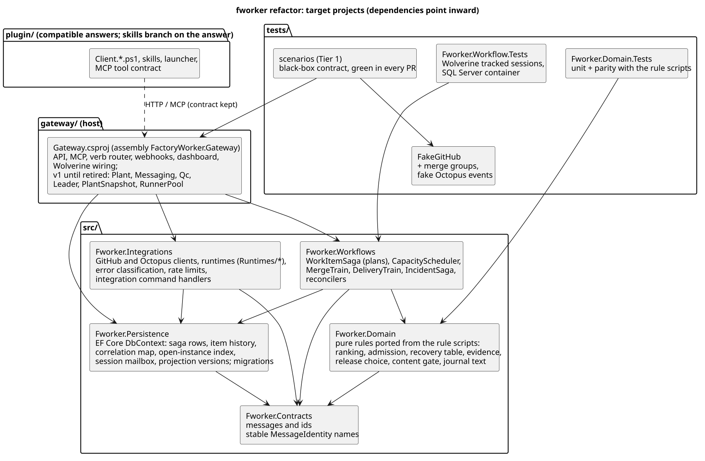
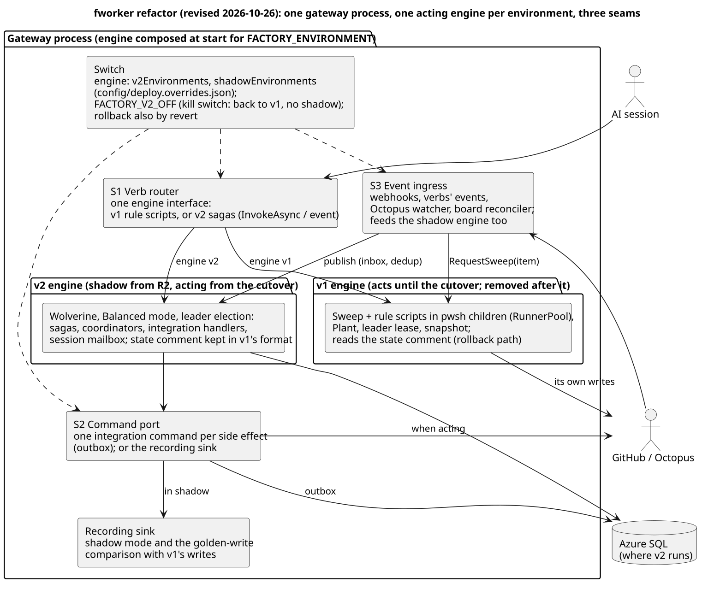
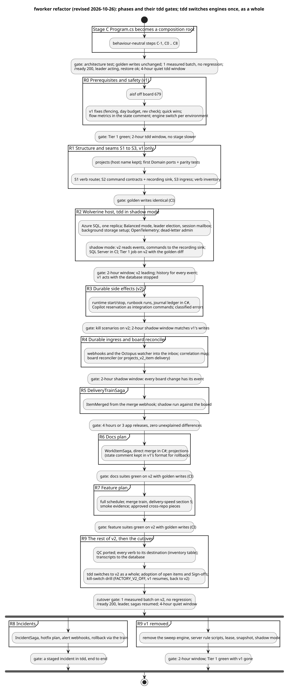

# Refactoring fworker onto Wolverine and sagas, release by release

Status: plan only, 2026-10-25, revised 2026-10-26. Nothing here is built. Asked for by the owner: "How would the existing fworker repo
be refactored and enhanced for this new design with Wolverine and sagas? Make a phased refactoring plan that keeps fworker releases
stable." The target design is `wolverine-factory.md` (sections 2 to 4). This plan takes the fworker gateway as the base (its decision
2, second option) and uses Wolverine directly: the gateway has no messaging seam to keep and no downstream hosts. The delivery-speed
rules (`delivery-speed.md`, merged in #253) are built inside the phases below, once.

**Revision of 2026-10-26** (the owner's decisions; ADR 0001, "Revision 2026-10-26"): uat and prod do not matter for this plan, so
what works in tdd is accepted; green pull requests merge and deploy without approval stops. The v2 engine is built beside v1 as new
projects, held to the same Tier 1 suites and golden-write oracle, and **tdd switches engines as a whole**, once, instead of item by
item. What existed only so that v1 and v2 could share one environment item by item is gone (the `engine:v2` label, the skip and
forward paths, Solo mode on the lease holder, seams S4 to S6, expand and contract for uat's and prod's lag, the per-capability
flags). Gates are tdd observation windows measured in hours. The sequence, the clock-time estimate and the board's changed tasks are in
`fworker-wolverine-implementation.md`.

| View | Source | Rendered |
|---|---|---|
| Target projects | `fwr-projects.puml` | [fwr-projects.svg](diagrams/fwr-projects.svg) |
| One process, one engine per environment, three seams | `fwr-seams.puml` | [fwr-seams.svg](diagrams/fwr-seams.svg) |
| Phases and gates | `fwr-phases.puml` | [fwr-phases.svg](diagrams/fwr-phases.svg) |

## 1. Starting point (origin/master, 2026-10-25)

- **Gateway:** one project, `gateway/Gateway.csproj` (assembly `FactoryWorker.Gateway`, which the Dockerfile's entry point and
  `architecture.yml` name), 14,460 lines of C#: `Program.cs` 3,294 (routes, sweeper, dashboard, verbs), `Plant.cs` 2,267,
  `Messaging.cs` 1,506, `Qc.cs` 875, `Runtimes/` 2,604 (Octopus, Copilot, Cursor, CAE), `Auth`, `Lease`, `Leader`, `PlantSnapshot`,
  `Transcripts`, `BaseUpdate`, `ReleaseQueue`, `Manager`, `Keeper`. Packages: Azure.Identity and ModelContextProtocol.AspNetCore; no
  database, no OpenTelemetry exporter (an `ActivitySource` only).
- **Rule scripts:** 73 server verbs (`factory.ps1 --server <verb>`, run by `RunnerPool` in pwsh child processes), about 6,200 to
  6,800 lines of server-side PowerShell. The rest of `plugin/` (`Client.*.ps1`, skills, launcher) is what workers download.
- **The journal is a rule script:** `Plant.Journal` runs the `journal` verb under the item lock, and `Add-Journal` (called from about
  32 places in the rule scripts) keeps a ledger in the state comment: dedup keys, the 30-line cap, folds by comment id, the
  `waiting_at` rate limit.
- **State:** GitHub (state comments, claim refs, board, snapshot and lease refs, transcripts in the same ref store) and process memory.
- **Events in:** a repository webhook (issues, workflow_run, pull_request, pull_request_review; `create-webhook.sh`). The code accepts
  `projects_v2_item`, but nothing delivers it, so card moves are seen by the sweep.
- **Tests:** `tests/smoke.ps1` (pure rule functions); Tier 1: 29 suites in 30 scenario files, 5,743 checks against `tests/FakeGitHub`,
  the required check of every pull request (`tests.yml`, nine Tier 1 jobs plus "Tests result"; the owner jobs are near their limit).
- **Release:** a green Build of master becomes image and Octopus release `cmdemo1-fworker`. Lifecycle Lifecycles-720 deploys tdd
  automatically; uat and prod are optional phases, promoted by cmdemo1-system's `ui-auto-promote.yml` one environment per 10-minute run
  or by a person (held now, cmdemo1-system#314). uat and prod run releases about 20 behind tdd (last: Releases-50899, 2026-10-21).
  **tdd is the only acting gateway**: it delivers the app to tdd, uat and prod; the uat and prod gateways are inert on the board
  (github-token "unset"). Since 2026-10-26 fworker's own uat and prod are outside this plan.

## 2. Rules that keep every release stable

1. **Tier 1 is the contract, for both engines.** The scenario suites drive the gateway only from outside, so they stay valid while the
   inside changes. Every pull request keeps them green; a phase adds scenarios, never weakens one. From stage C (task C0 of the
   implementation plan) a **golden-write harness** records the fake GitHub's writes per scenario (times, ids, session links
   normalized), so a change can be shown to change nothing. From R2 the same suites also run with the engine set to v2, and v2's writes
   are compared with the same golden baseline; a difference v2 makes on purpose is a line in a reviewed declared-differences file.
2. **Build beside, switch per environment.** v2 is built as new projects inside the same host, not threaded into v1 item by item. The
   host composes one engine per environment at start. Seams exist only where they give the new code its shape (section 4).
3. **One switch per environment.** `config/instance.json` has `engine: { "v2Environments": [], "shadowEnvironments": [] }`, read for
   `FACTORY_ENVIRONMENT`; tdd's value is in `config/deploy.overrides.json`. Flags are baked into the image, so a switch is a release,
   and it merges on green like any other pull request (owner, 2026-10-26). **Rollback** is either a revert of the switch's pull
   request, or the kill switch `FACTORY_V2_OFF=1`, kept in cmdemo1-system's infrastructure code (so a system deploy does not reset it)
   and set by the cmdemo1 session: a new revision in minutes, no image change, the environment back on v1 with no shadow. Until v1's
   code is removed (R9), v2 writes each item's state comment in the format v1 reads (section 4), so **v1 resumes every open item** after
   a rollback; nothing is frozen or handed over item by item.
4. **Additive migrations.** A column or table (Wolverine's included) is dropped only when neither tdd's running release nor the one a
   revert would bring back reads it. uat's and prod's lag no longer constrains it.
5. **The database is required only where v2 runs.** Wolverine is registered only when the environment is in `shadowEnvironments` or
   `v2Environments` and a connection string is configured; storage setup and migrations run in a background task with retries;
   `/ready` never waits on the database (the 49-minute `/ready` outage of 1.0.58). An environment on v1 runs as today, with or
   without a database, which is what the kill switch relies on. In an environment on v2 the database is required and the health
   check says so.
6. **One acting engine per environment.** In shadow mode (R2 to R5, tdd) v1 acts and v2 only reads: its commands go to a recording
   sink, never to GitHub or Octopus. From the cutover (R9) v2 acts and v1 does not run. No item carries an engine label.
7. **Agents see compatible answers.** The verbs' request and answer shapes stay the same. Changes to what agents are told (R0's
   "stay connected while checks run", R7's 5.1 texts) are explicit, measured steps. Every session downloads the same skills, so a
   skill branches on the **answer** it gets (exit 21 or `continue: true`), never on the engine.
8. **Wolverine's own leadership from the start.** v2 runs in Balanced mode with Wolverine's leader election and the session mailbox
   from R2, as `wolverine-factory.md` 2 and 4.8 assume; the coordinators listen globally partitioned. v1's lease and snapshot belong to
   v1 and leave with it. While a new revision's node joins, v2 decision verbs answer exit 20 with `retryAfterSeconds`, as other verbs
   do when they cannot act yet.
9. **The usual path:** small pull requests, the pre-commit review, merge on green and release to tdd without an approval stop; each
   phase's gate is a tdd observation window measured in hours (implementation plan section 1, rule 6), or CI alone where v2 does not
   act yet.
10. **Declared deviations from `wolverine-factory.md`:** none of the earlier three remain (Solo mode on the lease holder, the session
   mailbox only at R9, v1's side effects through the outbox). Shadow mode is now part of its migration (its section 6).

## 3. Target structure

| Project | Content | Comes from |
|---|---|---|
| `src/Fworker.Contracts` | message records with stable `[MessageIdentity]` names, ids, the integration-command contracts (S2) | new |
| `src/Fworker.Domain` | pure rules: ranking, admission, recovery table, evidence composite, release choice, content gate, docs-only test, journal text | the rule scripts' pure functions, with parity tests |
| `src/Fworker.Persistence` | EF Core `DbContext`: saga rows, item history, correlation map, open-instance index, session mailbox, projection versions; migrations | new |
| `src/Fworker.Integrations` | GitHub and Octopus clients, runtimes, error classification, rate limits, integration command handlers (they write the correlation map and projection versions), the recording sink | `gateway/Runtimes/*`, the rule scripts' GitHub calls |
| `src/Fworker.Workflows` | `WorkItemSaga` and plans, `CapacityScheduler`, `MergeTrainSaga`, `DeliveryTrainSaga`, `IncidentSaga`, reconcilers | new, replacing `Verbs.*` |
| `gateway/Gateway.csproj` (name and assembly kept) | host: API, MCP, verb router, webhooks, dashboard, Wolverine wiring; v1 until R9 | today's gateway |
| `tests/Fworker.Domain.Tests`, `tests/Fworker.Workflow.Tests` | unit and parity tests; Wolverine tracked sessions against SQL Server | new |
| `tests/scenarios`, `tests/FakeGitHub` | Tier 1 with the golden-write harness, run for either engine; the fake gains merge groups and Octopus events | today's |

The Dockerfile copies `src/` too.

## 4. The seams

Three seams stay, because each gives the new code its shape, not because two engines share an item:

| Seam | Today | Behind it in v2 | Why it stays |
|---|---|---|---|
| **S1 verb router** | `VerbPipeline` (stage C) runs the verb's rule script through `RunnerPool` | one engine interface composed per environment: v1's rule scripts, or v2's sagas by `InvokeAsync` (decision verbs) or a published event (event verbs) | the agents' contract in one place; Tier 1 runs either engine |
| **S2 command port** | none in v1 (side effects inside rule scripts and `RuntimeManager`) | one integration command per external side effect, through the outbox; results come back as messages (`SessionStarted(execution, url)`, `StartFailed(reason)`); or the **recording sink** | idempotent, classified side effects; shadow mode and the golden-write comparison read the sink |
| **S3 event ingress** | webhook routes and the verbs' `RequestSweep` | the inbox, deduplicated on the delivery id and business keys, resolved through the correlation map | one entry for every event; in shadow mode it feeds v2 too |

And one compatibility contract: **v2 writes the state comment in the format v1's `Get-State` reads,** as a versioned projection (R6),
until v1's code is removed. It is what makes a revert or `FACTORY_V2_OFF` safe.

Dropped: S4 as a seam in v1's code (the state comment is v2's projection instead), S5 timers (v2's are scheduled messages; v1 keeps
its own), S6 the loopback route (no rule script asks v2 for anything), and returning posted journal lines from rule-script answers.

## 5. Phases

**Before R0: stage C** (`gateway-composition.md`, owner's decision of 2026-10-26). `Program.cs` becomes a composition root,
behaviour-neutral step by step, and is stabilised before R0 starts: the architecture test green, golden writes unchanged, one measured
batch in tdd with no regression against the 2026-10-25 baseline, `/ready` 200 with the leader acting and the plant restored after
each release, and a 4-hour quiet tdd window (implementation plan section 3 gives the reasons for 4 hours).

Sizes are relative; the implementation plan gives clock time (about 61 hours in all, from about 3 hours for a phase's coding plus its
window).

### R0. Prerequisites and safety (M)

- **Prerequisites** (outside the repository): cmdemo1-aisf stops acting on board 679 (a kit watcher change through Platform Hub).
- **v1 safety fixes**, which matter while v1 acts in tdd and releases restart it several times an hour: `delivery-speed.md` 18.1.1
  (lease checks inside running sweeps, `Plan` and `Provision`), 18.1.4 (the day budget), the `rev` check of 18.1.2. 18.1.3 (budgets
  into the item state) is v2's by design (R6). No per-fix flags.
- **Delivery-speed quick wins:**
  - replenish backpressure, the ranking, plan on slot freed;
  - for the exit-21 texts, only "stay connected while checks run", because v1 follows `awaiting_checks` in Development only
    (Verbs.Sweep.ps1:687-697); 5.1 as a whole ships with section 5 in R7.
- **Flow metrics** as `delivery-speed.md` 13 and 18.2 define them: one timestamp per stage in the state comment, not read from the
  capped journal. They measure every later batch, the cutover's included.
- **The engine switch** (`engine`) and the `FACTORY_V2_OFF` reader, both inert until R2.
- The golden baseline re-recorded at R0's gate.
- **Gate:** Tier 1 green; a 2-hour tdd window with board activity, flow timestamps on every item that moved and no stage median more
  than 5 minutes slower than the 2026-10-25 baseline.

### R1. Structure and seams, v1 only (M; no behaviour change)

- The projects of section 3 (names of the host kept); `Fworker.Domain` gets its first ports (ranking, journal text; the recovery table
  is lane D's D5) with parity tests that run the rule scripts' pure functions on the same inputs.
- S1 to S3 (section 4): S1 with only v1 behind it, S2 as contracts and the recording sink, S3 in front of today's webhooks and
  `RequestSweep`.
- The verb inventory of R9 is written here, with an owner for each of the 73 verbs.
- **Gate:** Tier 1's golden writes are identical before and after (CI).

### R2. The Wolverine host, in shadow mode (M)

- **Infrastructure:** an Azure SQL database for the tdd gateway, provisioned rather than serverless (Wolverine polls every few
  seconds and would keep a serverless database awake), managed identity, no secret; at least one replica.
- **Packages:** WolverineFx, WolverineFx.SqlServer, WolverineFx.EntityFrameworkCore, WolverineFx.Http (dead-letter endpoints),
  Microsoft.EntityFrameworkCore.SqlServer, OpenTelemetry and the Azure Monitor exporter; all pinned.
- **Host:** Balanced mode with Wolverine's leader election and the session mailbox (rule 8), registered only for a v2 or shadow
  environment with a connection string, storage set up in the background (rule 5), OpenTelemetry, the dead-letter admin page.
- **Shadow mode:** tdd joins `shadowEnvironments`; v2 reads S3's events, decides, writes its history, and sends its commands to the
  recording sink; a report compares them with v1's writes.
- **CI:** SQL Server as a service container in the Tier 1 jobs and for `Fworker.Workflow.Tests`; the v2 Tier 1 job with the golden
  diff (rule 1); the owner jobs split once more to stay within their time limit; a check that the image starts and turns ready with no
  connection string (the kill switch's case).
- **Gate:** a 2-hour tdd window: v2's node leading, a history row for every ingress event, and a 10-minute database stop during which
  v1 acts and `/ready` stays 200. (Was 7 days: shadow mode writes nothing outside, and what can fail here shows within minutes.)

### R3. Durable side effects for v2 (M)

- S2's integration commands for runtime start and stop and runbook runs (with result messages), for the journal (`Add-Journal`'s
  ledger ported to C#, golden-identical), and for the Copilot launch reservation; error classification and rate limits
  (`wolverine-factory.md` 4.4). v1's own side effects stay as they are.
- **Gate:** the kill and restart scenarios and the journal-fold and octopus suites green on v2 (no lost or duplicated line, start or
  stop across a kill); a 2-hour shadow window in tdd in which every recorded command has its counterpart in v1's writes, or a
  declared difference.

### R4. Durable event ingress and the board reconciler (S)

- S3 publishes every webhook and verb event to the inbox; a C# Octopus watcher publishes releases and deployments; the correlation map is
  filled from verbs, runtimes and the watcher.
- Card moves: an organization webhook or App delivery of `projects_v2_item` (an admin action for the owner), or a **board reconciler**
  (a Wolverine recurring job comparing the board with the item states) that publishes card-move events. The reconciler is built here
  either way, as the safety net.
- **Gate:** a 2-hour shadow window in tdd with board activity: every board-relevant change has its event in v2's history.

### R5. DeliveryTrainSaga (M to L)

- The train for the app's tdd, uat and prod, driven by the tdd gateway: candidates, today's evidence (version, Healthy reads, settle),
  the newest qualifying release per environment, Sign-off answers, due timers.
- **Inputs:** `ItemMerged(commit, gates)` is derived from the merge webhook and the reconciler, with the per-item gates (Auto Merge,
  Hold, merged by the gateway after a PASS, demo video published) read from the item; v1 emits nothing.
- **Shadow run:** the train decides and logs in tdd against the board while v1 promotes. It acts from the cutover (R9), which adopts any
  pending Sign-off; there is no separate switch while v1 acts.
- The smoke runbook and the other cross-repo pieces of `delivery-speed.md` 9 to 11 join in R7, after their owner decisions.
- **Gate:** a tdd shadow run of 4 hours or 3 app releases, whichever ends later, with zero unexplained differences. (Was 3 shadow
  releases and a batch to prod.)

### R6. WorkItemSaga on the docs plan (L)

- **The saga:** the docs plan, decision verbs through S1 by `InvokeAsync`, the recovery policy, generation and arm ids, `NotFound` on
  every message, the budgets (failures, launches, `idleFollowUps`) in its state.
- **Merging:** the **direct strategy** in C# in `Fworker.Integrations` (the squash merge with the PASS head as `sha`, the
  mergeability wait, the branch update and the out-of-date retries of `Verbs.Merge.ps1`).
- **Projections:** the board, labels and state comment as versioned projections with echo suppression; the state comment in v1's
  format (section 4).
- **Views:** the dashboard, `/api/v1/status` and the patrol digest read the history on the v2 engine, grouped by repository.
- **No per-item routing:** no `engine:v2` label, no separate runtime for v2 items, no skip or forward paths in v1. Which items take the
  docs plan is the saga's choice at start, on the v2 engine.
- **Gate:** the docs-plan suites green in the v2 Tier 1 job with golden writes (CI). (Was 8 docs items to Done on v2 beside v1.)

### R7. The feature plan (L)

- The full `CapacityScheduler` owns the v2 ledger: slot freed on `SessionEnded`, host headroom, docs-only overflow
  (`delivery-speed.md` 4, after the owner's overflow decision).
- The feature plan: section 5 of `delivery-speed.md` as a whole (Functional Testing with CI alongside, the 5.1 answer texts), the
  file-overlap hold decided inside the invoke, recovery.
- `MergeTrainSaga` for the v2 engine. v1 keeps its own merge until it is removed. The merge queue, `merge_group`, the ruleset and the
  kit's `release.yml` change come in only after their owner approvals (`delivery-speed.md` 9, 10, 15).
- The smoke runbook and `[Category("Smoke")]` in cmdemo1-workorders join the train's evidence (`delivery-speed.md` 11).
- **Gate:** the feature-plan suites green in the v2 Tier 1 job with golden writes (CI). (Was an 8-item code batch to prod on v2.)

### R8. Incidents, after the cutover (M)

- `IncidentSaga` and the hotfix plan in the tdd gateway, watching the app's three environments; the Azure Monitor alert webhook; rollback
  as a command to the DeliveryTrain; the factory's own failures alerted out of band (`wolverine-factory.md` 3.3).
- It comes after R9's cutover: incidents are a new capability with nothing in v1 to compare with, and they need v2 acting.
- **Gate:** a staged incident in the app's tdd, rolled back or fixed end to end.

### R9. The rest of v2, the tdd cutover, then v1 removed (L)

- **The rest of v2:** QC environments and the QC gate ported (`Qc.cs`, `Qc.ps1`); every verb to its destination:

| Verbs | Become |
|---|---|
| `get-item`, `append-body`, `comment`, `claim-item`, `accept`, `release`, `my-items`, `record-review`, `move-next`, `complete`, `validation-verdict`, `open-pr`, `update-pr`, `item-pr`, `park-item`, `unpark-item`, `resettle-item`, `expire-claim` | WorkItemSaga (decision verbs by `InvokeAsync`, event verbs published) |
| `pr-checks`, `wait-for-checks`, `inspect-facts`, `get-delivery`, `model-tier`, `check-secrets` | read models over the history and the integrations |
| `approve-pr`, `merge`, `clear-hold`, `base-watch`, `base-update-branch` | MergeTrainSaga and its integration commands |
| `settle`, `publish-demo`, `ci-release`, `copilot-settle`, `copilot-owner`, `private-build` | DeliveryTrainSaga and the runtime integrations |
| `sync-board`, `ingest-event` | the board reconciler and S3 ingress |
| `journal` | the history plus the projection |
| `qc-*` (14 verbs) | a QC service with its own saga per environment |
| `backlog`, `amend-criteria`, `split-item`, `create-item`, `set-priority`, `link-dependency`, `manager-action` | keeper and manager commands to the sagas |
| `revocations`, `revoke-worker`, `git-credential` | C# services in the gateway (revocations keeps gating `/ready`) |
| `operator-releases`, `operator-release`, `metrics` | C# services and read models |
| `transcript-save`, `transcript-load`, `transcript-prune` | transcripts move to the database before the ref store goes |
| `plant-snapshot-save`, `-load`, `-clear`, `-await`, `leader-lease` | removed: Wolverine leader election and durable state replace them |

- **The cutover:** with every Tier 1 suite green on v2, tdd moves to `v2Environments`. On its first start v2 adopts every open item
  from its state comment and claim refs, and every pending Sign-off (idempotent). Before the measured batch, a kill-switch drill: set
  `FACTORY_V2_OFF`, v1 resumes the items, unset it, v2 adopts them again.
- **Cutover gate:** one measured 8-item batch on v2 with no regression against the 2026-10-25 baseline; `/ready` 200, v2's node leading
  and every open saga resumed after each release; a 4-hour quiet tdd window with the batch inside.
- **Then v1 is removed:** the sweep engine, the server rule scripts, the lease, the snapshot, `RunnerPool` and `runner-host.ps1`
  (workers run their scripts on their own machines), shadow mode and the v1 side of S1; the sweep remains only as the board
  reconciler. No item is drained: there is no `engine:v1` item. Rollback from here is a revert of the removal.
- **Gate:** the release check and a 2-hour tdd window after the removal; Tier 1 green with v1 gone.

## 6. Environments

The tdd gateway is the only acting gateway, so every v2 capability is exercised there. It also delivers the app to its uat and prod
and watches them for incidents; that is the app's delivery, which v2 takes over at the cutover. fworker's own uat and prod gateways are
outside this plan (owner, 2026-10-26): no gate waits on them and nothing here promotes to them.

| `engine` | tdd gateway |
|---|---|
| v1, no shadow | through R1; again whenever `FACTORY_V2_OFF` is set |
| `shadowEnvironments: [tdd]` | R2 to R9's cutover: v1 acts, v2 reads and records |
| `v2Environments: [tdd]` | from the cutover: v2 acts, with every capability at once; R8 adds incidents |

**Moving the acting role** (`activate-prod.sh` makes the prod gateway act): the board's database moves with it, one database per board
as in `wolverine-factory.md` 2, so the saga rows follow the board. It is not part of this plan.

## 7. Decisions and actions for the owner

Since 2026-10-26 no pull request of this plan waits for an approval; what remains is outside the repository or a policy:
1. **The base:** the fworker gateway (decision 2 of `wolverine-factory.md`, second option); the plan proceeds on it, and ADR 0001 stays
   Proposed until the owner accepts it. cmdemo1-aisf off board 679 first (R0).
2. **System changes** (the cmdemo1 session): Azure SQL for the tdd gateway and at least one replica (R2); `FACTORY_V2_OFF` in
   cmdemo1-system's infrastructure code, unset (R2).
3. **`projects_v2_item` delivery:** an organization webhook or App (admin), or rely on the board reconciler (the default).
4. **The delivery-speed decisions R7 can use:** the merge queue ruleset, the workorders pipeline changes, the kit's `release.yml`, the
   uat settle, and overflow for docs-only items. Each is optional; without an answer R7 keeps today's behaviour.
5. **The incident rollback policy** in the app's prod (R8); until answered, automatic in the app's tdd and uat and a person's Sign-off
   in its prod.
6. **For the system-level gateway** (`system-gateway.md`): the catalog comes from cmdemo1-system's `system.json` and the split of
   `Depends on` between repositories was confirmed (both 2026-10-25); open are the `system.json` fields (kit and cmdemo1-system) and
   the gateway's read access to cmdemo1-system.

No longer asked: the packages, the protected paths (Dockerfile, `deploy.overrides.json`) and SQL Server in CI merge on green after the
reviewer subagent; `ui-auto-promote`'s application paths and cmdemo1-system#314 concern fworker's uat and prod only.

## 8. Forward compatibility with a system-level gateway

The owner wants the gateway to work items in any of the system's repositories later (`system-gateway.md`). v1 stays
home-repository-only until R9 and v2 is repository-aware from its first line; the hooks H1 to H12 are built inside these phases:
- the board reading (shipped early as defect C-1) and R0: the `Depends on` parser ignore other repositories;
- R1: the system catalog, the `ItemId` contract, the token's repository claim, and the isolation scenarios with a second repository;
- R2: qualified ids in the schema and partition keys;
- R3 and R4: integrations per repository, budgets per credential, a secret per hook source, business-key deduplication;
- R5: delivery trains per deployable with the delivered-to table and the `dependencies-delivered` slot, and policy per deployable;
- R6: merge policy, the WIP intake rule and the views per repository;
- R7: toolchain admission and runtime capabilities;
- R8: the IncidentSaga keyed by (deployable, environment);
- R9: QC keyed by (repository, pull request), and the transcript table with the qualified item.
With one repository configured, each hook behaves exactly like today. The catalog comes from cmdemo1-system's `system.json`
and the split of `Depends on` between repositories is confirmed (owner, 2026-10-25).

## 9. Risks

- **A subtle difference in a ported rule:** parity tests per rule function, the golden-write oracle for both engines, shadow mode
  against the real board for ingress and the delivery train, and Tier 1 as the black-box check.
- **All or nothing per environment:** the cutover moves every item and capability at once, so a defect v2's Tier 1 run and the
  shadow windows did not catch reaches every item in tdd. The answer is fast rollback: `FACTORY_V2_OFF` or a revert, with v1 resuming
  every item from the state comments v2 keeps in v1's format, rehearsed in the cutover's drill. Accepted by the owner: tdd is the
  only environment in scope.
- **Work items in flight at the cutover:** v2's adoption from state comments and claim refs is idempotent and drilled before the
  measured batch; a Sign-off pending at that moment is adopted, not answered twice.
- **The database as a new dependency:** required only where v2 runs; the kill switch returns tdd to a v1 that needs none.
- **CI time:** SQL Server in the Tier 1 jobs and the v2 Tier 1 job; the jobs are rebalanced in R2.
- **Wolverine's pace and single maintainer:** pinned versions, each upgrade its own pull request with the full suites.
