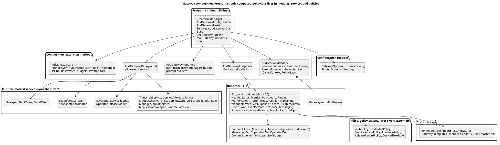

# Program.cs as a composition root: separating wiring from runtime behaviour

Status: design, 2026-10-26. Nothing here is built. Asked for by the owner: "Program.cs being over 1000 lines of code is a problem. This
tells us that there are patterns and responsibilities that shouldn't belong to the class that wires up dependencies to prepare to
start. we need to identify responsibilities that can be refactored out of Program.cs - especially separating logic used to configure
dependencies from code that actually is active at runtime", then "Program.cs refactoring has to be first and stabilized before
enhancement plan commences." It is **stage C** of `fworker-wolverine-implementation.md`: done first, stabilised by a gate, and only then
does the enhancement plan (W0 onward) start. It is the ground the seams of ADR 0001 are built on.



## 1. What Program.cs holds today (origin/master, 3,294 lines)

Top-level statements run from line 1 to `app.Run()` at 2494; lines 2496 to 3294 are classes that live in the same file.

| Responsibility | Lines | Where |
|---|---|---|
| A. Configuration reading (environment variables, `instance.json` readers, settings `Load` calls) | 137 | 15-117, 450-483 |
| B. Composition (builder, construction, DI registrations, wiring after `Build()`) | 277 | 118-248, 252-279, 943-946, 1888-1895, 2256-2271, 2365-2432, 2488-2495 |
| C. Bare route mappings | 18 | 654-670, 768-769, 2254 |
| D. **Endpoint handler logic** (52 production routes, 16 test hooks) | **1,357** | 671-2253 |
| E. **Background work** (`Task.Run` loops, snapshot, leader, revocations, CI release, owner watch, manager ticks, MCP sweep; classes `Sweeper`, `PlantTicker`, `EventHub`) | **621** | 249, 280-554, 1896-1915, 2272-2353, 2433-2493, 2559-2880 |
| F. Business rules outside handlers (`RevokeName`, `DerivedText`) | 50 | 925-942, 1451-1482 |
| G. **Static content and prompt builders** (the dashboard's CSS, HTML and JS; prompt text with logic) | **457** | 2445-2487, 2881-3294 |
| H. Helpers (49 local functions; class `Runner`) | 259 | spread |
| I. Middleware and admission | 78 | 577-653 |
| J. Lifetime hooks (4 `ApplicationStopping.Register` calls at 250, 251, 301, 415; 12 uses of `ApplicationStopping` in all) | 40 | 240-251, 298-311, 413-432 |

More rules hide inside the handlers (about 175 lines in the verbs handler alone: the refusal table, keeper rules, the supervisor step
budget repeated in three handlers, manager-action pre- and post-run rules, the GitHub budget gate, the after-run plant hooks), plus the
credential role rules, metrics access rules, presence validation and record-release limits.

**What binds it together:** about 70 top-level locals captured by closures. Some are **written after `Build()`**:
- the late-bound prompt functions (`cursorPrompt`, `copilotPrompt`, `copilotItemPr`), which exist only because `PromptStore` and `app`
  are created later;
- `managerCopilot` and `mcpSessionsRef`, null until the end of the file;
- ten `Plant` properties set after the container is built (`OnRenew`, `OnTakeBack`, `RequestSweepAfterTakeBack`, the runtime hooks);
- the snapshot and revocation fields.
Process-wide statics are written from Program.cs too: `Auth.Environment`, `Auth.LegacyKinds`, `Auth.Keeper`, `GatewayMcp.Tools`, the
runtimes' `QuotaBlock`.

## 2. The target

`Program.cs` only composes and starts, about 40 lines:

```csharp
var builder = WebApplication.CreateBuilder(args);   // keeps today's content root
builder.AddGatewayConfiguration();      // options from the environment and instance.json (section 3, A)
builder.AddGatewayHosting();            // Kestrel ports, logging, forwarded headers, process diagnostics
builder.Services
    .AddGatewayCore()                   // Runner, EventHub, Plant, Messenger, QcHub, BaseWatch, budgets, prompts, transcripts
    .AddGatewayIdentity()               // Revocations, RuntimeNonces, token minting, admission
    .AddGatewayRuntimes()               // the runtime registry and its managers
    .AddGatewayBackground()             // every hosted service (section 3, E)
    .AddGatewayMcp()
    .AddGatewayEndpoints();             // endpoint modules (section 3, D)
var app = builder.Build();
app.UseGatewayPipeline();               // forwarded headers, the gateway's auth middleware
app.MapGatewayEndpoints();              // each module maps its own routes
app.Run();
```

**Rules of the target:**
1. **No behaviour in Program.cs:** no handler body, no loop, no `Task.Run`, no `ApplicationStopping` hook, no business rule, no string
   content. An architecture test fails the build if Program.cs has more than 60 lines or contains `Task.Run`, `while`, `MapGet(`/`MapPost(`
   with a lambda body, or `"""`.
2. **No captured mutable state.** Every piece of shared state has one owning class, injected where it is needed.
3. **No wiring after `Build()`.** Collaborators are constructor parameters; ordering problems are solved by registration, not by
   late-bound delegates or property setters.
4. **Route patterns unchanged.** `InProcess` (MCP) finds eight endpoints by `RoutePattern.RawText` (`/api/v1/status`,
   `/api/v1/metrics`, `/api/v1/messages` GET and POST, `/api/v1/messages/{id}`, `/api/v1/digest`, `/api/v1/questions`,
   `/api/v1/supervisor/patrol-ack`, `/api/v1/verbs/{verb}`); a test pins them, and modules map full patterns (no `MapGroup` prefix for
   these). Guards move only into endpoint filters, never into middleware or ASP.NET authorization: `InProcess` (`Mcp/InProcess.cs`) calls `RequestDelegate` directly; a test makes one in-process call per pinned pattern.

## 3. Where each responsibility goes

### A. Configuration → options

| Today | Becomes |
|---|---|
| environment variables 15-26 (`scriptsDir`, `apiToken`, `webhookSecret` (`FACTORY_WEBHOOK_SECRET`, 18), `tokenSecret`, `ownerMode`, environment, public URL, SSE ping, sweep seconds) | `GatewayOptions`, bound once |
| ports 120-126 (`FACTORY_API_PORT`, `FACTORY_WEBHOOK_PORT`, `FACTORY_SINGLE_PORT`) | `GatewayOptions` (hosting) |
| `instance.json` readers 30-108 (`TimingNumber`, `TimingValue`, `AckSeconds`, `OneItemPerSession`, `IntakeColumnOf`, `ConfigBool`; the file path expression repeated seven times) | `InstanceConfig` (one reader, one path) and `TimingOptions` |
| `QcSettings`, `MessagingSettings`, `KeeperSettings`, `LeaderSettings`, `BaseUpdateSettings`, `LeaseSettings`, `HostSettings`, `ManagerActionSettings`, `ManagerCopilotSettings`, `RuntimeSettings`, cloud runtime settings | registered as singletons by their `Load`, not held as locals |
| `GitHubConfigured`, `Unset`, revocation settings 450-483 | `RevocationOptions` |

### B. Composition → `AddGateway*` extension methods

| Today | Becomes |
|---|---|
| construction and registrations 118-248 | `GatewayServiceCollectionExtensions` per area |
| the late-bound prompt functions (171, 184, 185) | `ICopilotPromptBuilder`, `ICursorPromptBuilder`, `IItemPrLookup` services; `PromptStore` registered first |
| Plant properties set after `Build()` (255, 262-277, 2380-2382, 2410-2412) | an `IPlantHooks` collaborator (implemented by `PlantRuleHooks`, which calls the rule scripts) passed to `Plant`'s constructor |
| `Revoke = RevokeName` on each manager (943-946) | managers take `IRevocationService` |
| four runtime adapters and managers as nullable locals | a `RuntimeRegistry` (all configured managers, by kind) |
| Copilot and Cursor wiring 2365-2417 | one `CloudOwnerWatch` per cloud runtime; its options carry the differences: interval (`CiReleaseSeconds` against `OwnerWatchSeconds`), master fixer and `OverBudget` (Copilot only), `LoadOwner`'s runtime test (inverted), `Ending`'s head (`HeadOf` against null) |
| `OwnerVerb` (2294-2299) | `CopilotOwnerVerbs` |
| `CopilotSettle` (2356-2364) | `CopilotSettleClient`, a runtime constructor parameter |
| `new InProcess(app, Admit)` after `Build()` (2488) | `InProcess` resolves endpoints through `EndpointDataSource` |
| `ManagerCopilot` constructed late (2418-2432) | registered normally; null-object when disabled |
| statics `Auth.Environment/LegacyKinds/Keeper`, `GatewayMcp.Tools`, `QuotaBlock` | injected options and services (last step, section 5 P8) |

### C and D. Endpoints → endpoint modules

One class per area implementing `IEndpointModule { void Map(IEndpointRouteBuilder routes); }`, handlers as methods with services
injected by the framework. **Cross-cutting guards become endpoint filters** (`IEndpointFilter`): `MessagingOff`, `SupervisorOff`,
`OperatorOff`, owner mode, admin and admin-or-operator, and the supervisor step budget (written three times today).

| Module | Routes (lines today) |
|---|---|
| `HealthEndpoints` + `BuildInfo` (`buildVersion`, `started`) | /health, /alive, /ready, /, /_build (656-670) |
| `StatusEndpoints` + `StatusQuery` | /api/v1/status, /api/v1/dashboard (aggregation of about 28 subsystems moves to `StatusQuery`), `MessagingBlocks`, `RuntimesBlock` |
| `MetricsEndpoints` + `MetricsCache` | /api/v1/metrics (708-767) |
| `DashboardEndpoints` | /dashboard page (static files, G) |
| `PluginEndpoints` + `PluginArchive` | /api/v1/plugin (434-447, 770-792) |
| `WorkerAdminEndpoints` | credential, revoke, runtimes reset, base-update, promotion-request, workers/{name}/{action} |
| `RuntimeHostEndpoints` | octopus desired and report, runtime/redeem, build-slot (951-970, 1302-1320, 1635-1651) |
| `CopilotEndpoints` | copilot exchange, bootstrap-token, /fworker-mcp.mjs (1237-1270) |
| `TranscriptEndpoints` | runtime/transcript, api sessions, /sessions page (1271-1300) |
| `WebhookEndpoints` | /webhooks/github (972-1015), with `seenDeliveries` in a `WebhookDeduplicator` |
| `VerbEndpoints` + **`VerbPipeline`** | /api/v1/verbs/{verb} (1017-1235): the pipeline is seam S1 of ADR 0001 |
| `ItemAdminEndpoints` | manager actions and mode, unpark, resettle (1322-1391); the exit-to-HTTP mapping written four times becomes one `RuleScriptResult` helper |
| `DemoEndpoints` | demo upload (1393-1450) |
| `WaitEndpoints`, `EventStreamEndpoints` + `SseStreams` | wait, events SSE and its operator, keeper and supervisor streams (1483-1630, 2170-2246) |
| `PresenceEndpoints` | presence (1655-1702) |
| `MessagingEndpoints` | peers, messages, inbox, ack (1724-1805) |
| `SupervisorEndpoints` | questions, answer, digest, patrol, budget, messaging/{action} (1806-1887) |
| `OperatorReleaseEndpoints` | release-check, record-release (1924-1958) |
| `TestHookEndpoints` | the 16 `_test` routes (1959-2169), registered only when `TestHooks` is on |
| `QcEndpoints`, `McpEndpoints` | today's `qc.Map(app)` and `MapMcp` |

**Request helpers:** `ICallerContext` (scoped: `Who`, `Admitted`, `OperatorActive`, `By`, `SessionLinkOf` 561-575) and `PublicBase`
(singleton: `seenBase`, `LinkBase`, `NoteBase`, 146-147 and 622-629) are created in C6; only the static helpers (`Fail`, `ReadBody`,
`Refuse`, `AsResult`, `ParseCursor`, `FixedEquals`) go to `HttpResultsX` in C3.

### E. Background work → hosted services that own their state

| Today | Becomes | Owns |
|---|---|---|
| `Task.Run(transcripts.Loop)` + flush on stop (249-250) | `TranscriptService : BackgroundService` | the transcript store's save loop and final flush |
| snapshot restore, save, debounce, hand-over (280-412, 516-554), leader start | `LeadershipService` and `SnapshotCoordinator` | the lease, `MayAct`, `plantRestored`, the snapshot fields, `snapshotState` (exposed read-only to status) |
| revocations read loop (484-515), `RevokeName` (925-942) | `RevocationService` (loader as hosted service) | `Loaded`, `Status()`, `RevokeAsync`: replaces about ten locals |
| operator releases load (1896-1915) | `OperatorReleaseLoader` | `Loaded` |
| Copilot CI release (2272-2292) | `CopilotCiReleaseService` | |
| owner watch ×2 (2300-2353) | `CloudOwnerWatch` (one per cloud runtime) | the master-fix prompt moves to an embedded template |
| ManagerCopilot tick (2433-2444) | `ManagerCopilotService` | |
| MCP session sweep (2493, `while(true)` with no cancellation) | `McpSessionSweeper` | with the stopping token |
| classes `Sweeper`, `SweepGap`, `PlantTicker`, `EventHub`, `Runner` at the end of Program.cs | their own files, unchanged | |

Gate on `ILeadership.MayAct`: `TranscriptService`'s save loop, `CopilotCiReleaseService`, `CloudOwnerWatch`, `ManagerCopilotService`,
`Sweeper`, `PlantTicker`. Never gated: the revocation loader (the leader's start awaits `revocationsLoaded`, 526),
`OperatorReleaseLoader`, `McpSessionSweeper`. The hand-over (415) and the transcript flush (250) stay `ApplicationStopping` callbacks,
registered by their owning services; `StopAsync` runs later, after Kestrel's drain, under `HostOptions.ShutdownTimeout`. A start-up test
pins their order (callbacks run last-registered first, so the hand-over runs before the flush) and that both fit the platform's 30 s grace.

### F. Rules → policy classes, ready for `Fworker.Domain`

`VerbPolicy` (refusal table, keeper and supervisor rules, manager-action pre- and post-run rules), `CredentialPolicy`,
`MetricsAccessPolicy`, `PresencePolicy`, `ReleaseRecordPolicy`, `DerivedTextRule`. Pure, unit-tested in C8; whether they later move into `src/Fworker.Domain` is decided when
lane D starts.

### G. Static content → files

The dashboard becomes an embedded resource served with `text/html; charset=utf-8`; `wwwroot` is not used, since Tier 1 runs the build
output in Production (`tests/scenarios/lib.ps1:42`). The prompt builders (2445-2487), the connect prompt and the master-fix prompt are
logic plus text: their text goes to embedded templates in `gateway/Templates/`, not `prompts/` (otherwise `PromptStore` would parse and
hash them, changing `/_build`'s `promptsHash`, files without front matter would become load errors, and the text would be served through
`get_prompt`). A test pins each rendered text.

### I. Middleware → a class

`GatewayAuthMiddleware` (port split, replaced process, bypasses, authentication, revocation wait, MCP role gate) and `AdmissionService`
(`Admit`, also handed to `InProcess`).

## 4. Patterns used

- **Composition root:** one place builds the object graph; nothing else news up services.
- **Options pattern** for configuration; settings validated at start.
- **Module registration:** `AddGateway*` extension methods and `IEndpointModule`, so an area is added or removed as one unit.
- **Endpoint filters** for cross-cutting guards instead of copies in each handler.
- **Hosted services** (`BackgroundService`) for every loop: owned lifetime, cancellation; stopping callbacks owned by their service.
- **State owners:** each piece of shared mutable state has one class with a narrow interface (`IRevocationService`, `ILeadership`,
  `ISnapshotCoordinator`).
- **Policy objects** for rules, separated from HTTP.
- **Static content as embedded resources.**

## 5. Sequence (each pull request behaviour-neutral, proven by Tier 1 and the golden-write harness)

The tasks C0 to C8 of the implementation plan, section 3, carry these steps out (P1 is C1, P2 is C2, and so on; C0 first builds the
safety net of section 6, and C7 is split into C7a to C7d). The stabilisation gate there ends the stage.

| Step | Content | Lines out of Program.cs | Parallel with |
|---|---|---|---|
| P1 | move the classes after `app.Run()` (`Runner`, `EventHub`, `PlantTicker`, `Sweeper`, `SweepGap`) to their own files | about 385 | P2 |
| P2 | dashboard and connect prompt as embedded resources | about 414 | P1 |
| P3 | configuration: `GatewayOptions`, `InstanceConfig`, `TimingOptions`; static helpers only to `HttpResultsX`; `GatewayLeader` registered as `ILeadership` | about 250 | after P1 |
| P4 | state owners, one pull request each: `RevocationService`; `OperatorReleaseLoader`; `TranscriptService`; then `LeadershipService` with `SnapshotCoordinator` (largest, alone) | about 450 | revocations and transcripts together, operator releases after revocations; the fourth after all three |
| P5 | composition: `AddGateway*` methods; `IPlantHooks`; prompt builders instead of late-bound functions; `RuntimeRegistry`; `CloudOwnerWatch`; `ManagerCopilotService`; `McpSessionSweeper` (four pull requests, C5a to C5d) | about 400 | after P4 |
| P6 | `GatewayAuthMiddleware` and `AdmissionService`; `ICallerContext`, `PublicBase` | about 80 | after P5 |
| P7 | endpoint modules and filters: (a) first, as it creates the filters; then (b) and (c) together; (a) health, status, metrics, dashboard, plugin, operator releases; (b) runtime hosts, Copilot, transcripts, webhook, demo, item admin, worker admin; (c) wait, events and SSE, presence, messaging, supervisor, test hooks. `VerbEndpoints` with `VerbPipeline` last, alone | about 1,300 | three groups, then the verbs |
| P8 | rules out of handlers into policy classes; statics (`Auth.*`, `GatewayMcp.Tools`, `QuotaBlock`) into injected services | rest | after P7 |

**Program.cs is a hot file throughout:** each step removes its own block and adds at most one registration line, so parallel pull
requests touch different hunks and merge in sequence. The architecture test of section 2 lands with P8 and keeps the file small after.

## 6. Tests that guard the refactoring

- Tier 1 and the golden-write harness (no behaviour change, step by step).
- A route test pinning the eight `RawText` patterns `InProcess` depends on, with one in-process call per pinned pattern, and every route's auth (a table of route, method and
  expected status without credentials).
- A start-up test: the container builds with `ValidateOnBuild` and `ValidateScopes`; the gateway starts with only the test
  configuration; each hosted service stops within its timeout; the stopping order and time budget (hand-over before flush, within 30 s).
- Unit tests for each policy class as it is extracted (P8).
- The architecture test (P8).
