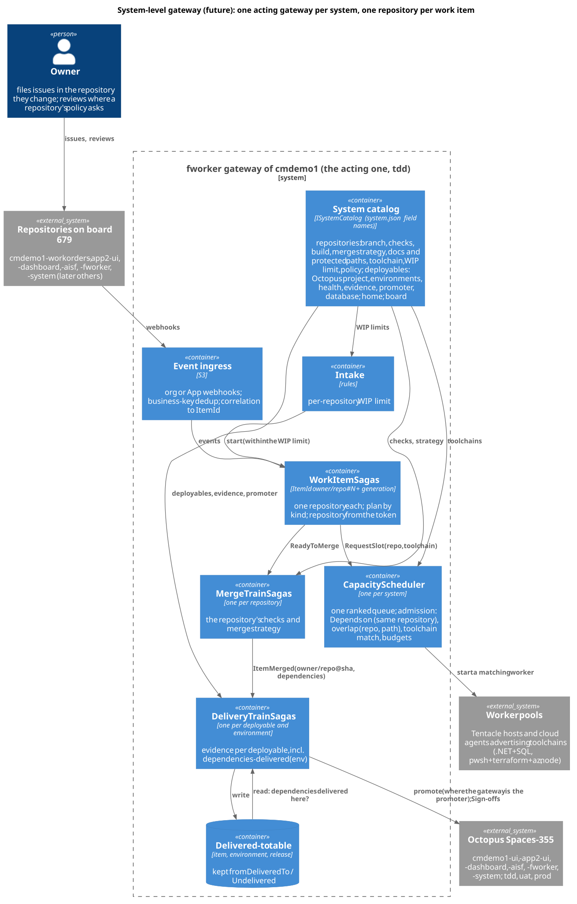

# The gateway at the system level: forward compatibility for many repositories

Status: decisions and design hooks, 2026-10-25. The multi-repository gateway is a **future enhancement**; this document records what
ADR 0001's refactoring builds **now** so that the enhancement needs no redesign. Asked for by the owner: "I would like to be able to have
the factory worker Gateway operate at the system level and have the flexibility to be able to dispatch any type of change for the
system to it and have it work a implementation for a work item for any of the six or seven repositories and deployment pipelines … I
want the abstractions and patterns that we implement in ADR 0001 to be forward compatible … Ask me questions and look for what we need
to put into the design now."

## 1. The system today (2026-10-25)

| Repository | Default branch | Required checks (rulesets) | Octopus project | On board 679 |
|---|---|---|---|---|
| cmdemo1-workorders | master | Build result, secret-scan | cmdemo1-ui | yes |
| cmdemo1-app2-ui | master | Build result, secret-scan | cmdemo1-app2-ui | yes |
| cmdemo1-dashboard | master | Build result, secret-scan | cmdemo1-dashboard | yes |
| cmdemo1-aisf | master | Build result, secret-scan | cmdemo1-aisf | yes |
| cmdemo1-fworker | master | Build result, secret-scan | cmdemo1-fworker (cmdemo1-fworker-runtime is a runbook project, not a deployable) | yes |
| cmdemo1-system | main | env-checks | cmdemo1-system | yes |
| cmdemo1-scorecard | main | none | cmdemo1-scorecard (disabled) | no |
| cmdemo1-scorecard-site | gh-pages | none | cmdemo1-scorecard-space | no |
| cmdemo1-video | main | none | none | no |

- **Octopus:** all projects are in Spaces-355 and share tdd, uat and prod. cmdemo1-system's `system.json` already lists the system's
  `deployables[]` (repository, healthPath, buildPath, pipelineSignOff, database).
- **The board:** board 679 is linked to six repositories, but all 253 of its cards today are cmdemo1-workorders issues.
- **The gateway is single-repository in more places than one:**
  - the REST calls (about 130) go through `Get-RepoPath` (`plugin/scripts/lib/Core.ps1:50`);
  - these read `owner` and `repo` themselves:
    - GraphQL in `Board.ps1:10, 37, 122`;
    - the App token scope in `Apps.ps1:94-110`;
    - fork and webhook checks in `Qc.ps1:140, 603` and `Verbs.Sweep.ps1:851, 890`;
    - pull-request `head=` filters in `Verbs.Pr.ps1:96, 379, 399`;
    - the cloud runtimes' `cfg.Repository` (`CursorCloudRuntime.cs:27, 52`, `CopilotCloudRuntime.cs:30, 53`);
    - `Qc.cs:29`;
    - the setup text at `Program.cs:3040`;
  - `Get-BoardList` (`Board.ps1:113-133`) and the `projects_v2_item` resolution (`Verbs.Sweep.ps1:872-878`) read only
    `content.number`.
- **Single-repository config keys in `config/instance.json`:** `owner`, `repo`, `project` (679), `defaultBranch`, `ciGates`,
  `ciWorkflow`, `releaseCheckName`, `master*Checks`, `docsOnlyPaths`, `inspector.*Paths`, `octopus.project`,
  `api.cursor.repository` and `api.copilot.repository`.
- **The factory's own refs live in cmdemo1-workorders:** claims, leader lease, plant snapshot, revocations, transcripts and operator
  releases, all through `Get-RepoPath`.
- **Octopus rights of the gateway's account (Users-904):**
  - DeploymentCreate and InterruptionSubmit on cmdemo1-ui in uat and prod (UserRoles-150 through Teams-404);
  - project viewer on cmdemo1-ui and cmdemo1-fworker (Teams-361);
  - runbook runs on cmdemo1-fworker-runtime in tdd (Teams-403);
  - a Sign-off also needs Teams-361 as a responsible team of the project's Sign-off step, which `pipelineSignOff: true` in
    `system.json` gives only cmdemo1-ui and cmdemo1-fworker today.
- **Who promotes:** the gateway promotes cmdemo1-ui; cmdemo1-system's `ui-auto-promote` promotes cmdemo1-fworker.

## 2. The owner's decisions (2026-10-25)

1. **One repository per work item.** A change that spans repositories becomes linked items joined by `Depends on`, written in the full
   form `owner/repo#N` (a bare `#N` means the item's own repository).
2. **The issue lives in the repository it changes.** The issue's repository is the target; the item id is `owner/repo#N`.
3. **Per-repository policy:** what may happen unattended (auto-merge, paths that need the owner). Refined here: auto-promotion and
   evidence are set per **deployable**, since a repository can have several deployables or none. For example, cmdemo1-system and cmdemo1-fworker stop for the owner's review while the app repositories run
   autonomously.
4. **One acting gateway per system.** Each system has its own gateway, database, board and credentials; ids carry the repository, not a
   system. As today, the system's tdd gateway acts and its uat and prod gateways stay inert (`fworker-wolverine-refactor.md` 6).
5. **Toolchains matched by capability.** A repository's registry entry names the toolchain it needs; runtimes and Tentacle hosts
   advertise what they provide; the scheduler offers an item only to a worker that has it.
6. **`Depends on` across repositories gates delivery per environment.** The dependent item may start at once, but its release is not
   promoted to an environment until the item it depends on is deployed there. A `Depends on` within one repository keeps today's start
   gate (not offered until the other is closed, in Release Queue or Done). This split is how the decision is read here; the owner
   confirms it.
7. **One system-wide queue with per-repository WIP limits.**

## 3. What ADR 0001's refactoring builds now

The rule that keeps this cheap: **v1 stays home-repository-only until R9; items of other repositories are v2-only.** So v1 only needs to
ignore other repositories safely, and v2 is built repository-aware from its first line. With one repository configured, every hook
behaves exactly like today.

| Hook | Now | Phase |
|---|---|---|
| **H1 Qualified ids, in v2** | one `ItemId` type in `Fworker.Contracts` (parse and format; owner and repo lowercased, GitHub being case-insensitive); the saga id is `ItemId` plus generation; pull request `owner/repo!N` internally, `owner/repo#N` in every text people read (GitHub links it); branch `owner/repo:branch`; commit `owner/repo@sha`; release `deployable@version`. Used in message contracts, saga ids, correlation map, history, open-instance index, projection versions and Wolverine partition keys. v1's journal ledger keys (per issue) stay as they are. Qualified ids are added **beside** the numeric `item` in verb answers, `/api/v1/status`, metrics and dashboard JSON, never replacing it | R1 (contracts), R2 (schema) |
| **H2 System catalog** | an `ISystemCatalog` interface with one loader. It reads `repositories[]` and `deployables[]` using `system.json`'s field names, plus `home` (the repository of the factory's own refs), `board` (`{owner, number}`), and the cloud runtimes' repository. v1's keys read `repositories[0]`; `Get-RepoPath` is unchanged | R1 |
| **H3 Coordinator keys** | `MergeTrainSaga` per repository; `DeliveryTrainSaga` per deployable and environment; `CapacityScheduler` one per system; the file-overlap hold keyed by (repository, path); `IncidentSaga` per (deployable, environment), holding only that deployable's train | R5 to R8 |
| **H4 Intake and admission** | a per-repository WIP limit as an **intake** rule, beside today's `intake.wipLimit` (R6 touches intake), unset by default; the `toolchain` admission rule in the scheduler | R6 (WIP), R7 (toolchain) |
| **H5 Dependencies across repositories** | v1's `Depends on` parser (`'#(\d{1,7})\b'`, `Verbs.Sweep.ps1:419`) and the keeper's cycle check (`Verbs.Keeper.ps1:220-228`) read `owner/other#12` as the home repository's #12: fixed in R0 to treat a qualified ref to another repository as "not this repository's item". `ItemMerged` (R5) carries the item's qualified dependencies; a durable **delivered-to table** (item, environment, release), kept from `DeliveredTo` and `Undelivered`, answers the DeliveryTrain's `dependencies-delivered(env)` evidence slot (events only trigger a re-check). A dependency that settles without a release (docs-only, or a repository with no deployable) counts as delivered when merged | R0 (parser), R5 (slot, table), R7 (rule on) |
| **H6 Integrations per repository** | the GitHub client takes the repository per call; installation resolved per owner; `GitHubBudget` keyed by (credential, resource), not by resource alone; one webhook secret per hook source (today one `FACTORY_WEBHOOK_SECRET`); deduplication on business keys, so a repository hook and an organization or App hook can overlap | R3, R4 |
| **H7 Worker contract** | a session's launch carries repository, clone URL, default branch and toolchain. Item verbs take **no** repository: it comes from the token, whose `i1`/`r1` payloads (`Auth.cs:208, 268`) gain an optional repository claim, absent meaning home, so the tokens of running sessions survive the release. Keeper, manager and operator verbs that name another item (`create-item`, `split-item`, `link-dependency`) take `owner/repo#N`, with a bare `#N` meaning home | R1 (shape), R6 (used) |
| **H8 Runtime capabilities** | runtimes and Tentacle hosts advertise toolchain labels (Tentacle tags next to `fworker-host`; cloud agents per repository's setup) | R7 |
| **H9 Policy per repository and per deployable** | registry fields mapped from today's keys: `policy.autoMerge` from `mergePolicy` and `autoMergeLabel`; `policy.ownerReviewPaths` from `inspector.protectedPaths`; per deployable `autoPromote[env]` from `delivery.autoPromote`, its evidence (`octopus.health.<env>.*`, smoke) and its **promoter** (the gateway, or cmdemo1-system's `ui-auto-promote` for cmdemo1-fworker). The Auto Merge and Hold labels stay inputs | R5 (delivery), R6 (merge) |
| **H10 Per-repository facts** | docs-only paths, protected paths, required checks, build workflow name, and the delivery-speed keys (`merge.strategy`, the merge queue with its `merge_group` and "switch together", `mergeQueueDepth`, `overlapIgnore`) live in registry entries when each is created. The migration-number rule belongs to the **database** (`system.json`'s database package), not the repository | R0, R5, R7, wherever each is created |
| **H11 Board** | `Get-BoardList` and the `projects_v2_item` resolution read `repository.nameWithOwner` and drop cards of other repositories in v1 (no change today: every card is home); R4's reconciler keys cards by repository | R0/R1, R4 |
| **H12 Tests** | `tests/FakeGitHub` (single-repository today, `Program.cs:446`) gains a second repository in R1, and Tier 1 asserts **isolation**: a second repository's webhook is dropped and its card ignored; `Depends on other#N` is not read as home #N; the same number in both repositories does not collide. v2's workflow tests cover a second repository from R6 | R1, R6 |

Also, inside the same phases:
- **Wolverine routing:** the repository is a partition key, never a queue or listener per repository. Integration commands carry the
  repository and the acting App identity. `ItemMerged` fans out to the repository's deployables through the catalog (R2, R3).
- **Release content** (the commit range of the content gate) is computed in the deployable's repository; release ids use the catalog's
  deployable key (R5).
- **QC** per deployable: an enabled flag and a recipe; the QC saga keyed by (repository, pull request) (R9).
- **Transcripts:** the R9 transcript table carries the qualified item; session names stay `{prefix}-{item}-{hex}`.

## 4. Later, when the enhancement is built

Adding a repository is **a gateway release**: the registry lives in the image (and `deploy.overrides.json` is owner-protected). It also
needs:
- webhooks for the repository (organization or App);
- the three factory Apps (author, reviewer, testperson) installed on it;
- for each of its deployables, a promoter role grant for the gateway's account plus `pipelineSignOff` in cmdemo1-system's `system.json`;
- worker images or hosts for its toolchain (pwsh with Terraform and az for cmdemo1-system; Node for the video), and the cloud agents'
  setup per repository;
- the `dependencies-delivered` rule switched on in the delivery trains.

**The gateway working on its own repository** (cmdemo1-fworker): its delivery restarts the gateway; with durable sagas that is safe, and
its policy asks for the owner's review (decision 3).

## 5. Not decided yet

- **The registry's source:** `instance.json` or cmdemo1-system's `system.json`, which already lists the deployables. H2 builds the
  catalog behind an interface with `system.json`'s field names, so this is a loader choice, recorded in the plan's section 7 and the
  ADR's open decisions.
- **Decision 6's split** between same-repository and cross-repository `Depends on` (section 2) needs the owner's confirmation.
- Whether the scorecard, scorecard-site and video repositories join the board.
