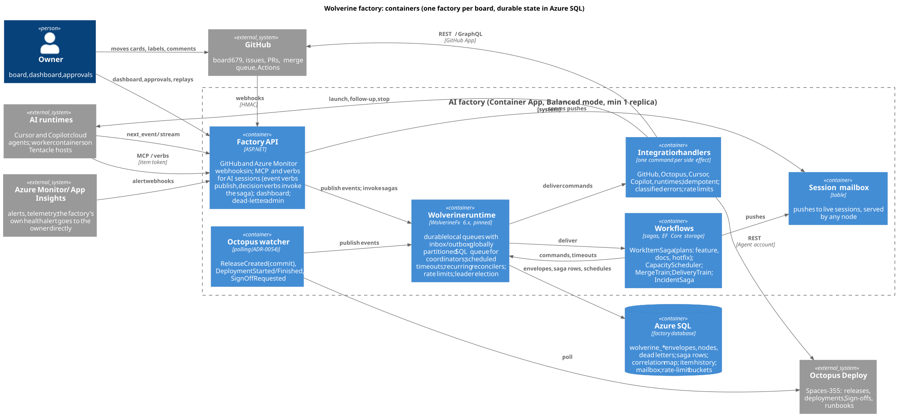
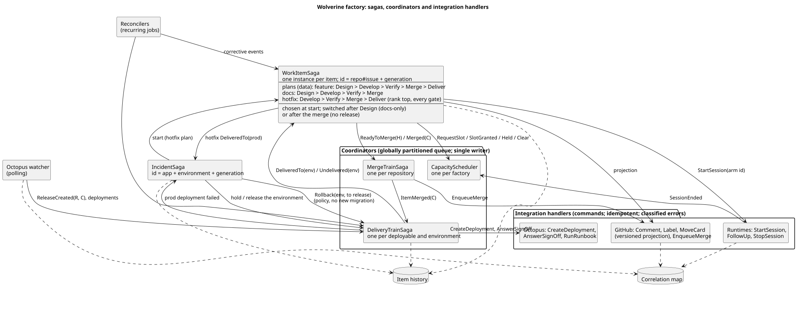
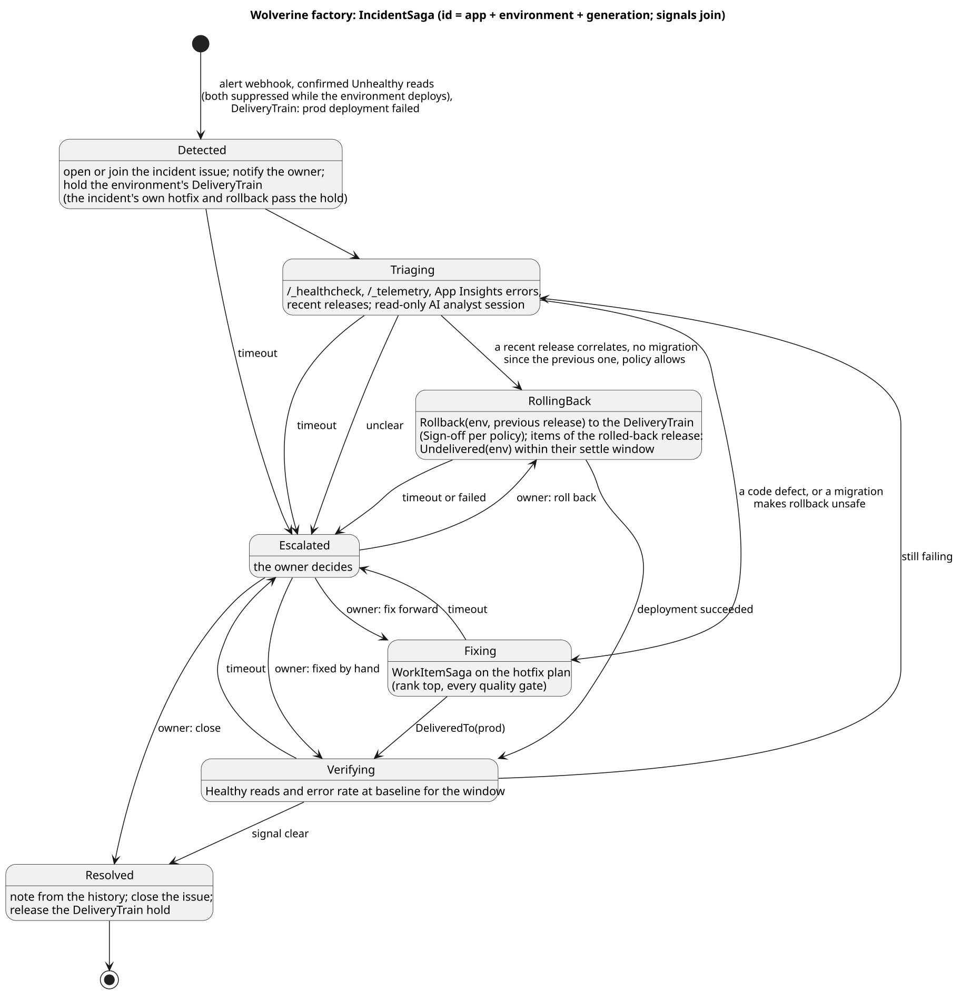

# The factory on Wolverine: durable queues, handlers and one saga per work item

Status: analysis and proposal, 2026-10-25; migration (section 6) revised 2026-10-26. Nothing here is built. Asked for by the
owner: "I think all of our invocations of ai sessions and integrations with github and octopus and external dependencies could be handled with durable queuing and
handlers. And each work item could start a new saga so that the workflow and its retries and error handling would be a first
class citizen. Then different types of work items would be a different saga. In this way, even production incidents could be
handled with a saga controlling the workflow. Investigate my hypothesis and fill in the gaps to moving to the Wolverine
approach." Inputs: the cmdemo1-fworker gateway (origin/master), ClearMeasureLabs/AISoftwareFactory (origin/master e489ae03,
PR #538; open PR #496; closed PR #409), the deployed host cmdemo1-aisf, and the Wolverine and NServiceBus documentation as of
2026-10-25. Related: `delivery-speed.md` (section 18 lists the gateway's state gaps).

| View | Source | Rendered |
|---|---|---|
| Containers | `wvf-container.puml` | [wvf-container.svg](diagrams/wvf-container.svg) |
| Sagas, coordinators, integration handlers | `wvf-sagas.puml` | [wvf-sagas.svg](diagrams/wvf-sagas.svg) |
| One feature item as messages | `wvf-item.puml` | [wvf-item.svg](diagrams/wvf-item.svg) |
| Incident saga | `wvf-incident.puml` | [wvf-incident.svg](diagrams/wvf-incident.svg) |

## 0. Verdict

**The hypothesis holds, with five refinements.** Both factories already are hand-built process managers, and their worst defects
(state lost on a redeploy, blind writes, retry budgets in memory, a running pass acting after its successor took over) are what a
versioned saga store with an inbox, an outbox and durable timeouts removes. The refinements:

1. **A real database is the prerequisite.** Queues and saga files on a container's own disk are not durable. Wolverine needs Azure
   SQL (or PostgreSQL) for envelopes, saga rows, schedules and dead letters.
2. **Not everything is per item.** Capacity, merge order, delivery to an environment and rate budgets are shared; they get their
   own coordinators, and item sagas talk to them with messages.
3. **One work-item saga type whose plan is data,** not one saga type per work-item type: the type is often known only after design
   (docs-only is decided there, and confirmed only after the merge), so the plan (feature, docs, hotfix) is chosen at start and may
   switch after design. Incidents are a separate saga type: their identity and lifecycle differ.
4. **Handling is at-least-once.** The outbox makes publishing atomic with the saga change; delivery and handling stay
   at-least-once. Every handler is idempotent on business keys, and every external side effect is its own idempotent command.
5. **Some verbs answer with decisions on the spot** (exit 21, `held: file-overlap`, the next column), so decision verbs call the
   saga synchronously instead of publishing and hoping.

Two facts change the framing:
- **Two factories act on board 679 today:** the fworker gateway (which delivered every batch) and cmdemo1-aisf, whose watcher parked
  #709 at 09:43. One factory per board comes first, whatever the framework.
- **The cost premise needs a check:** NServiceBus has a free Community tier (3 endpoints, 10,000 messages a day), and it has SQL
  Server sagas and an outbox too (NServiceBus.Persistence.Sql). The deployed cmdemo1-aisf runs on a trial licence with none
  supplied. What Wolverine adds for this design: recurring jobs, rate limiting backed by SQL Server, global partitioning
  (exclusive listeners across nodes), NServiceBus interop for a side-by-side migration, and an MIT licence with no per-endpoint
  price.

## 1. What exists today

### 1.1 cmdemo1-fworker gateway

- **State:** GitHub is the database: item state comments, claim refs, the board, a plant-snapshot ref; the plant lives in memory.
- **Engine:** GitHub webhooks (issues, workflow_run, projects_v2_item, pull_request, pull_request_review; Program.cs:972-984) and
  verbs queue incremental passes; a full sweep runs every 180 s (PowerShell rule scripts) and a tick every 2 s. Timeouts are
  timestamps compared on each pass; retries are counters; idempotency comes from journal keys in comments.
- **Restart:** a leader lease (compare-and-swap ref, growing epoch) and the snapshot.
- **Gaps** (`delivery-speed.md` 18.1): a running sweep keeps acting after a successor took over; state writes are blind PATCHes;
  several retry budgets live in memory; the day budget is undercounted after a restart.

### 1.2 AI Software Factory (cmdemo1-aisf)

- **A messaging seam** (ADR-0053): Core defines `IHandleMessages<T>`, `IAmStartedByMessages<T>`, `Saga<TData>`, `RequestTimeout` and
  `IFactoryMessagingProvider`; only `Aisf.Messaging.NServiceBus` references NServiceBus. Publish-only: no send, reply, headers or
  delayed send outside a saga; one correlation property per saga.
- **A Wolverine provider:** PR #496 (WolverineFx 6.39, SQLite, durable local queues, Solo mode) passed the contract suite and 29 of
  29 full-system tests, but is 124 commits behind and predates the instance stamp (#505), the moved-timeout test and the library
  split. PR #409, a native Wolverine rewrite on PostgreSQL, was closed: every saga rewritten in Wolverine's style, and master's
  changes ported by hand.
- **Ten sagas, nine per item and one per deployment:** three long-running on the issue number (`AiRunWatchdogSaga`, `DevelopmentChecksGateSaga`,
  `FunctionalValidationSaga`, 2,496 lines); seven on a WorkflowKey (`issue:owner/repo#N` or derived keys), of which
  `DeploymentWorkflowSaga` (Deploying, then Deployed, 2 h timeout), `AiToolDispatchSaga` (1,637 lines) and
  `AutomationBootstrapSaga` re-arm timeouts, and the rest handle one message. `DeploymentWorkflowSaga` is keyed per deployment
  (`WorkflowKeys.ForDeployment(owner, repo, environment, run)`), not per item. Work-item type only selects a prompt file.
- **Durability:** NServiceBus LearningTransport and LearningPersistence, files on the container's disk with no volume; no outbox;
  default recoverability, nothing processing the error queue. Per-item state is spread over saga data, a file cache (dedup claims,
  park markers, verdicts) and GitHub. A redeploy loses queues, sagas, timeouts and claims.
- **Integrations:** GitHub inside handlers through HTTP clients that inherit `AddStandardResilienceHandler`, so a POST can be
  retried at the HTTP level [not tested]; Cursor launches turn retries off; Copilot (`AIWorkers.CopilotAgent`) has no lookup of an
  issue's active run; Octopus is polled by design (ADR-0054: subscription payloads carry only ids and no commit, and need a second
  public route and secret).
- **A package:** other hosts consume it (JiraAisf, GitHubCursorFactory, the scorecard, alice-fst) and it supports Jira and Azure
  DevOps besides GitHub.
- **Incidents:** `HealthCheckMonitor`, a background service with a confirmation rule (after the phantom incidents of 2026-09-13),
  creates incident issues directly.

### 1.3 Wolverine (facts of 2026-10-25)

WolverineFx 6.53.0, MIT, net9.0 and net10.0. SQL Server persistence and transport; lightweight or EF Core saga storage;
**optimistic concurrency is opt-in** (`IRevisioned` on the saga plus a retry policy for `ConcurrencyException`); durable scheduled
messages and `TimeoutMessage`; error policies (retry, cooldown, scheduled retry, requeue, pause listener, circuit breaker, dead
letter to `wolverine_dead_letters`); SQL Server rate limiting; logical deduplication (6.31); recurring cron jobs (6.34); leader
election and durability agents; **local** partitioned sequential handling (one node) and **global** partitioning (an exclusive
listener across nodes on a SQL Server transport queue, `GlobalPartitioned()` with sharded queues); OpenTelemetry; tracked-session
testing; NServiceBus SQL Server transport interop. The durable inbox on a relational store gives **at-least-once** handling and
drops a repeated envelope id for 5 minutes. Sagas are found by their id: `[SagaIdentity]`, `[SagaIdentityFrom]` or the
`{Saga}Id` convention map a message property to it, and messages cascaded from a saga carry its id; there is no correlation on
another saga property and no custom finder (NServiceBus `IFindSagas`). Risks: one maintainer writes 91% of commits and releases ship
four to five times a week (6.30 broke startup on small Azure SQL tiers); no audit queue; CritterWatch (operations console) is free
read-only and $4,000 a year with replay actions.

## 2. Target architecture

One factory service per board, in Container Apps, **Balanced** mode, **at least one replica** (with scale to zero, timeouts and
recurring jobs do not fire), a termination grace long enough to drain listeners, its own Azure SQL database. Inside:

- **Factory API:** GitHub webhooks in; Azure Monitor alerts in; the MCP and verb endpoints AI sessions already use, **unchanged for
  the agents**: event verbs (`append-body`, `comment`, heartbeats) publish; **decision verbs** (`complete`, `record-review`,
  `validation-verdict`, `merge`) call the item's saga with `InvokeAsync<T>` and answer with its decision, under the saga's version.
  A decision needs only what the invoke can read in its own transaction: the file-overlap hold, for example, is decided by reading
  the footprints of the items between Development and merged from the database inside the invoke; `Held` or `Clear` goes to the
  scheduler afterwards, as a message, because a saga's messages leave only after its handler commits.
  Also the dashboard and dead-letter admin.
- **Octopus watcher:** polling stays primary (ADR-0054); it publishes `ReleaseCreated`, `DeploymentStarted`,
  `DeploymentFinished` and `SignOffRequested` with the commit already resolved.
- **Wolverine runtime:** durable local queues with the inbox and outbox; a SQL Server transport queue, globally partitioned, for the
  coordinators; scheduled messages for every timeout; recurring jobs for reconcilers; leader election instead of the gateway's lease.
- **Session mailbox:** pushes to live sessions (`checks.failed`, `base.updated`, `session.end`) are rows any node can serve to the
  session's `next_event` long poll or stream, instead of today's node-local streams.
- **Workflows** (section 3) and **integration handlers** (section 4.4).

## 3. Sagas

### 3.1 WorkItemSaga: one type, a plan per kind of item

- **Id:** `owner/repo#issue` plus a **generation** (incremented when a closed item is reopened); every timeout and lease carries the
  generation and an arm id, so a message from an earlier instance or an earlier lease is ignored (the AI Software Factory's #500,
  fixed by its instance stamp in #505). Events from outside name only the item, so an **open-instance index** (item to its current
  generation, a table next to the correlation map) answers which saga instance they go to.
- **Completion:** after `DeliveredTo(prod)` the saga stays open for a **settle window** (24 h) in which `Undelivered(env)` returns it to
  its Deliver step; after the window it completes, and a later `Undelivered` starts a new generation on a redeliver plan.
- **Plan, chosen at start, switchable:** `feature` (Design, Develop, Verify, Merge, Deliver), `docs` (Design, Develop, Verify,
  Merge), `hotfix` (Develop, Verify, Merge, Deliver; rank top, every gate). The plan switches from `feature` to `docs` when the
  design carries `aisf:docs-only`, and back if the pull request touches code; after the merge, a commit with no release built is
  settled as docs (as `Verbs.Delivery.ps1:243-256` does today). New kinds (dependency update, UX columns) are new plans.
- **Steps:** each step is a class with its state slice, the messages it handles and its timeouts (`DesignStep`, `DevelopStep`,
  `VerifyStep` with CI alongside, `MergeStep`, `DeliverStep`). The saga routes each message to the current step.
- **Idempotent on business keys:** each step message carries the phase, round, head SHA and session id; a handler that has already
  recorded that key does nothing.
- **Concurrency:** `IRevisioned` with a `ConcurrencyException` retry policy, and the item's messages partitioned on its id.
- **Late messages:** a `NotFound` handler for every message type, so late timeouts and webhooks for a completed item end quietly
  instead of in dead letters.

### 3.2 Coordinators

| Coordinator | Instances | Owns | Messages with items |
|---|---|---|---|
| `CapacityScheduler` | **one per factory** | ranking, admission (Depends on, overlap holds, host headroom, runtime and day budgets), slot ledger across all runtimes | `RequestSlot(item, rank facts, footprint, depends-on)`, `SlotGranted(runtime, host)`, `Held(by #N)`, `Clear`, `SessionEnded` |
| `MergeTrainSaga` | one per repository | merge strategy, queue entries, conflicts, re-enqueue | `ReadyToMerge(head)`, `Merged(commit)`, `Dequeued(reason)` |
| `DeliveryTrainSaga` | one per deployable and environment | commit-to-release map, candidates, evidence (version, reads, settle, smoke), the newest qualifying release, supersession, Sign-offs, holds during an incident | `ItemMerged(commit)` in, `DeliveredTo(env, release)` and `Undelivered(env)` out |

- **Single writer across nodes:** the coordinators listen on a SQL Server transport queue with `GlobalPartitioned()`, so one node
  holds the listener; `IRevisioned` plus retry is the backstop during a revision change. Local partitioning would serialise only
  within one node.
- **Inputs to the scheduler:** items send their rank facts and design footprint with `RequestSlot`; host reports and runtime health
  arrive as events; `SessionEnded` (the session's end signal, confirmed by the host report) frees a slot. A verdict does not.
- **Who starts a session:** the item saga, after `SlotGranted`, sends `StartSession` with its arm id, so it owns the session's lease
  and lineage.
- **DeliveryTrain keying:** no release exists when an item merges, so the train is per environment; `ReleaseCreated(release, commit)`
  from the Octopus watcher maps master commits to releases, and the train decides per target environment, as `delivery-speed.md` 12
  does.

### 3.3 IncidentSaga

- **Id:** application and environment plus a generation; further signals (alerts, Unhealthy reads, error rate, dead-letter growth
  of the app's own queues) **join** the open incident instead of opening another, found through the open-instance index (keyed by
  application and environment).
- **Triggers:** an Azure Monitor alert webhook, confirmed Unhealthy reads (`HealthCheckMonitor`'s confirmation rule kept), a signal
  from the DeliveryTrain when a prod deployment fails (the train owns that deployment; the incident only receives the signal).
  Health reads and alerts are suppressed while that environment is deploying; the DeliveryTrain's "prod deployment failed" signal
  is not.
- **Flow:** open or join the incident issue and notify the owner; **hold the environment's DeliveryTrain**; triage (a read-only AI
  analyst session plus `/_healthcheck`, `/_telemetry`, Application Insights errors and recent releases); then roll back, fix
  forward with a `WorkItemSaga` on the hotfix plan, or escalate; verify health and error rate at baseline for a window; resolve with
  a note built from the history; release the hold.
- **The hold lets the incident's own work through:** a held train promotes only the incident's hotfix release and performs its
  rollback. The rollback is a `Rollback(env, to release)` command **to the DeliveryTrain**, which owns deployments and keeps its
  current-release state and evidence; the incident never calls Octopus directly.
- **Rollback precondition:** cmdemo1's DbUp migrations are forward-only, so redeploying the previous release is a rollback only when
  no migration was added since it; otherwise fix forward or escalate. Items of a rolled-back release receive `Undelivered(env)` and
  return to their Deliver step.
- **Timeouts at every stage** escalate to the owner; from Escalated the owner chooses rollback, fix or close.
- **The factory's own failures** (its bus or database down) cannot run on that bus: an Azure Monitor alert on the factory's health
  notifies the owner directly.
- **Policy decision for the owner:** whether a prod rollback may run without a person.

## 4. The gaps, filled

### 4.1 A durable store
Azure SQL per factory (kit deployables support `"database": true`); `UseSqlServerPersistenceAndTransport`; durable local queues;
**EF Core saga storage**, so the saga row, its history rows and correlation rows commit in one `DbContext` transaction with the outbox;
inbox and outbox on all endpoints. SQLite and the learning transport stay for local runs and tests. Wolverine pinned; upgrades
deliberate, gated by the full suites.

### 4.2 Correlation
- **Inside the factory:** identity conventions (`[SagaIdentityFrom]`) and the saga id carried by cascaded messages.
- **From outside:** a **correlation map** table (pull request, branch, head commit, Cursor or Copilot agent id, Octopus release,
  deployment and task id, to item and generation). Its sources: the integration handlers that create things; the verbs (sessions
  report their pushed heads and pull requests); naming conventions (`copilot/<slug>`, the factory's branch names); the Octopus
  watcher (releases created by CI, deployments run by the lifecycle). A webhook that cannot be resolved yet is retried with a
  schedule, then dead-lettered, never dropped.

### 4.3 Events in, reconcilers behind them
- **GitHub webhooks** (a GitHub App with organization Projects read receives `projects_v2_item`): verified by HMAC, deduplicated on
  the delivery id with logical deduplication, resolved through the correlation map, published.
- **Octopus:** the watcher polls (section 2), as ADR-0054 decided.
- **Reconcilers** (recurring jobs) compare GitHub and Octopus with the saga state every few minutes and publish corrective events
  for anything missed. A corrective event and a late webhook for the same fact are absorbed by the handlers' business keys.

### 4.4 External side effects
- **One integration command per side effect** (`PostComment`, `MoveCard`, `EnqueueMerge`, `StartSession`, `CreateDeployment`,
  `AnswerSignOff`), sent through the outbox in the saga's transaction, handled by its own handler, so a retry repeats only that call.
- **Idempotency per call:** a natural key checked before acting (a comment's journal key, deployments re-read before create,
  `expectedHeadOid` on enqueue, a session name reserved before launch, an active Cursor run looked up). **Copilot** has no lookup of
  an issue's active run: a launch reservation row is written before the call and a reconciler resolves reservations without a run.
  HTTP-level retries are off for non-idempotent calls.
- **Error classification before any dead letter:**

| Answer | Meaning | Action |
|---|---|---|
| 5xx, timeout | transient | retry with cooldown and jitter |
| 403 or 429 with `Retry-After` or a rate-limit reset, or a secondary rate limit | rate-limited | reschedule at the reset; pause that API's listener |
| 401 after an installation token expired | transient | refresh the token, retry |
| 409 or 422 "already exists", "already queued" | success for an idempotent command | record and continue |
| other 4xx | a real refusal | `IntegrationFailed` to the saga, which parks or retries by its policy; the command is dead-lettered |

- **Rate limits:** Wolverine's SQL-backed limit per API (GitHub, Octopus), plus the reschedule above.

### 4.5 AI sessions
The item saga starts a session (`StartSession` with its arm id after `SlotGranted`) and waits for its events through the verbs, with
a scheduled `PhaseLeaseExpired(arm id)` per phase. Long waits are scheduled messages. Pushes to a session go through the session
mailbox (section 2), so any node can serve them.

### 4.6 GitHub as projection and input, not the database
- The saga row is the truth. Board columns, labels and comments are a **projection** written by integration commands that carry the
  saga's version; the projector keeps the last version it applied per item and skips an older one, so a retried `MoveCard(Dev)` cannot
  land after `MoveCard(FT)`. Projection commands are partitioned per item.
- **Echo suppression:** only echoes of the projector's own writes are ignored: a card move, label or comment whose webhook matches
  the version the projector applied. Other events with a factory App as sender (sessions push with the author App's installation
  token; the factory opens and merges pull requests) are input the saga needs.
- A person's move, label or comment arrives as an event the saga accepts or answers ("moved back: the PR is not merged").
- The state comments and the plant-snapshot ref retire once nothing reads them.

### 4.7 History, audit and operations
Wolverine has no audit queue. An **item history** table (every event and command per item, with time, generation and session link) is
written in the saga's transaction: the audit trail, the flow metrics of `delivery-speed.md` 13, the incident timeline, the
dashboard's "where is item X". Dead letters: an admin page over WolverineFx.Http's dead-letter endpoints (list, replay, discard);
CritterWatch optional. OpenTelemetry (`Wolverine` source, `Wolverine*` meter) into the existing Application Insights exporter.

### 4.8 Restarts and replicas
*Revised 2026-10-30 (owner): the factory keeps a single-actor lease, a SQL application lock, and runs Wolverine in Solo mode on its
holder; the node starts when the process acts and stops before its hand-over. The plant's state moves into SQL, so the snapshot goes,
but the lease stays. The paragraph below is the original proposal; section 8 lists what was built instead.*
Balanced mode with leader election replaces the lease and snapshot. A graceful rolling deploy within the termination grace drains
listeners (documented: no duplicate executions); a hard kill is recovered by the durability agent and may handle a message twice,
which the business keys absorb. Saga state is fenced by `IRevisioned`; projections by their version (4.6). Together they close
`delivery-speed.md` 18.1.1 and 18.1.2.

### 4.9 Versioning in-flight work
Message and timeout types get stable identities (`[MessageIdentity("...")]`), so moving a class does not orphan a stored timeout;
saga state is JSON read tolerantly (new fields optional); a breaking change gets a new saga type while old instances drain.

### 4.10 Tests
Wolverine tracked sessions (`InvokeMessageAndWaitAsync`, `PlayScheduledMessagesAsync`) for sagas and coordinators; the AI Software
Factory's provider contract suite and full-system suites carry over; the fake GitHub and fake Octopus stay; restart tests kill a node
mid-saga and assert no double side effect.

## 5. Decisions for the owner

1. **One factory per board now:** which factory owns board 679 until the migration ends; the other stops acting on it.
2. **The base codebase:**
   - **(recommended) The AI Software Factory.** C#, packaged, typed sagas with a contract suite, multi-tracker, webhooks, Copilot and
     Octopus delivery already in it. fworker's unique capabilities (Octopus Tentacle and CAE runtimes, gated promotion with
     evidence, QC environments, the plant manager, transcripts, the delivery-speed rules) are ported in as modules, one at a time.
   - Or the fworker gateway rebuilt on Wolverine, absorbing the AI Software Factory's sagas.
3. **On the AI Software Factory: extend the seam, do not rewrite to native** (avoiding PR #409's failure): ADR-0053 is amended so the
   contracts gain send, invoke-with-answer, headers, scheduling outside sagas, a deduplication id, a partition key, a version for
   optimistic concurrency, not-found handling, and a transactional unit of work for history and correlation rows; the Wolverine
   provider (PR #496, refreshed) implements them; global partitioning, rate limits and recurring jobs are provider configuration,
   and the provider registers one saga storage and listener per saga type instead of its one generic saga class. The NServiceBus
   provider stays until every host has moved. Sections 3 and 4 name Wolverine's constructs; on this path they are the provider's
   behaviour behind the extended contracts. **On the fworker gateway** there is no seam to keep: it uses Wolverine directly
   (`fworker-wolverine-refactor.md`).
4. **Store:** Azure SQL with EF Core saga storage (recommended; the kit provides it) or PostgreSQL with Marten.
5. **Incident rollback policy:** automatic in tdd and uat; in prod automatic or Sign-off by a person.
6. **NServiceBus meanwhile:** a Community licence for cmdemo1-aisf, or the refreshed Wolverine provider as a stopgap.

## 6. Migration (strangler, switched per environment)

Revised 2026-10-26 with the owner's decisions of that day: uat and prod do not matter for the migration (what works in tdd is
accepted), and green pull requests merge and deploy without approval stops. The first version ran both engines on one environment,
item by item; this one builds v2 beside v1 and switches an environment as a whole.

### 6.1 Rules while two engines exist

- **One acting engine per environment,** chosen at start (`engine: { v2Environments, shadowEnvironments }`). No item carries an
  engine label, and neither engine checks one. (Exception, owner decision of 2026-10-28: for the docs plan, in an environment where
  v2 acts, the items the `WorkItemSaga` has started are v2's and v1's sweep leaves them alone; see `fworker-wolverine-implementation.md`, W6.)
- **Shadow mode before the switch:** in tdd, v2 reads the same events and the board, decides, writes its history, and sends its
  commands to a recording sink, never to GitHub or Octopus; a report compares them with v1's writes. v1 acts meanwhile.
- **The same oracle for both:** the Tier 1 suites run against either engine, and v2's writes are compared with v1's golden baseline;
  a difference v2 makes on purpose is declared and reviewed.
- **Shared resources are not split:** only one engine acts, so capacity, promotion and merging each have one owner at a time without
  a split by configuration or a hand-over moment per capability.
- **Rollback:** a revert of the switch, or the kill switch `FACTORY_V2_OFF`, which returns the environment to v1 in a new revision.
  Until v1 is removed, v2 writes the state comments in the format v1 reads, so v1 resumes every open item.
- **v1 gets its safety fixes now:** `delivery-speed.md` P1 quick wins, 18.1.1 (fencing), 18.1.4 (day budget), and the `rev` check of
  18.1.2, because v1 acts until the switch and every release restarts it. 18.1.3 (durable budgets) is v2's by design.

### 6.2 Steps

Each exit criterion is checked in tdd; windows are measured in hours (`fworker-wolverine-implementation.md` gives them and the
clock time).

| Step | Content | Exit criterion |
|---|---|---|
| M0 | decisions 1 to 6; Azure SQL; pinned Wolverine; amended ADR-0053 (on the AI Software Factory path only); v1 safety fixes | one factory acts on board 679 |
| M1 | the v2 host in shadow mode: persistence, queues, Balanced mode and leader election, the session mailbox, OpenTelemetry, dead-letter admin, history, correlation map; integration handlers (to the recording sink in shadow); webhook ingress, Octopus watcher, reconcilers | a 2-hour tdd window per part: every event in v2's history, every recorded command matched with v1's writes, v1 acting with the database stopped |
| M2 | `DeliveryTrainSaga`, in a shadow run against the board (decides and logs while v1 promotes) | 4 hours or 3 app releases with zero unexplained differences |
| M3 | `WorkItemSaga` on the docs plan; the direct merge in C#; projections, the state comment in v1's format | the docs suites green on v2 with golden writes |
| M4 | the full `CapacityScheduler`, `MergeTrainSaga`, the feature plan, QC, and every remaining verb | every Tier 1 suite green on v2 with golden writes |
| M5 | the switch: tdd on v2 as a whole; v2 adopts every open item and pending Sign-off; a kill-switch drill | one measured batch with no regression against the 2026-10-25 baseline; `/ready` 200, leader acting, sagas resumed after each release; a 4-hour quiet window |
| M6 | `IncidentSaga` and the hotfix plan; v1 removed (sweep, snapshot, lease, rule scripts); the NServiceBus provider retired when no host uses it | a staged incident in tdd rolled back or fixed end to end; Tier 1 green with v1 gone |

**The delivery-speed design:** P1 and the 18.1 fixes ship in v1 now (6.1); P2 to P6 are built once, as the plans, steps and
coordinators above.

## 7. Risks

- **Single maintainer and fast releases:** pin, upgrade deliberately, the contract suite as the gate.
- **A large port:** fworker's logic is mostly PowerShell rule scripts; each moves to C# handlers. M1 delivers value on its own
  (durable, classified side effects with history), and each later step retires a slice of v1.
- **At-least-once everywhere:** a handler that is not idempotent on its business key is a bug; the contract suite gains a
  duplicate-delivery test per message type.
- **Seam extension effort** (decision 3) versus a native rewrite; the extension keeps downstream hosts working and ports sagas one
  at a time.
- **All or nothing per environment at M5:** v2 takes every item at once, so the rehearsed rollback (a revert or `FACTORY_V2_OFF`,
  with v1 resuming from the state comments) is the safety net; shadow mode and the shared Tier 1 oracle come before it.
- **In-flight NServiceBus state does not migrate:** drain it, or run side by side with the SQL Server transport interop if the AI
  Software Factory moves to SQL Server first.
- **Visibility:** the item history is required from M1.

## 8. As built: deviations from this design (2026-10-30)

Recorded after the audit of 2026-10-30, with the owner's decisions of that day (`fworker-wolverine-implementation.md`, "Revision
2026-10-30 (audit)"; ADR 0001, "Revision 2026-10-30"):
- **Solo, not Balanced** (2, 4.8): one acting process holds a lease (a SQL application lock from W9.10b) and runs the only Wolverine
  node; the coordinators use local sequential or partitioned queues, not `GlobalPartitioned` listeners. No replica set elects a leader.
- **Decision verbs feed the saga, they do not invoke it** (0.5, 2): `V2VerbFeed` runs the verb as v1 answers it and then tells the
  saga what happened, so the saga cannot refuse a session in the call, and the file-overlap hold is decided by the scheduler
  asynchronously. Synchronous decision verbs are dropped as a target.
- **History is written by a separate `WorkItemDecided` handler,** outside the saga's own transaction (4.7).
- **The trains are hand-written handlers over a JSON state document** with a revision (#491), not Wolverine `Saga` classes; the saga
  save and the outbox become one transaction in W9.10o.
- **The hybrid composition** (6.1): where v2 acts, the sagas own the items they started and every routed verb, and what is left of v1
  runs beside them in the same process until W9.11; `intake.v2Plans` chooses the plans v2 carries.
- **Sessions are started by the plant** until W9.10j moves the start to the saga after `SlotGranted` (3.2, 4.5).
- **The session mailbox** (2, 4.5) is not built: one node serves every session, and pushes stay node-local.
- **Incidents** (3.3, 5.5): automatic rollback in the app's tdd only; uat and prod escalate; no analyst session role.
